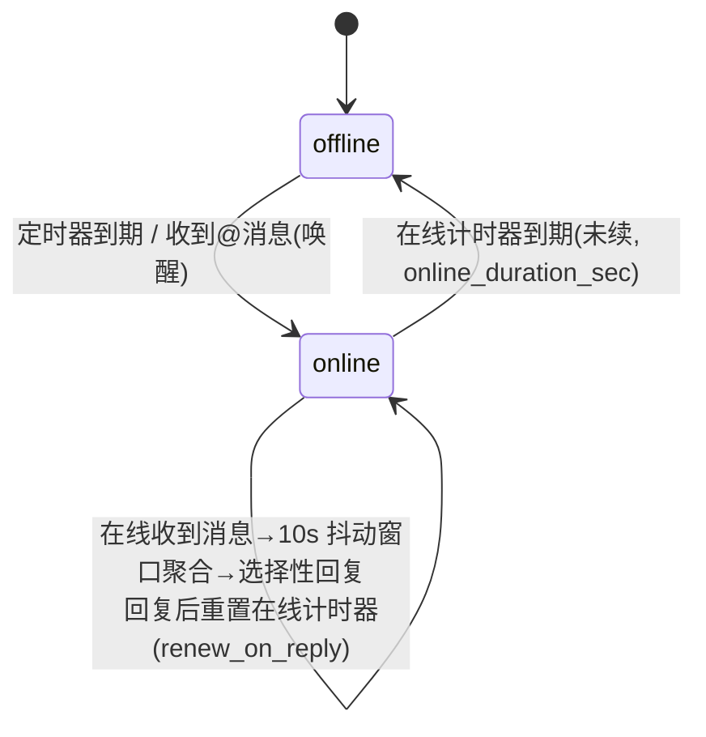

# GGBot — QQ 群聊机器人

基于官方 QQ 开放平台 api-v2（qq-botpy 1.2.1）+ DeepSeek（deepseek-flash）+ SiliconFlow 向量记忆的群聊机器人。

**四大模块：**
1. **消息收发网关**（`ggbot/bot.py`）— 群@/单聊事件接收、归一化、去重，富媒体附件落地 `temp/`
2. **AI 请求装置**（`ggbot/llm.py`）— DeepSeek Chat Completions，function calling 原生工具
3. **上下文组织 / 持久化记忆 / 自我进化**（`ggbot/storage.py` + `ggbot/memory.py` + `ggbot/tools.py`）
4. **Web 控制面板**（`ggbot/web.py`）— FastAPI，在线状态 / 消息流 / 记忆检索 / 规则 / 人设管理

## 目录结构

```
GGBot/
├── db/
│   ├── config.json      # 全部配置（QQ 凭据 / DeepSeek / Embedding / 行为 / 存储 / Web；含密钥，gitignored）
│   ├── persona_core.md  # 内核人设（owner 定义，AI 只读；首次启动自动导入）
│   └── ggbot.db         # SQLite 持久化：会话/消息/记忆/规则/人设版本（运行时生成，gitignored）
├── temp/                # 富媒体附件临时落地（默认保留 24h 自动清理，gitignored）
├── requirements.txt
├── main.py              # 入口
├── start.bat            # Windows 前台启动（Ctrl+C 停止）
├── start.sh             # Linux 后台启动（nohup，kill <PID> 停止）
├── logs/                # 运行日志（5MB × 5 轮转，gitignored）
├── web/                 # Web 前端（与后端分离，经 /static 托管，改完即热加载）
│   ├── index.html
│   ├── style.css
│   └── app.js
├── ggbot/
│   ├── config.py        # 配置加载（纯配置文件驱动 + Web 热更新）
│   ├── logging_setup.py # 日志系统（多等级 / 文件轮转 / 面板 tail）
│   ├── storage.py       # SQLite（会话/消息/记忆/规则/人设版本）
│   ├── memory.py        # 向量记忆（SiliconFlow Embedding + 余弦检索 + 整理）
│   ├── llm.py           # DeepSeek 请求装置
│   ├── tools.py         # 8 个 function calling 工具 + agent 循环
│   ├── presence.py      # 在线/离线状态机（唤醒/积压分流/抖动/分段发送）
│   ├── bot.py           # QQ 网关
│   └── web.py           # Web API + WebSocket + 静态托管（不内嵌前端）
```

## 系统架构


数据流：QQ 事件 → 网关归一化 → 上下文装置组织会话 → AI 装置请求 DeepSeek → 回复回传网关 → QQ；全链路事件同步推送到 Web 面板。

**核心循环**：`人设（内核+动态）+ 技能（8 工具）+ 上下文（群窗口≤128k，超限摘要压缩） → 回复`。工具层（可调用动作）通过 DeepSeek function calling 实现；认知层（人设进化、记忆沉淀）由 AI 通过工具触发；基础设施层为 SQLite 持久化。人设双层：内核人设 owner 定义 AI 只读，动态人设 AI 可追加/整理，版本化带 diff 可回滚。

## 快速开始

```powershell
# 1. 虚拟环境（已建 .venv）
python -m venv .venv
.\.venv\Scripts\python.exe -m pip install -r requirements.txt

# 2. 配置 db/config.json（密钥已写入）：
#    appid / appsecret          → QQ 机器人凭据（qq 开放平台后台）
#    deepseek.api_key           → DeepSeek key
#    embedding.api_key          → SiliconFlow key（Qwen3-Embedding-4B）

# 3. 启动
start.bat                    # Windows 前台（Ctrl+C 停止）
# 或
.\.venv\Scripts\python.exe main.py [--no-web] [--log-level DEBUG]
# Linux 后台：
./start.sh
```

启动后：QQ gateway 连接成功 → 群@消息触发 → Presence 状态机（离线积压 / @唤醒 / 在线抖动聚合 / 选择性回复）。Web 面板：`http://127.0.0.1:8080`（需 `?token=ggbot-local` 或 `X-Token` 头）。

## 日志与 Web 运维

- **日志文件**：`logs/ggbot.log`（RotatingFileHandler，5MB × 5 轮转；stderr 同时输出）。格式 `时间 | 等级 | 模块 | 内容`；botpy/openai/httpx 等第三方库默认 WARNING 降噪
- **等级控制**：`db/config.json → web.log_level`（默认 INFO），或启动参数 `--log-level DEBUG`；面板保存设置即时热切换。项目**纯配置文件驱动**，不使用环境变量
- **Web 面板查看**：设置卡（LLM 参数 / Presence / 积压 / 日志等级，白名单热更新并写回 config.json）+ 日志卡（等级过滤，5s 自动刷新）
- **API**：`GET /api/config`（密钥脱敏）、`POST /api/config`（`[{"path": "a.b.c", "value": x}]` 批量，越权路径忽略）、`GET /api/logs?lines=&level=`

## 关键行为（config.json `behavior`）

| 机制 | 配置 | 说明 |
|---|---|---|
| 在线/离线作息 | `presence.online_duration_sec` / `offline_interval_sec` | 定时上线、在线一段时间后离线 |
| @唤醒 | `presence.wake_on_at_message` | 离线被@ → 立即上线并立即回复该条（不进积压） |
| 聊得火热 | `presence.renew_on_reply` | 在线每次回复重置在线计时器 |
| 抖动聚合 | `reply.debounce_sec` | 在线消息 10s 窗口聚合，LLM 选择性回复（非每条必回） |
| 积压分流 | `backlog.*` | 上线扫描 pending（≤1000），@/提问单独回，其余每 100 条合并一条 |
| 分段发送 | `reply.max_segments` / `max_chars_per_segment` / `segment_gap_sec` | 回复拆短句逐条发送（msg_seq 递增，官方支持同一消息多次回复） |

**状态机**



**消息处理路径**：收到消息 → 在线？→ 离线：写存储层标记 pending（不调 LLM）；若被@且 `wake_on_at_message` → 唤醒并**立即被动回复该条**（不进积压）→ 上线流程。在线：先浏览积压 pending（≤1000 条），`priority_rule=llm` 判定哪些单独回、其余每 ≤`batch_size` 条合并为一条（走主动消息通道），然后进入实时模式：10s 抖动窗口聚合 → LLM 选择性回复 → 重置在线计时器。

## 消息全形式矩阵

| 消息形式 | 接收依据 | 处理策略 |
|---|---|---|
| 文本 | `content` | 直接进入上下文 |
| 图片 | attachments content_type=image/* | 下载存 temp/ → base64 → DeepSeek 视觉输入（单图≤32MiB） |
| 语音 | content_type=voice + `asr_refer_text` | 下载存 temp/；优先用平台 ASR 参考文本 |
| 视频 | content_type=video/* | **不下载不处理**（`storage.download_video=false`），仅保留 URL/元信息供引用转发 |
| 文件 | content_type=file | 元信息描述，可选存 temp/ |
| 艾特 | content 去@前缀 + mentions[] | 作为对话触发信号（离线可唤醒） |
| 引用 | msg_elements type=103 | 拉取被引消息原文并入上下文 |
| 卡片 | ark_data | 解析 title/desc/jump_url 为文本 |
| 聊天记录 | msg_elements type=102 | 文本化并入上下文 |

> 已注册**群全量消息**事件（私域 `GROUP_MESSAGE_CREATE`，botpy 1.2.1 未内置，运行时注入 parser）：普通消息（非@）进入 Presence 积压/抖动路径，与@消息共用去重与统一路由。机器人需在开放平台/群内开启"接收群内全部消息"权限。

> `temp/` 目录默认只保留 24h（`storage.temp_ttl_hours=24`）：启动时清理一次 + 每小时巡检，超过时限的文件自动删除。

## 配置（db/config.json 全字段）

```json
{
  "appid": "...", "appsecret": "...",
  "deepseek": {
    "base_url": "https://api.deepseek.com", "api_key": "...", "model": "deepseek-flash",
    "request": { "thinking": "disabled", "reasoning_effort": "high", "temperature": 1.0,
                 "top_p": 1.0, "max_tokens": 2048, "stop": [], "stream": false },
    "context": { "max_input_tokens": 128000, "max_history_messages": 50,
                 "summary_threshold_tokens": 100000 }
  },
  "embedding": { "provider": "siliconflow", "base_url": "https://api.siliconflow.cn/v1",
                 "model": "Qwen/Qwen3-Embedding-4B", "api_key": "...", "batch_size": 32 },
  "behavior": {
    "presence": { "online_duration_sec": 300, "offline_interval_sec": 900,
                  "wake_on_at_message": true, "wake_on_c2c": false, "renew_on_reply": true },
    "backlog": { "max_scan_messages": 1000, "batch_size": 100, "priority_rule": "llm" },
    "reply": { "max_segments": 5, "max_chars_per_segment": 80,
               "segment_gap_sec": 2, "debounce_sec": 10 }
  },
  "storage": { "temp_dir": "temp", "db_path": "db/ggbot.db", "public_base_url": "",
               "temp_ttl_hours": 24, "download_video": false },
  "web": { "enable": true, "host": "127.0.0.1", "port": 8080, "token": "ggbot-local", "log_level": "INFO" }
}
```

参数口径（按 DeepSeek 官方文档核实）：`thinking` 仅 `enabled`/`disabled`（disabled 经 `extra_body` 生效）；`temperature` 仅非思考模式生效、`top_p` 仅思考模式生效；`reasoning_effort` 仅思考模式；`top_k` 官方不支持、`presence/frequency_penalty` 已废弃，均不入配置；base_url 不带 `/v1`。

## 工具（DeepSeek function calling，`ggbot/tools.py`）

`send_text` / `send_image` / `send_voice`(TTS) / `send_video` / `send_emoji` / `memory_search` / `memory_write` / `persona_update`

> 富媒体发送限制：官方 `post_group_file` 上传需要**公网 URL**。转发群友刚发的图片/语音直接用其附件 URL（代码已记录；视频不下载但保留 URL 同样可转发）；本地生成的文件（如 TTS 语音）需配置 `storage.public_base_url` 指向公网可访问的目录，否则该工具返回明确错误。

## 记忆向量化

- 嵌入：SiliconFlow `Qwen/Qwen3-Embedding-4B`（OpenAI 兼容 `/embeddings`，无本地模型）
- 写入：AI 调 `memory_write`（importance 1-5）
- 检索：`memory_search` 余弦相似度 top-k，命中记忆拼入 system prompt
- 整理：面板「整理」按钮合并近似重复（阈值 0.95）

## 验证记录（已通过）

```
[PASS] import_all        # 全部模块导入
[PASS] storage_crud      # SQLite 会话/消息/记忆/规则/人设 CRUD + 积压查询 + 回滚
[PASS] memory_vector     # SiliconFlow embedding 真实调用 + 语义检索 + tidy 合并
[PASS] llm_chat          # DeepSeek deepseek-flash 真实调用（thinking=disabled 生效）
[PASS] tools_schema      # 8 工具 schema 校验
[PASS] presence_split    # 分段逻辑（空行/按句/无标点硬切/限段）
[PASS] tool_loop         # function calling 端到端：AI 调用 memory_write 真实入库
[PASS] config_read       # 纯配置文件驱动（无环境变量）+ persona/temp/db 路径
[PASS] logging_system    # 多等级写文件 + tail 等级过滤 + set_level 热切换
[PASS] web_api_settings_logs # /api/config 白名单热更新写回、密钥脱敏、越权忽略；/api/logs
[PASS] temp_video_policy # 视频附件不下载 + temp 过期文件清理
```

> 未覆盖：QQ 真实收发（需机器人上线 + 群内实测）；`send_image/video/voice` 富媒体实发（需真实群 + 公网 URL）。

## 已知限制

- qq-botpy 1.2.1（2024-03 停更）但内置新鉴权（appId+clientSecret → access_token 自动缓存刷新），实测可用
- 语音 TTS 产出 mp3，QQ 语音富媒体为 silk 格式，平台不接收时该工具返回错误（转发收到的语音不受影响）
- 表情消息类型官方未单列，`send_emoji` 以文本形式发送
- Web 面板无登录页，仅本地 token 鉴权；公网暴露请自行加反向代理
