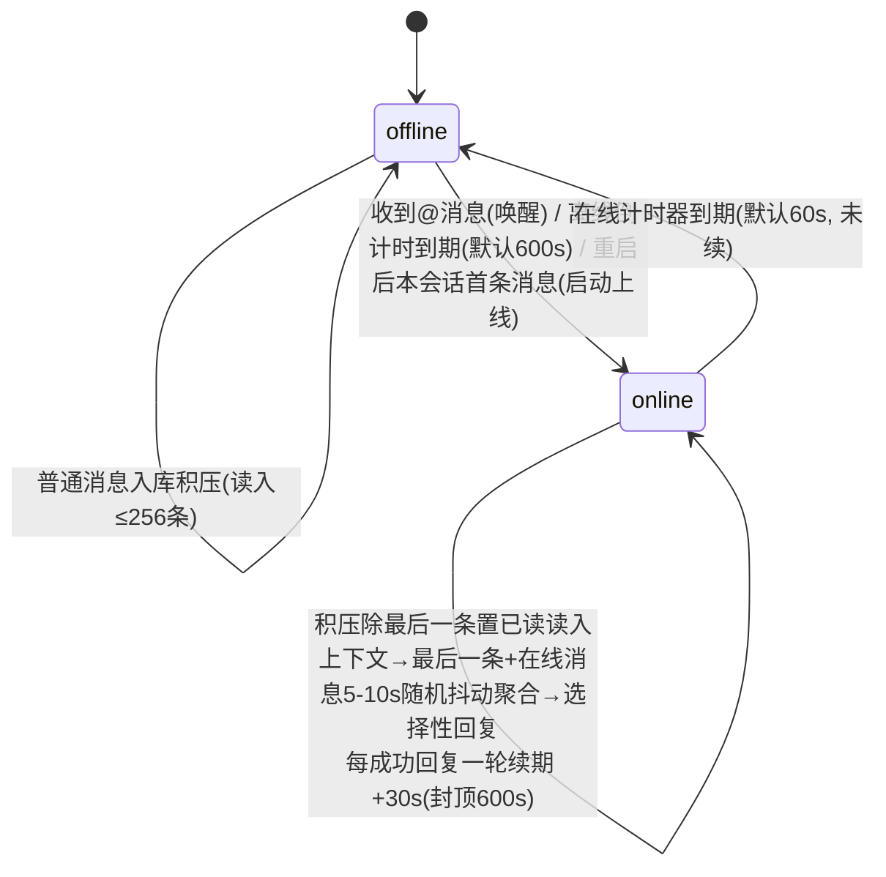
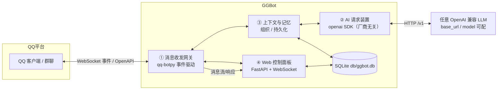

# GGBot — QQ 群聊机器人

基于官方 QQ 开放平台 api-v2（qq-botpy 1.2.1）+ 任意 OpenAI 兼容的 LLM 服务（function calling）+ 可选的 OpenAI 兼容向量服务（不配置时记忆自动降级为关键词检索）的群聊机器人。项目不绑定具体厂商：换 `base_url` / `model` / `api_key` 即可切换。

**六大模块：**
1. **消息收发网关**（`ggbot/qq/bot.py`）— 群@/单聊事件接收、归一化、去重，富媒体附件落地 `temp/`
2. **AI 请求装置**（`ggbot/llm/llm.py`）— OpenAI 兼容 Chat Completions，function calling 原生工具（服务商与模型由配置决定）
3. **Tool 插件系统**（`tool/base.py` + `tool/<分类>/`）— 一切皆 Tool：按能力域分包的 toolset 自包含代码/配置/数据，启动时自动发现并动态挂载进上下文
4. **消息流 / 上下文组织 / 持久化记忆**（`ggbot/core/presence/` 包 + `ggbot/core/outbox.py` + `ggbot/core/storage.py` + `ggbot/llm/memory.py`）— 入站分流、在线作息、发言决策、上下文组装、满窗归档各是一个模块，出站（能不能发、以什么身份发、发完记什么账）只有一处
5. **权限系统**（`ggbot/core/auth.py` + `tool/base.py` + `tool/admin/`）— 发送者等级 0–5、Tool 调用门槛 1–6；启用的工具一律下发给模型，门槛只在执行期校验，越权直接失败返回；归属者可在对话里用 `manage_permission` 按昵称/8 位 id 授权
6. **Web 控制面板**（`ggbot/web/server.py`）— FastAPI，分组导航（概览 / 对话 / 知识 / 系统）共 10 页：仪表盘（在线/作息值班带 + 倒计时，离线时整套信号色转冷、本次启动统计与运行环境）、会话与上下文、记忆（人物档案 + 事件流水，分组显示命中/到期/保留分，可整组清理与遗忘扫描）、表情包（素材浏览 + 改描述/删除/上传）、人设（系统提示词编辑器）、设置、成员等级与工具门槛、工具开关、运行日志、日程（一次性 + 周期，按「已经过点 / 今天要发 / 这周之内 / 以后 / 历史」分组，带统计与筛选，可改时间正文、取消、删除与清理历史）

> 本文讲「怎么用、怎么装、字段是什么意思」。已经定过的设计取舍与踩坑原因记在根目录 `MEMORY.md`（改行为前先翻对应小节）。

## 文档地图

| 层 | 小节 | 什么时候看 |
|---|---|---|
| **上手** | 快速部署 · 部署到云服务器 | 从零装到能说话，再接自动部署 |
| **日常运维** | 日志与 Web 运维 · 运维 CLI · QQ 平台侧配置要求 · 已知限制 | 机器人已经在跑：看日志、改配置、查为什么没回 |
| **参考手册** | 配置（全字段）· 关键行为 · 消息全形式矩阵 · Tool 管理 · 权限与工具门槛 · 记忆管理 | 某个字段、工具或机制到底是什么意思 |
| **开发者** | 系统架构 · 目录结构 · 验证 | 动代码之前：模块怎么切、测试怎么跑 |

> Ctrl-F 定位靠这张表和后面的小节名：搜小节名（「Tool 管理」）或小节里的关键词（`proactive_per_minute`、`min_score`、`remind_add`……）都能落到那一段。

## 快速部署

### 1. 准备

- Python 3.11+
- QQ 开放平台机器人：拿到 `AppID` / `AppSecret`，并订阅群@、单聊等事件（见「QQ 平台侧配置要求」）

### 2. 安装依赖

```powershell
python -m venv .venv
.\.venv\Scripts\python.exe -m pip install -r requirements.txt
```

Linux 用 `python3 -m venv .venv && .venv/bin/pip install -r requirements.txt`。

### 3. 全局配置

首次启动时若 `db/config.json` 不存在，会自动从 `db/config.example.json` 生成并提示填写；也可以手动复制：

```powershell
Copy-Item db\config.example.json db\config.json
```

| 配置 | 必填 | 说明 |
| --- | --- | --- |
| `appid` / `appsecret` | 是 | QQ 机器人凭据 |
| `llm.base_url` / `llm.api_key` / `llm.model` | 是 | 任意 OpenAI 兼容服务；模型需支持 function calling |
| `llm.system_prompt` | 否 | 人设整段（系统提示词）；留空 = 用 `ggbot/core/presence/defaults.py` 里的内置默认。日常改它不用碰配置文件：面板「人设」页读写就是这个键 |
| `embedding.base_url` / `api_key` / `model` | 否 | 任意 OpenAI 兼容 `/embeddings`；缺任一项或 `enabled=false` 时记忆自动改用关键词检索，不影响启动 |
| `memory.max_memories` / `max_per_subject` | 否 | 遗忘扫描的容量上限（默认 800 / 每人档案 12）：整库超出或某个人的档案超出时，按保留分从低往高腾地方 |
| `memory.forget_after_days` | 否 | 淡出天数与保留分的半衰期（默认 90）；`event` 很久没被提起就按这个删，最小 7 |
| `memory.sweep_every_writes` | 否 | 累计写入多少条自动跑一次遗忘扫描（默认 50，最小 10；自动那次不做合并） |
| `memory.reconcile` | 否 | 写入前的取代判定开关（默认 true）；关掉则退回余弦去重直写 |
| `vision.base_url` / `api_key` / `model` | 否 | 任意支持图片输入的 OpenAI 兼容多模态模型；留空沿用 `llm` 三项（同厂商直接可用），`enabled=false` 时图片只保留 `[图片]` 占位 |
| `web.token` | 建议 | 面板登录令牌；公网部署请改成强随机字符串 |
| `permissions.default_level` / `owners` | 否 | 未登记发送者的默认等级（默认 2）；`owners` 里的 openid 首次启动补成 5 级 |
| `storage.public_base_url` | 否 | 仅超过 10MB 的本地媒体回退签名链接时需要 |

LLM 与 embedding 都不绑定厂商：DeepSeek、OpenAI、通义、SiliconFlow、自建网关等只要兼容 OpenAI 接口，改这三项即可。`llm.request.thinking` 是 DeepSeek 扩展，不支持的厂商留空（不发该字段）。

识图默认复用 `llm` 的连接与模型；如果聊天模型本身不支持图片输入，在 `vision.model` 里单独填多模态模型（DeepSeek 用 `deepseek-flash`）。收到图片时先由该模型生成一句描述，原文替换为 `[图片]（描述）` 入库再交给聊天模型，因此历史里能像普通文本一样检索；识图 tokens 与费用单独计入日志和启动统计，单价沿用 `llm.pricing`。`vision.*`（除 `base_url` / `api_key`）与 `llm.pricing.*`（除 `peak_hours`）都可在面板「设置」页改，保存即生效：单价与闲时折算按新值计入之后的调用；识图的模型、提示词、字数、max_tokens 每次识别现读，启动时关着的识图被面板打开后自动补建连接——只有 `vision.timeout_sec`（建连时固定）在面板上标了「需重启」。

### 4. Tool 配置与素材

- 各工具的 `tool/<分类>/config.json` 在首次运行时按代码里的 `default_config` 自动生成，新增字段自动补齐；模板见同目录 `config.example.json`。
- 含密钥的工具配置（MiMo key、Agnes key、SMTP 授权码、元宝搜索 key）不入库；邮件收件人白名单、语音克隆、表情限流、搜索服务等可在 Web「工具」页或直接改配置文件；生图的比例与尺寸只改 `tool/media/generate/config.json`（面板工具页没有逐工具的参数编辑）。
- **调用门槛**：每个工具的默认门槛写在代码里（`min_level`），可在 `tool/<分类>/config.json → levels` 单独覆盖（1–6，6 = 永久锁）；发送者等级在 Web「权限」页设置。详见「权限与工具门槛」。
- 可选素材与凭据不入库。**部署时就定好的东西缺失 = 工具未启用**（不进下发列表）：生图要 `tool/media/generate/config.json → api_key`（Agnes AI），语音克隆要 MiMo `api_key` 且 `tool/media/audio/voice_ref.wav` 在位，联网搜索要 `tool/web/config.json → api_key`（元宝搜索控制台的「服务 API KEY」，`sk-` 开头）。**会随聊天长大的素材不做下发条件**：表情库默认空，为空时 `send_emoji` 照样下发、调用时才如实返回"表情库为空"并给出放素材的路径（图片直接放 `tool/media/emoji/`，一个统一库，不分内置/收藏；手动放进去的图只有文件名兜底描述，挑图质量差，在面板「表情包」页点开补一句描述，或用 `emoji_save` 让识图自动写）。

### 5. 启动

```powershell
start_windows.bat              # Windows 前台（Ctrl+C 停止）
# 或直接运行（日志等级取配置 web.log_level）：
.\.venv\Scripts\python.exe main.py
# Linux 后台：
./start_linux.sh
# macOS 前台（双击即可，或）：
bash start_mac.command
```

三个脚本行为一致：缺 `.venv` 就建（macOS/Linux 还在基础解释器被升级掉、venv 软链接失效时重建），都用 `import botpy, aiohttp, openai, fastapi, uvicorn, numpy, pysilk` 探测依赖，缺了才 `pip install -r requirements.txt`，都带 `--log-level DEBUG`。加依赖时这行探测要同步补模块名，否则环境缺包也会被判定"依赖齐全"，直到跑到对应工具才报错（`requirements.txt` 顶部有同样的提醒；探测模块名与 `requirements.txt` 一一对应，由 `temp/test_deploy_scripts.py` 盯着）。只有 `start_linux.sh` 是后台：`nohup` 起进程、PID 打屏、`kill <PID>` 停止，控制台输出**每次启动覆盖**写入 `temp/logs/stdout.log`（只当启动失败的兜底，留档的一直是 `ggbot.log`）。`start_linux.sh` / `start_mac.command` 在版本库里带可执行位（Linux 上直接 `./start_linux.sh` 就能起），`deploy/` 下的脚本按 `bash deploy/xxx.sh` 调用、不需要可执行位；shell 脚本与 rsync 排除清单都钉成 LF 检出（`core.autocrlf=true` 的机器上也不会变成 CRLF——这两份文件都是给服务器上的 bash / rsync 读的）。

启动后：QQ gateway 连接成功 → 群@消息触发 → 消息流（离线积压 / @唤醒 / 在线抖动聚合 / 选择性回复）。Web 面板：`http://127.0.0.1:11028`（首次访问输入 `db/config.json → web.token`；登录后写入 HttpOnly + SameSite=Strict Cookie，令牌不落 localStorage/URL）。

## 部署到云服务器（push 后自动更新）

`git push origin master` 之后，GitHub Actions 把代码同步到服务器、重启并做一次健康检查；密钥与运行时数据不在这条链路上。

**一次性准备（服务器上）**

```bash
sudo bash deploy/install_service.sh
```

这一步按本机项目目录渲染 `deploy/ggbot.service` 后写进 systemd（`Restart=on-failure`，掉线自动拉起）、enable（开机自启）、停掉仍在跑的 `main.py`（只停工作目录在本项目下的那些，同机别的同名进程不碰），并**删除 crontab 里的 `@reboot ... start.sh`**——两条启动路径并存时会抢 `db/.bot.lock` 单实例锁，谁后起谁进不去。此后日常只管 `systemctl status|restart ggbot`。项目不在 `/root/GGBot` 也不用手改 unit：两个部署脚本都先把模板里写死的 `/root/GGBot` 换成脚本自己 `cd` 出来的项目根，因此 `/etc` 里那份是**模板渲染后的结果**，`DEPLOY_SSH_PATH` 指的目录和 unit 里的目录天然一致。

unit 里有 `LimitNOFILE=65535`：systemd 拉起的服务 soft nofile 默认只有 1024，一个 SQLite 连接要占 `ggbot.db` + `-wal` 两个 fd，会话一多就顶满（面板 accept 报 `Errno 24`）。unit 归仓库管，`deploy_server.sh` 每次部署都会把渲染结果与 `/etc/systemd/system/ggbot.service` 比对，不一致才覆盖 + `daemon-reload`（一致就一句「已是最新」，不多余 reload），改完 push 即可，不用重跑 `install_service.sh`。

**仓库 Secrets**（Settings → Secrets and variables → Actions）

| Secret | 必填 | 说明 |
|---|---|---|
| `DEPLOY_SSH_KEY` | 是 | 部署专用 SSH **私钥**（只存 GitHub；公钥写进服务器 `authorized_keys`，建议单独生成、不要复用日常登录密钥） |
| `DEPLOY_SSH_HOST` | 是 | 服务器地址 |
| `DEPLOY_SSH_USER` | 否 | 登录用户，默认 `root` |
| `DEPLOY_SSH_PATH` | 否 | 项目目录，默认 `/root/GGBot`；unit 里的路径按服务器上代码实际落地的目录渲染，两边不用分别改 |
| `DEPLOY_SSH_PORT` | 否 | SSH 端口，默认 `22` |

**每次 push 做的事**（`.github/workflows/deploy.yml`，也可在 Actions 页手动触发）

1. `rsync -az --delete` 同步代码，排除项只有**一份**：`deploy/rsync-exclude.txt`（CI 与手工同步共用同一份；清单里保持纯模式，rsync 虽然会忽略空行和 `#`/`;` 开头的行，但条目的理由写在下面而不是塞进清单）。清单：`.git/ .github/ .venv/ __pycache__/ *.pyc config.json *.db *.db-wal *.db-shm *.db.bak-* .bot.lock temp/ tool/media/emoji/ tool/media/audio/ tool/web/search_usage.json`。为什么必须排除：CI 的 checkout 里没有这些文件（`.gitignore` 挡掉了），而 `--delete` 会把"服务器有、源没有"的东西删掉——不排除就等于每次部署清一遍密钥、数据库和 `--reset-db` 生成的库备份。被排除的条目同时受 `--delete` 保护，所以服务器上的 `db/config.json`、数据库与备份、表情素材、语音参考音频、日志都不受影响；当天的搜索计数（`tool/web/search_usage.json`）也不被本地那份覆盖——SearchPro 按次计费，"今天用了多少次"只有跑着它的那台机器知道。服务器原来手工放的 `start.sh` 会被删（systemd 接管后不再需要）。表情库整目录排除是因为它整个就是这台机器的本地状态：图片在服务器上，`index.json`/`vectors.json`/`usage.json` 又是按目录扫出来的，仓库里那份空索引对服务器没有意义（新机器首次扫描会自动建）。手工同步（从本地推）用同一份清单：`rsync -az --delete --exclude-from=deploy/rsync-exclude.txt ./ user@host:/path/GGBot/`。
2. （例外）换过工具分类目录或工具名时，先 SSH 跑一次 `bash deploy/migrate_tool_dirs.sh` 再重启：数据目录不在同步范围内，旧路径上的素材与配置不会自己搬到新分类下，漏跑一次对应工具就"未启用"。脚本按文件逐项搬、目标已存在只跳过不覆盖，可以重复跑，也会把 `config.json → levels` 里的旧工具名键改成新名字（旧键不改就是静默回到代码默认门槛）。
3. SSH 执行 `deploy/deploy_server.sh`（同一份逻辑也能手动在服务器上跑，systemd 托管时要 `sudo`）：先补 `.venv`（新服务器第一次部署、或系统升级掉 Python 导致旧 venv 软链接失效时 `python3 -m venv .venv`）→ `requirements.txt` 的 sha1 变了才 `pip install`（平时几毫秒跳过）→ 按项目目录渲染 unit 并与 `/etc/systemd/system/ggbot.service` 比对，不一致才覆盖 + `daemon-reload` → `systemctl restart ggbot`；这台机器没有 systemd 时退回 `start_linux.sh` 后台启动并提醒该接管（此时以普通用户跑也能干活，不会死在写不了 `/etc` 上）。
4. 探活看的是配置，不是固定端口：读 `db/config.json → web.enable / web.port`（配置还没生成或读不懂就按代码默认「面板开、11028」算），最多探测 30 秒。面板开着就 `curl` 它的首页，响应即打「面板端口 11028 响应正常，重启成功」；`web.enable=false` 是故意关的，那就改看服务还活着（systemd 用 `systemctl is-active`，nohup 用「工作目录等于本项目根的 `main.py` 进程」，不认领同机上别的同名进程）——以前一律探端口，关掉面板的部署每次都被判成失败。起不来就以非零退出（Actions 里直接红叉），并把现场打全：`systemctl status` + `journalctl -u ggbot.service -n 40`（systemd 下控制台输出在 journal 里，`temp/logs/stdout.log` 只是上一次 nohup 留下的旧文件，别再当现场）+ `tail -40 temp/logs/ggbot.log`。

**公网访问**：`web.host` 保持 `127.0.0.1` 时用 SSH 隧道看面板最省事；确实要公网直连，改 `web.host=0.0.0.0`、`web.token` 换强随机串，前面加 HTTPS 反向代理并设 `web.cookie_secure=true`（需要按 `X-Forwarded-For` 限流再置 `web.trust_proxy=true`）。QQ 侧只要求机器人能连上开放平台的 WebSocket，服务器不需要公网入站端口。

**换大版本、清空线上数据（"从零部署"）**：同步的排除清单既不会把运行产物推上去，也不会替你删掉它们，所以清空只能手工做（新版数据模型不做旧版迁移，旧库顶上新代码只会缺列报错）。顺序：`systemctl stop ggbot` → 整目录快照到**项目目录之外**（`tar czf /root/ggbot_backup_$(date +%Y%m%d-%H%M%S).tar.gz -C /root GGBot && chmod 600 ...`，里面有密钥，放在项目目录外才躲得过 `--delete` 与 temp 的 TTL）→ 删 `db/*.db*`、`db/config.json`、`db/.bot.lock`、`temp/`、`tool/media/emoji/`、`tool/media/audio/`、`tool/media/generate/` 以及各 `tool/*/config.json` 与已删工具留下的目录壳 → 只把初始化配置推回去（`db/config.json` 与各 `tool/*/config.json`，**外加 `tool/media/audio/voice_ref.wav`**——参考音色属于初始化素材而不是运行产物，`send_voice_clone` 的启用判定要同时看到 `api_key` 和这个文件真的存在，缺文件就整条工具在面板上显示"未启用"；表情素材、记忆、日志这些运行产物不推，表情库首次扫描自动建索引）→ `systemctl enable ggbot` 恢复开机自启 → push 触发 CI。起来以后核对：日志第一条是 `GGBot v3.0 启动`，`工具就绪` 的各分类计数与代码一致，面板「工具」页没有"未启用"的条目（有就说明该工具的素材或配置没推全），`db/ggbot.db` 是刚建出来的空表，面板 `/api/*` 全 200。

> 密钥不进仓库、不进日志、不进本文：SSH 私钥只在 GitHub Secrets 与服务器上，服务器地址与凭据也不要写进任何被提交的文件。

## 日志与 Web 运维

- **日志文件**：只写 `temp/logs/ggbot.log`（RotatingFileHandler，5MB × 5 轮转；**追加写，跨重启保留**——`maxBytes > 0` 时标准库会把 `mode="w"` 强制改成 `"a"`，"每次启动清空"这个写法在这条路径上从来没有生效过，体积由轮转封顶在 5MB × 6 份；目录随 `storage.temp_dir` 自动创建；stderr 同时输出）。项目根目录不再产生 `botpy.log` / `logs/`——botpy 的文件 handler 已关闭（`bot_log=None, ext_handlers=False`）。格式 `时间 | 等级 | 会话 | 内容`——会话列统一为 `群聊xxxxxxxx` / `私聊xxxxxxxx` / `系统00000000`（8 位 openid），控制台、文件、Web 面板三处一致；DEBUG 只输出业务状态（入站 / 上下文 / LLM 请求 / 识图 / 工具 / 上下线），**同一信息只打一行**——正文、工具参数、图片描述各只在一条里出现，发出的正文只有一条 `发送: ` 行；第三方库（botpy / openai / httpx / httpcore2 / uvicorn 等）固定 WARNING，不打印连接与报文细节
- **一轮对话的日志形状**（前缀固定，扫一眼就能对齐）：
  - 启动先一条版本行（形如 `GGBot v3.0 启动`，版本号只在 `ggbot/__init__.py` 的 `__version__` 一处，面板与标签页同源注入，文档里的数字只是示例），随后八条就绪信息——`日志就绪`（相对路径 + 等级）/ `存储就绪`（相对路径）/ `记忆就绪`（模型 + 地址；未配置 embedding 时为 `关键词模式`）/ `LLM 就绪`（模型 + 地址）/ `识图就绪`（模型 + 地址；配置不全时为 `识图未启用`）/ `工具就绪`（数量 + 各分类计数）/ `Web 就绪`（地址）/ `Bot 就绪`（gateway）
  - 入站一条：`收到 [小明/54019C24] @=1: 哈哈 [图片 6ce72460]`（`@` 是这条有没有 @ 到本机器人，只用 `1` / `0`；无昵称时只剩 8 位 id；引用为 `[引用 被引内容] 正文`；富媒体标记用 8 位短标识，与 temp 落地文件 `1760000000000_6ce72460.png`（毫秒 + 同一段短标识）互相对上；同一条消息被 @事件与全量事件重复推送时只记一条；走被动还是主动由发送侧按当时还有没有可用的锚点决定，这里不重复）
  - 落地一条：`富媒体落地 image/1760000000000_6ce72460.png 168.7 KB`（语音带平台转写时另记一条 `语音已转写 8ebd2219: 帮我加两个表情`，正文同步替换为 `[语音]（…）`；平台没给转写才在落地行追加「平台未给转写，正文只保留标记」，此时不打转写行）
  - 识图两条、各司其职：`识图 deepseek-flash 请求 1402 | 输出 26 | 命中 - | 费用 ¥0.0032`（只有数字）+ `图片已识别 6ce72460: 一只橘猫趴在窗台上…`（描述全文只在这一行出现，超长显式补省略号）
  - 上下文一条：`上下文预算: 历史 40 / 1024 条 · 估算 5951 / 128000 tokens`（「历史」是本轮注入的历史消息条数，「估算」是整次请求的 tokens；预算只做观测，窗口按条数截断，不再按它压缩历史）
  - LLM 两条：`LLM 请求 5951 tokens (工具 329 | 历史 456 | 新增 215)` / `LLM 响应 11 tokens (命中 5504/5951 (92%) | 费用 ¥0.0045)`。请求总数取服务商返回的 `usage.prompt_tokens`，响应数是 `completion_tokens`；请求行括号里的工具/历史/新增三段来自本地估算，按比例缩放到服务商总数（三段之和 = 总数），便于看本轮新增占比；不再标第几次调用；服务商没返回 usage 时总数与三段一起加 `≈` 明确是估算；同一回合出现两条是工具往返的追加请求；命中率与费用按 `llm.pricing` 估算，未配单价显示 `-`
  - 工具一条（模型调用的工具，唯一形态）：`工具 send_emoji（admin=小明/54019C24(L2), query=笑死）`——只有**模型调用的工具**走这个形状：调用者（`admin=`）、等级与全部参数只出现在这一行（单值 120 字、整行 200 字截断；密钥都不是工具参数，不会进日志）。L3 及以上特权工具升 INFO，普通工具留在 DEBUG。异常各一条：`工具 clear_context 拒绝: 需要 L4，当前 小明/54019C24(L2)` / `工具 xxx 不存在（模型编造的工具名）` / `工具 web_fetch 未成功: <错误>`；模型凭空调用一个注册表里没有的名字（例如旧的 `send_text`）也只留这一条 `不存在`，不会被执行
  - 发出正文一条：`发送: 在忙 稍后找你`——正文通道不是工具（住在 `ggbot/core/outbound.py`，也不暴露给模型），所以**不套工具格式**：实际发出的每条消息一行（正文带换行拆成多条时也是一条一行），INFO 级，不带 `admin=`（谁在说话看「收到」行与会话列就够了）。同一轮模型既调了工具又写了正文 → 先一条 `工具 …`、再一条 `发送: …`
  - 生图一条（只报数字，口径同识图行）：`生图 2K/16:9 1.4 MB（12.3s）`——档位、画幅、成品大小与等待时间都只在这一行，提示词看上一条工具调用行；成品送达另有一条 `发送图片: gen_….png`，失败只留 `生图失败: …`
  - 正文只出现一次：正常发出就是那条 `发送: ` 行，不再补"发送成功"确认行。只有出问题才另留痕——占位符拦截只报标记：`正文夹带占位符已剔除: [表情]（余文照常发送）` / `正文只有占位符，已拦截不发送: [表情]` / `发送未成功: <原因>`；模型把不接话写进正文时是一条普通 INFO：`正文只有沉默标志，按不接话结束本轮: [SILENCE]`（同轮带工具时改为 `正文只有沉默标志，本轮只发工具产物: …`，一次 LLM 请求里两条互斥、最多出现一条）；被动回复过期降级主动发送记一条 `被动回复失败，降级主动发送: …`；群聊 @ 成员若被平台拒收 markdown 会有一条 `群 markdown @ 消息被拒，退回普通文本: …`；富媒体仍是 `发送语音: …` 一条
  - 作息与归档：`在线窗口聚合 3 条，开始决策` / `离线积压 12 / 256 条（@可立刻唤醒）` / `离线积压已读 12 条（只读不回）` / `在线窗口超出上限 16，最旧 2 条只读不回` / `启动上线 预计在线 53s, 积压消息 0 / 256 条` / `自然上线 预计在线 53s, 积压消息 0 / 256 条` / `下线 预计离线 438s（本周期收 4 条）`——**一个在线周期没收到任何消息时上下线都降到 DEBUG**（空转不占行），有过消息才留 INFO；`历史归档 64 条消息 → 记忆 新增 2 · 改写 1 · 作废 0`（每批一条，写入走取代判定所以三个数分开报）；遗忘扫描只在真删了东西时打一行 `记忆遗忘 到期 1 · 淡出 0 · 超限 0 · 合并 0（共 0 条）`
  - 日程一条（到点触发，走的是回合外发言，正文照旧另有那条 `发送: ` 行）：一次性项写 `提醒到期触发 #12（提醒 小明/54019C24）`，周期项每发一场带上场次与下一场 `提醒到期触发 #12 第 3 场（每天，下一场 2026-11-01 08:00 星期日）`，排满场次收尾时补一句 `，已排满`（INFO，会话列就是该日程所在会话）；停机期间错过的一次性项记 `提醒过期未发（错过 3600s，宽限 300s）#4: 迟到的提醒`（WARNING，不发东西），周期项改成 `提醒跳过 6 场未发（错过 432000s，宽限 300s）#8: 每周体检`（只跳过没赶上的那几场，整条继续往后排、不消耗场数）；主动通道被本地频控拦住时降到 DEBUG `主动发言被拦（主动消息每分钟上限）: <正文>`，这一条留在库里下一轮重试；巡检本身出错只留 `日程巡检失败: …`，循环不停；历史清理一条 `日程清理 保留 30 天 · 到期删 2 · 超限删 0（共 8 条）`（启动跑一次，之后每 `sweep_interval_sec` 一次，没删东西也打这一行）
  - 会话列跟到调用方：LLM 请求/响应、识图、工具、发送、决策、作息与提醒都显式带 `session=`，所以同一轮的所有行都落在 `群聊8825F8A7` / `私聊54019C24` 上；只有纯进程事件（入群、消息审核、Temp 清理）留在 `系统00000000`
- **等级控制**：`db/config.json → web.log_level`（**默认 DEBUG**——代码兜底、`config.example.json` 与两份实际配置都是 DEBUG；面板保存设置即时热切换）。日志页的等级下拉与 `GET /api/logs` 的 `level` 默认同为 `DEBUG`（=全部）：文件里写了、界面又默认筛掉，等于还是看不到。`start_windows.bat` / `start_linux.sh` / `start_mac.command` 仍带 `--log-level DEBUG`（启动参数会盖掉配置，只在手工起脚本时生效），直接 `python main.py` 与 systemd 服务都不带这个参数，等级只按 `web.log_level` 走——**线上想改成 INFO 就在面板「日志等级」里切，保存即生效**，别往 unit 的 `ExecStart` 里加参数（unit 一旦钉死 `--log-level`，面板选了也没用，日志页筛不出来看起来就像筛选坏了）；DEBUG 只放业务行，第三方库（botpy / openai / httpx / uvicorn 等）固定 WARNING；项目不使用环境变量（Web 面板开关：`web.enable`）
- **Web 面板**：「值班中控台」基调——主色就是机器人的在线色，深色玻璃拟态 + 响应式；离线时仪表盘的值班带和侧栏发光边一起转成结构蓝，不用读文字就知道它不在岗。桌面端侧栏可折叠为图标栏（78px，状态记忆在 localStorage；≤900px 改为抽屉），侧栏品牌位显示版本号、底部显示当前对话模型；仪表盘顶部是一条通栏「值班带」：左边状态（呼吸信号点 + 在线/离线 + 下一次事件），中间画这一轮名义窗口走到哪（标注写窗口长度与 ±抖动，续期推后的时长只进标注不进轨道），右边大字号倒计时（不足 1 分钟报秒、1 小时内 `分:秒`、更长 `时:分`），下方 5 个指标卡按宽度自动回流，下方「本次启动」分「调用」（活跃会话、收发消息、工具 / LLM / 识图）与「开销」（合计 / 输入 / 输出 tokens、缓存命中率、按 `llm.pricing` 估算的费用）两组，进程内累计、重启归零，并排「运行环境」卡（对话与识图模型 + 服务商域名、记忆检索模式（向量 / 关键词）与向量模型、日志等级与日志路径、db / temp 相对路径；只读摘要，不含密钥）；会话状态表把上线事件折进状态格、新增「待处理」列；会话与上下文改为左右分栏（左列表支持筛选与待处理角标、滚动位置保持，右侧详情含消息 / 待处理 / 最近发言 / 当前作息与消息气泡，另有「最近出站」列出该会话最近 10 次发送尝试——被动回复 / 主动发送 / 降级主动 + 「已送达」或被拒原因，读的是 `sends` 表而不是日志；「清空上下文」连这批消息的锚点与出站记录一起删，可单独清空）；表情包页为素材网格（缩略图 + 描述，可改描述、删除、直接把图片文件传进库；未配 embedding 时按文件名与描述的字面重合度匹配）；日志为等宽控制台（吸顶表头 + 斑马纹，等级 / 会话 / 内容四列，警告与错误行带底色，自动跟随最新日志；手机端表头隐藏、时间/等级/会话一行、内容另起一行），筛选口径见下条；**日程（`reminders` 表的卡片列表：在排的按「已经过点 / 今天要发 / 这周之内 / 以后」分堆，已触发/已取消/已过期的收进「历史」一堆；标题下面一行写全局口径（在排 N · 今天 · 逾期 · 周期 · 历史条数），可按状态/会话筛、搜正文与提醒谁，一次载 50 条、「载入更多」是把窗口撑大而不是翻页（偏移量翻页在每秒轮询里会把同一行重复画两遍）；每行给钟点 + 「还有多久 / 过点多久」、周期徽标（`每天 已发 3` / `每周 2/8`）、会话徽标、提醒谁、编号与状态，落定的补一行「落定 <时间>」且只剩「删除」；在排的行有「改期 / 取消」——改只把人真动过的那一格发给后端（逾期项预填的是已经过去的时间，改个错别字不该被「新时间得是将来」挡回来），工具栏另有「清理历史」（按状态/会话/时间批量删，只碰终态）与「按保留期清理」；**不给新建**：排日程仍然只在对话里，面板再长一套时间输入就是第二个 `when` 解析）**；**记忆（工具栏分「查」「写」两条带，行首标出用途；人物档案按人分组、事件流水收尾，每组末尾一个「清掉这一组」；每行显示重要度★ + 保留分 + 相关度、类别/归属 + 作用域、命中次数与安静天数、到期日（已过打徽标），检索模式下按分数平铺不分组；顶部三条口径直接写在标题里——整库上限 / 每人档案上限 / 事件多少天不用就淡出；写入一行带「关于谁 / 类别 / 到期日 / 重要度」，编辑弹窗改同样这几项（到期日留空 = 不过期）；「立即遗忘扫描」按钮二次确认后返回「到期 a · 淡出 b · 超限 c · 合并 d（剩 N 条）」；面板的浏览与检索都不记命中——看一眼不该算想起来过）**、**权限（最近发言者与已登记成员的等级下拉、全部 Tool 的调用门槛下拉，含永久锁与「默认 L n」调整标记）**、工具（20 个 Tool 按分类启停，门槛徽标显示等级名（如 `L4 心腹`）、标记与代码默认不一致的门槛；发正文的通道不是 Tool，不在这一页）、**人设（整页一块编辑器，读写 `llm.system_prompt`：打开时显示当前生效的那份——没自定义就是内置默认，徽标写「内置默认」，改了徽标变「自定义」；「填入内置默认」把代码里那段灌进编辑框，清空保存同样回到内置默认；字数实时统计、超过 20000 字变红并拒绝保存，页脚提示这段是缓存前缀、改一次会让前缀失效一次；这页不吃每秒轮询，编辑框里有未保存的改动时切走再回来也不会被后端值冲掉，想丢弃改动点「重载」）**、设置分组（LLM 请求 / 识图 / 费用单价 / 在线作息 / 回复节奏 / 上下文与积压 / 日志，39 个路径白名单热更新并写回 config.json——常驻对象都是每次现读配置，保存即生效；仍需重启的 `vision.timeout_sec` 在字段标签后挂了「需重启」徽标；`api_key` / `base_url` / `web.token` 等凭据路径不在白名单；同行卡片等高，短卡不再留一块页面底色）；状态、统计、会话与当前页数据每秒刷新；侧栏共 10 页（概览 / 对话 / 知识 / 系统四组，「日程」挂在系统组末尾）。**前端没有打包步骤**：`static/index.html` 逐个引用 `css/` 6 个样式表与 `js/` 19 个经典脚本，加载顺序就是原来单个 `app.js` / `style.css` 的行序（`js/events.js` 必须最后、`css/responsive.css` 必须最后），改哪一页只碰哪一个文件
- **日志筛选口径**（面板与 `tail_log` 一致）：等级下拉是**门槛**不是等值——选 `INFO 及以上` 得到 INFO / WARNING / ERROR / CRITICAL，选 `DEBUG` 得到全部（含没有等级列的堆栈续行，续行继承上一条的等级，否则选了 WARNING 就只剩报错第一行）；会话与内容筛选**先筛后截**——先按等级扫整份日志、再按关键词/会话筛，最后才取最近 N 行，所以 3000 行 DEBUG 噪声之前的那条 WARNING 也搜得到（旧实现是先截 400 行再筛，等于只能在很窄的窗口里搜，看起来就像筛选失效）；匹配忽略大小写；回执 `total` 是命中总数、`logs` 只回最近 N 行，面板据此显示「命中 X 条，显示最近 N 条」
- **运维 CLI**：`python -m ggbot.cli stats|sessions|context|clear|reset-chat|memory|schedule ...`，可直接查看统计、导出会话上下文（消息按 `reply_state` 标出 `[待处理]` / `[回复失败]` / `[没接话]`，末尾附最近 5 条出站回执）、清空单个会话（含该会话的锚点与出站记录）、看/检索/写入/编辑/删除记忆、整组清理（`memory purge`）与遗忘扫描（`memory sweep`）（`--yes` 跳过确认）；日程一组：`schedule list [--status all] [--session 群1A2B3C4D] [--q 交稿] [--limit 50]`（含周期、已发场次、距今多久）、`schedule show 12`（全部字段）、`schedule cancel 12`（周期项是整条停下）、`schedule delete 12`（物理删一行）、`schedule purge --status fired|--session X|--before-days 30`（只碰终态，`--status pending` 直接拒绝）、`schedule sweep`（按保留天数与整表上限清历史）
- **API**：登录 `POST /api/login`（HttpOnly Cookie，失败限流 8 次/60s）、`GET /api/auth`、`POST /api/logout`；业务 `GET /api/stats|sessions|messages|memories|reminders|tools|config|logs`、`GET /api/sessions/{sid}/messages`（会话详情：该会话消息 + 最近 10 条 `sends` 出站回执，`DELETE /api/sessions/{sid}/context` 清空时连该会话的锚点与出站记录一起删），`POST /api/config`（`[{"path": "a.b.c", "value": x}]` 批量，白名单 + 类型校验；越权、类型不符、config.json 里没有该键的都算拒绝，回执里给 `updated` / `rejected`，不静默丢弃）、`POST /api/tools/{name}/toggle`（共享配置的 Tool 返回 400）、`GET /api/system-prompt` + `POST /api/system-prompt`（读写 `llm.system_prompt`，回执同时给代码里的内置默认与当前生效那份；超过 20000 字返回 400，存空串 = 回到内置默认。这个键刻意**不**在 `POST /api/config` 的白名单里——人设只有一条写入路径，也不会被设置页的批量保存顺带改掉）、`GET /api/actors` + `POST /api/actors`（成员等级 0–5）、`POST /api/tools/{name}/level`（门槛 1–6）、`GET /api/reminders?status&session_id&q&limit&offset`（默认只列 `pending` 且按到期时间从近到远，`status=all` 或单个状态才含历史；回执 `items`（每行带后端算好的 `rule_label`）+ `total`（与 `items` **同一份筛选条件**的行数，面板据此算还剩几条）+ `offset` + `stats`（**全会话**口径：各状态条数 + 待触发里的逾期/今天/周期，不跟着筛选变）+ `limits`（把 `tool/schedule/config.json` 的上限透给面板写口径）、`POST /api/reminders/{id}/cancel`（把 `pending` 行置 `cancelled`，非 pending 返回 400、查不到 404）、`PUT /api/reminders/{id}`（改 `due_ts` / `text`：正文非空且不超 `max_text_chars`、时间得是将来且不超 `max_days`，只有 `pending` 改得了；校验通过后落库前那行刚好被巡检发掉 → 409）、`DELETE /api/reminders/{id}`（物理删一行，404）、`DELETE /api/reminders?status&session_id&before_days`（批量清历史，SQL 里就只碰终态：条件全空或 `status=pending` 返回 400）、`POST /api/reminders/sweep`（按保留天数与整表上限清历史，回执 `aged` / `over` / `total` / `keep_days`；日程工具没挂载时改与清理返回 503，列表照样能看）；记忆一组：`GET /api/memories?limit&offset&session_id&subject&kind`（分页 + 三个筛选，回执 `items`（每条带保留分/安静天数/是否已过）+ `total` + `limits`（整库上限/每人档案上限/淡出天数，面板标题据此写口径））、`GET /api/memories/search?q&k&session_id`（语义检索，**不记命中**）、`POST /api/memories`（走取代判定写入，回执 written/updated/dropped/retired）、`PUT /api/memories/{id}`（改内容会重新向量化；`kind` 只认 profile/event，空 body 400，条目不存在 404）、`POST /api/memories/sweep`（遗忘扫描，含合并）、`DELETE /api/memories?subject&kind&session_id`（整组删，三条件全空 400）、`DELETE /api/memories/{id}`；`GET /api/config|tools` 密钥脱敏，`GET /api/config` 一并返回 `allowed`（白名单）与 `restart`（仍需重启的键，面板据此挂徽标）；`GET /api/stats` 一并返回 `runtime`（进程内累计统计）与 `env`（模型 / 检索模式 / 日志等级 / db 与 temp 相对路径摘要，不含任何密钥）；`GET /api/logs?lines&level&session&q` 的 `level` 是门槛、`session`/`q` 在全量日志里筛（见上条口径），回执 `logs`（最多 `lines` 行，上限 2000）+ `total`（命中总数）；`GET /` 返回 `index.html` 并把 `{{VERSION}}` 换成 `ggbot.__version__`（前端仍可独立热改，版本号不留第二份）；`GET /media/{exp}/{sig}/{rel}` 为 QQ 提供签名媒体，不参与 Cookie 鉴权
- **安全**：Cookie 鉴权（常量时间比较）、按 IP 的 API 限流（240 次/10s，超限 429 + Retry-After）、登录失败 8 次/60s 后 429、`/ws` 同源 + Cookie 校验、跨站写请求拦截、CSP / X-Frame-Options DENY / nosniff / no-store，FastAPI 文档端点关闭；缓存口径分开——`/` 与 `/api/*` 一律 `no-store`，`/static/*` 用 `no-cache` 带 ETag 回源校验（前端是「改完刷新就生效」的设计，不能让浏览器抱着旧 JS 跑新页面，没改动照样 304）；公网部署建议再加 HTTPS 反向代理、设 `web.cookie_secure=true`，反代后置 `web.trust_proxy=true` 以按 `X-Forwarded-For` 首地址限流

## 运维 CLI

```powershell
.\.venv\Scripts\python.exe -m ggbot.cli stats            # 会话/消息/待处理/记忆统计
.\.venv\Scripts\python.exe -m ggbot.cli sessions         # 会话列表（标签 / 消息数 / 最后活动）
.\.venv\Scripts\python.exe -m ggbot.cli context 群聊8825F8A7 --limit 50  # 导出某会话上下文
.\.venv\Scripts\python.exe -m ggbot.cli clear 群聊8825F8A7 --yes          # 只清该会话消息
.\.venv\Scripts\python.exe -m ggbot.cli memory list --subject 小明      # 列出记忆（含类别、归属、重要度、保留分、命中、安静天数、到期）
.\.venv\Scripts\python.exe -m ggbot.cli memory search "谁喜欢喝咖啡" --k 5
.\.venv\Scripts\python.exe -m ggbot.cli memory add "小明周五前要交稿" --kind event --subject 小明 --expires-days 5
.\.venv\Scripts\python.exe -m ggbot.cli memory edit <id> --kind profile --expires 2026-11-20   # --expires 传空串取消到期
.\.venv\Scripts\python.exe -m ggbot.cli memory delete <id> --yes
.\.venv\Scripts\python.exe -m ggbot.cli memory purge --subject 小明 --yes                     # 整组删（--subject / --kind / --session 至少给一个）
.\.venv\Scripts\python.exe -m ggbot.cli memory sweep                                          # 遗忘扫描；合并阈值默认按条数自动放宽，--threshold 可覆盖
```

重置数据库（非 CLI，属启动参数）：`.\.venv\Scripts\python.exe main.py --reset-db` 先备份再清空全部业务数据；`--reset-chat` 只清聊天数据、保留记忆。

> **v3 不迁移旧版库**：开库只做一件事——`executescript(SCHEMA)` 建缺失的表、列与索引。表结构只有这一份来源，不再有「老库就地补列 / 换词」那段代码，所以别把 v2 的库直接指给 v3：要么用 `--reset-db` 重建，要么让它继续留在 v2。

会话参数支持完整 id（`group:xxx` / `c2c:xxx`）、8 位标签（`群聊8825F8A7` / `私聊abcdef12`）或 openid 前缀。

## QQ 平台侧配置要求（发送失败的常见原因）

代码能**收**到群全量消息 ≠ 机器人能**发**消息。以下为 QQ 开放平台侧硬性要求，缺任一项都会出现「群里显示：该机器人的服务异常，暂时无法响应」而本地日志无 ERROR（HTTP 200 但未投递）：

1. **机器人必须已加入目标群**（未认证开发者仅能添加自己是群主/管理员身份的群；机器人进群能力在管理后台/客户端添加）
2. **群主需在 QQ 客户端打开【机器人主动在群聊内发言】**——2026-06-22 起主动推送能力全量开放；未打开则普通消息（没@机器人）的接话会失败，@/私聊的被动回复不受影响
3. **开放平台需订阅群@事件（`GROUP_AT_MESSAGE_CREATE`）**：未订阅则@本机器人的消息不推该事件（只有群全量流），此时只能靠全量消息里的 `<@openid>` 精确比对认@，需自己在 config 填 `bot_openid`（代码只从 @ 事件学，不再从全量消息猜）
4. 被动回复（@ 消息）依赖前置事件 ID `event_id`（代码已随消息事件透传）
5. 频控硬限制：群被动消息每条消息 5 分钟内最多回复 5 次；群主动消息单群 20 条/分钟、1000 条/天（本地默认再限 6 轮/分钟）
6. 消息内容含 URL 需在 q.qq.com 后台「开发设置 → 消息URL配置」预先配置，否则发送失败

## 已知限制

- qq-botpy 1.2.1（2024-03 停更）但内置新鉴权（appId+clientSecret → access_token 自动缓存刷新），实测可用
- `send_voice_clone` 产出 wav 后由 `pysilk` 转成 24kHz silk 再发送；QQ 语音富媒体只接受 silk
- 表情包以图片富媒体发送（非 QQ 商城表情）；本地素材走 base64 直传，不需要公网地址
- 工具目录 `tool/*/config.json` 含第三方密钥/授权码，已在 `.gitignore` 中排除；首次运行会按 `config.example.json`/代码默认值自动生成，无需手工创建
- 联网搜索特化为腾讯元宝搜索（SearchPro，`POST https://api.wsa.cloud.tencent.com/SearchPro`，标准库直连、无 SDK）：`api_key` 没填 = `web_search` 不下发（口径同语音克隆/生图），`web_fetch` 不受影响。按次计费，所以 `max_search_per_day`（默认 50）在请求发出前就拦下，计数写在 `tool/web/search_usage.json` 里、跨天归零、发版重启不清零。搜索质量仍受收录情况限制：结果与关键词字面重合度过低时挂 `note` 提醒模型换词或直说不确定，代码不能替它保证搜得到
- 一轮里的工具动作不进下一轮历史：`messages` 表只存发出去的消息（含代发的正文）与用户消息，`web_search` / `memory_fetch` 这类中间结果只在当轮请求里存在，下一轮模型看不到自己查过什么；要跨轮记住就让它写进正文或主动 `memory_save`
- 日程的触发精度就是 `scan_interval_sec`（默认 15s）；停机期间错过的按 `miss_grace_sec` 处置——一次性项作废不补发，周期项只跳过没赶上的那几场、整条继续往后排。日程行存在 `reminders` 表里，`--reset-chat` 只清 messages + sessions + 出站记账（已排好的日程**仍在**，要停得在对话里 `remind_cancel` 或在面板点「取消」），`--reset-db` 删整个库文件时才一起没了；面板「日程」页能看、能改时间正文、能取消删除与清理历史，但**排新日程与设周期仍然只能在对话里说**
- 自动部署只在 Linux + systemd 这条路上验证过：unit 模板里写死的 `/root/GGBot` 会在装/部署时换成本机项目根，所以换目录不用改 unit，但 `DEPLOY_SSH_PATH` 得指对（渲染取的就是代码实际落地的那个目录）；`rsync --delete` 只保住在 `deploy/rsync-exclude.txt` 里的运行时数据，服务器上手工放的其他文件会被清掉
- 部署脚本没有真实的服务器可测：`temp/test_deploy_scripts.py` 只验到语法、unit 渲染与比对、探活口径、排除清单和探测一致性这些离线可用的部分；`systemctl`/`journalctl`/`crontab` 的行为要真机跑一次才算
- Web 面板为单令牌 + HttpOnly Cookie 鉴权，并带登录失败与每 IP API 限流；适合本机/内网。公网暴露请加 HTTPS 反向代理、设 `web.cookie_secure=true`，置 `web.trust_proxy=true` 后才能按 `X-Forwarded-For` 识别真实客户端 IP

## 配置（db/config.json 全字段）

```json
{
  "appid": "...", "appsecret": "...",
  "bot_openid": "",                    // 机器人 openid：第一条群@事件送达时自动学（只认 robot 开头的 id），也可手工填；全量消息靠它精确比对认@
  "llm": {
    "base_url": "https://你的服务商/v1", "api_key": "...", "model": "模型名",
    "system_prompt": "",               // 人设整段；留空用代码里的内置默认，面板「人设」页可改
    "request": { "thinking": "", "temperature": 1.0, "top_p": 1.0,
                 "max_tokens": 2048, "stop": [] },
    "pricing": { "currency": "¥", "input_per_mtok": 2,
                 "cached_input_per_mtok": 0.04, "output_per_mtok": 8,
                 "peak_hours": ["09:00-12:00", "14:00-18:00"],
                 "peak_weekdays_only": true, "off_peak_multiplier": 0.5 },
    "context": { "max_history_messages": 1024, "token_budget": 128000,
                 "archive_overflow_messages": 512, "archive_batch_messages": 64,
                 "archive_enabled": true }
  },
  "embedding": { "enabled": true, "provider": "", "base_url": "https://你的服务商/v1",
                 "model": "embedding 模型名", "api_key": "...", "batch_size": 32 },
  "memory": { "max_memories": 800, "max_per_subject": 12, "forget_after_days": 90,
              "sweep_every_writes": 50, "reconcile": true },
  "vision": { "enabled": true, "base_url": "", "api_key": "", "model": "", "thinking": "",
              "prompt": "简单描述一下图片内容：主体、场景和画面里的关键文字，一两句话，不要客套。",
              "max_chars": 240, "max_tokens": 200, "timeout_sec": 30 },
  "behavior": {
    "presence": { "start_online": true,
                  "online_duration_sec": 60, "offline_interval_sec": 600,
                  "online_duration_jitter": 0.3, "offline_interval_jitter": 0.4,
                  "renew_jitter": 0.3, "wake_on_at_message": true, "wake_on_c2c": true,
                  "renew_on_reply": true, "renew_per_reply_sec": 30,
                  "renew_max_sec": 600,
                  "proactive_enabled": true, "proactive_per_minute": 6,
                  "proactive_per_day": 1000 },
    "backlog": { "max_scan_messages": 256, "online_max_messages": 16 },
    "reply": { "segment_gap_sec": 2, "debounce_sec": 5, "debounce_max_sec": 10 }
  },
  "permissions": { "default_level": 2, "owners": [] },
  "storage": { "temp_dir": "temp", "db_path": "db/ggbot.db", "public_base_url": "",
               "temp_ttl_hours": 24, "download_video": false },
  "web": { "enable": true, "host": "127.0.0.1", "port": 11028, "token": "<面板令牌>",
           "cookie_secure": false, "trust_proxy": false, "log_level": "DEBUG" }
}
```

> 这份就是 `db/config.example.json` 加上注释；两处说法不一致时以模板和代码里的默认值为准。
> `proactive_*` 三项模板里没有，走代码默认（开、6 次/分钟、1000 条/天），要改就在 `behavior.presence` 里补上。

请求参数按所用服务商的支持情况填写：`temperature` / `top_p` / `max_tokens` / `stop` 原样透传；`thinking` 是 DeepSeek 扩展（`enabled` / `disabled`，经 `extra_body` 发送），不支持的厂商留空即可。`reasoning_effort`、`top_k`、`presence_penalty`、`frequency_penalty` 当前不透传；请求固定非流式。`base_url` 是否带 `/v1` 取决于服务商。

`pricing` 是**每百万 tokens 的单价**（按服务商计费页填写，留 0 表示不估算）：`input_per_mtok`（未命中缓存的输入）、`cached_input_per_mtok`（缓存命中输入，缺省等于 input）、`output_per_mtok`（输出），`currency` 只影响日志里的符号。模板默认按 DeepSeek `deepseek-flash` 高峰价（输入 ¥2 / 缓存 ¥0.04 / 输出 ¥8）；`peak_hours` 是高峰时段（工作日、本地时间），时段外按 `off_peak_multiplier`（默认 0.5）折算，不需要分时计价就删掉这两个字段。DEBUG 日志按服务商返回的 `usage` 记录实际 token 与缓存命中；`prompt_tokens` 缺失时才退回本地估算。未配置单价时费用显示 `-`。识图请求同样按这套单价与分时规则计费，日志单独标注「识图」。

`embedding` 的 `api_key` / `base_url` / `model` 任一为空，或 `enabled=false` 时，不启用向量检索：`memory_save` 照常入库，`memory_fetch` 退化为字符/二元组关键词匹配，不再请求外部服务。旧版配置里的 `deepseek` 段会在启动时自动改写为 `llm`。

`vision` 的 `base_url` / `api_key` / `model` 留空即沿用 `llm`；`prompt` 是识图指令，`max_chars` 截断描述长度，`max_tokens` 限制识别输出，`timeout_sec` 为单次请求超时。`thinking` 留空时只在**与 `llm` 同一个 base_url** 时沿用 `llm.request.thinking`（DeepSeek 的 flash 是推理模型，不禁用思考会把 max_tokens 吃满、正文返空），换成别家识图服务商则默认不发该扩展字段。识图失败（网络、额度、非图片）只记录警告并保留 `[图片]` 占位，不影响消息继续处理。

`storage.public_base_url` 是**签名媒体的公网入口**——填 Web 面板对外地址（如 `https://bot.example.com`）。本地图片/表情/语音默认走 QQ 的 base64 `file_data` 直传（不需要公网地址）；只有超过 10MB 的本地文件才退回签名链接，此时未配置 `public_base_url` 会明确报错。Tool 私有配置不在 `db/config.json` 里，见「Tool 管理」。

## 关键行为（config.json `behavior`）

| 机制 | 配置 | 说明 |
|---|---|---|
| 在线/离线作息 | `presence.online_duration_sec`（默认 60）/ `offline_interval_sec`（默认 600） | 每会话独立：定时上线、在线一段时间后下线 |
| 启动即在线 | `presence.start_online`（默认 true） | 进程重启后该会话的第一条消息直接上线接话，不再先压满一个离线周期（默认离线要等 4–10 分钟，重启后看起来像没反应）；配 false 恢复旧的离线积压语义 |
| @唤醒 | `presence.wake_on_at_message` | 离线被@（本会话）→ 先读入离线积压（不含本条），本会话上线并立即回复该条 |
| 回复续期 | `presence.renew_on_reply` + `renew_per_reply_sec`（默认 30）/ `renew_max_sec`（默认 600） | 每成功回复一轮固定续期 30s（带抖动），单次封顶 600s；不随连聊轮数递增 |
| 上线带积压 | `backlog.max_scan_messages`（默认 256） | 定时上线把离线待处理（`reply_state=waiting`，最多扫 256 条）读进上下文并置为已读，**只回最后一条**（其余不单独触发 LLM）；超出上限的旧消息同样置已读（不读入），不会永远挂在待处理 |
| 在线批次 | `backlog.online_max_messages`（默认 16） | 在线抖动窗口最多保留 16 条，超出时最旧的几条只读不回（置已读并结束回复需求），避免一次处理过大批次 |
| 抖动聚合 | `reply.debounce_sec`（默认 5）/ `debounce_max_sec`（默认 10） | 在线消息进入 5–10s 随机抖动窗口聚合（每条新消息重新计时），LLM 选择性回复（非每条必回） |
| 分段发送 | `reply.segment_gap_sec` |正文通道遇到换行自动拆成多条，按间隔逐条发送（msg_seq 递增） |
| 作息抖动 | `presence.online_duration_jitter` / `offline_interval_jitter` / `renew_jitter` | 上下线时长、续期时长按 ±比例随机，避免机械整点；每会话首次上线时间也随机错开 |

> **会话隔离**：每个会话（每个群 / 每段私聊）是独立状态机——私聊被@只唤醒私聊会话，不会让群聊上线；A 群唤醒不影响 B 群；群聊积压只在本群上线时读入，不会跨群回复。离线倒计时/在线时长/抖动窗口均按会话独立计时。

**状态机（每会话）**



**消息处理路径**：收到消息 → （有图片则先识图，替换为 `[图片]（描述）`）→ 归属会话 → 该会话离线？→ 入库挂待处理（`reply_state=waiting`，不调 LLM）；若本会话是进程重启后的第一条且 `start_online`（默认开）→ 直接上线，本条按在线流程聚合回复；若被@且 `wake_on_at_message` → 先把旧积压置为已读读入上下文，再**立即被动回复本条** → 本会话上线。定时上线：把本会话积压（读入上限 256）除**最后一条**外置为已读读入上下文，最后一条投进在线抖动窗口当本轮话头回复（已读的历史会参与生成，所以 AI 知道离线期间聊了什么，回复时能接上语境；上线瞬间又来新消息会和它并成同一批次，不会对同一件事回两遍）。在线：5–10s 随机抖动窗口聚合（最多 16 条）→ 走 LLM 决策是否接话（一律先试被动回复，回满次数或锚点过期才主动发送，见下）→ 每成功回复一轮固定续期 30s（封顶 600s）。

> **一条消息的两条时间线**（`messages` 表两列，v3 起表结构只有 `SCHEMA` 这一份，不再就地迁移旧库）：
> - `read_state`：`unread` / `read` —— 有没有被读进上下文。用户消息进来就是未读，助手消息自己说的话直接算已读。
> - `reply_state`：`waiting`（待处理，等窗口或回合消费）/ `answered`（已回）/ `failed`（这一回合尝试回复但失败）/ `skipped`（这一回合并未回复：`silence` 或模型没话可说）/ `none`（不需要回复：助手消息、只读进上下文的旧积压）。
>
> 「到达」不占列——行存在 + `ts` 就是到达，`role` 就是方向。两条时间线各说一件事，不再有把「没读」和「没回」糊在一起的 `status` 列。上线只读积压 = 置 `read` + 结束回复需求（`waiting → none`），只动还挂着 `waiting` 的行——已经回过的消息不能被"再读一遍"抹掉结果。组装上下文时**排除 `waiting`**（那条就在本轮的 `【本轮消息】` 里），面板与 CLI 的「待处理」数读的都是 `reply_state=waiting`。
>
> 出站另有两张账（都不属于消息行）：`reply_anchors(session_id, msg_id)` 记「这条锚点下次 `msg_seq` 排到几、窗口什么时候过」，所以重启进程不会又从 1 开始、撞上平台拒绝的重复 `msg_id`+`msg_seq`；`sends` 记每一次发送尝试（`via` = 被动回复 / 主动发送 / 被动失败后降级、`kind` = 正文 / 表情 / 图片…、送达与否与被拒原因），只留最近 2000 条，面板会话详情「最近出站」与 `cli context` 读的就是它。

> **消息去重（两级）+ @ 标记后补**：入站先按 `msg_id` 去内存 `_seen`（上限 5000，超了截半）里筛一遍，未命中再查库（`messages.msg_id`，有索引 `idx_messages_msg_id`，随 SCHEMA 每次开库补）。@事件与群全量事件会把同一条消息推两次，内存这层就够；查库那层管重启窗口——每次发版都会重启进程，`_seen` 清空后平台若重推旧消息，内存拦不住，机器人会对同一件事回第二遍。命中任一层的重复只打一行 DEBUG（`重复/空消息忽略 id=…`，库中命中带「库中已有」），不打「收到」行、不进归一化与消息流，因此也不会再入一次库。助手消息入库不带 `msg_id`，所以查库只会命中用户消息。**唯一的例外是 @ 事件晚到**：全量事件先到时那条只被当普通消息入库（`is_at=0`），随后 `GROUP_AT_MESSAGE_CREATE` 才确定这是@本机器人——旧口径里它会被去重直接丢掉，那条@于是永远躺在积压里、离线时唤不醒机器人。现在晚到的 @ 事件不插第二条，只用 `messages.mark_message_at` 把库里那行的 `is_at/passive_ok` 补上（`event_id` 为空才填，已有的不覆盖；只动用户行），打一行 DEBUG `@ 事件晚到，补 @ 标记 id=…`，再把这条交给 presence 当唤醒用；会话已经在线时那条本来就在抖动窗口里，直接放过，不会回第二遍。

> **上下文满了会怎样**：历史窗口只装「归档游标（`sessions.archived_upto`）之后」的最近 `max_history_messages`（默认 1024）条，更早的消息仍在库里，只是不进本次请求——128k 的预算装这一千条足够，所以**没有会话摘要这一层了**（`sessions.summary` 与 `summary_threshold_tokens` 已移除，SCHEMA 里没有摘要列）。窗口装满的那一轮，本轮在后台把**窗口里最旧的 `archive_overflow_messages`（默认 512）条**交给 LLM 分批提炼成长期记忆（`memories`，每批一次取代判定）：每批 `archive_batch_messages`（默认 64）条各提炼写入一次（默认正好 8 批），提炼出来的是结构化事实（每条带 kind=profile/event、subject 是谁、importance、自带截止期的填 expires_in_days），写入前先和库里相关的旧条目比——同一件事的新说法改写旧那条、被推翻的直接作废，每批落地后推进游标。游标一动，这批消息就不再是历史，窗口当场从 1024/1024 回到 512/1024，再由新消息一条条攒满——这样留在窗口里的那一半尾巴逐字节不动，缓存前缀只在消化那一次整体失效，而不是每条消息都往后挪一格。消化量钳在 `max_history_messages - archive_batch_messages` 以内，缩窗后至少还剩一批历史；某一批没提炼成或记忆库写不进就停在原地，下一轮从同一批重试，最后一批允许不满；归档在后台任务里跑，不阻塞本轮回复，同一会话同时只有一个归档任务。游标远落在窗口之前时（比如归档关过一阵，或连续几批没落地），先从最旧一条批批往记忆补，追上窗口才重新开始缩窗。`【本轮消息】` 始终完整保留，不会被截断。

> **上下文按缓存顺序拼**：一次请求 = `tools` 数组（全量下发）+ messages，messages 里是「首条 system = 静态人设 → 历史消息 → 相关记忆（单独一条 system）→ 本轮消息」，权限越低的成员也拿到同一份工具列表。`tools` 与人设这两段跨会话逐字节一致（「静态人设」就是 `llm.system_prompt`，面板「人设」页改它——改一次这段就变一次，前缀随之失效一轮，所以别拿它当"每轮变量"用）；历史按时间追加，同一会话两次请求之间开头的一大段完全相同——只有尾巴在变，厂商的 prompt 缓存才复用得上。相关记忆按本轮内容检索出 top-3（相关度 ≥0.35，作用域「全局 + 本会话」），没有命中就整段不注入；这 top-3 会各记一次命中（`hit_count+1`、`last_hit_at` 推到当下）——**被想起的事不该淡出**，这是遗忘扫描里淡出时钟的唯一来源。日志里 `LLM 请求 … (工具 x | 历史 y | 新增 z)` 的「历史」= 人设 + 历史消息（即缓存前缀），「新增」= 记忆段 + 本轮 + 工具往返。

> **平台发送通道（一律先试可回，再退主动）**：每条消息都尽量走被动回复——它不占主动额度、也不受主动频控。锚点是「这条会话最近一条还能回的消息」：本轮批次里有可回的消息就用它，批次里一条都没有就回看库里窗口内最近一条（时间上按 `messages.ts` 比较，同一个锚点的 `msg_seq` 记在 `reply_anchors` 里接着上次往下排、重启也续得上，重复的 `msg_id`+`msg_seq` 平台会拒）。窗口与次数按 2026-10 官方文档口径写在代码里（`ggbot/core/outbox.py` 的 `PASSIVE_WINDOWS`）：群里一条消息 5 分钟内最多回 5 次，单聊 60 分钟最多 4 次；锚点过期或回满次数，这一轮才改主动发送（群主动 2026-06-22 起全量开放，群主需开启「机器人主动在群聊内发言」，20 条/分钟；本地再按 `proactive_per_minute`（默认 6）/`proactive_per_day`（默认 1000）闸门，超限这轮直接不回复）。事件来源上只有两处区别：**群全量事件（`GROUP_MESSAGE_CREATE`）的可回标记只带 `msg_id`、不带 `event_id`**——它的消息 id 官方文档写明能被动回复，跟着一起传的 `event_id` 反被平台拒（40034027），所以那条路径入库时 `passive_ok=1` 而 `event_id` 为空；@事件与私聊事件两个 id 都带。被动请求真被平台拒了（过期、次数用满）时，`ggbot/core/outbound.py` 会去掉引用改主动发送重发一次，日志留一条 `被动回复失败，降级主动发送: …`、`sends` 里落下被拒与降级那两行，消息不会因为锚点判断失误而丢掉。**回合外发言（日程到点、管理代发）走的是同一条出站**：`PresenceManager.speak` → `TurnDecider.speak` 也先要锚点、也过同一个主动闸门，被拦下就返回失败、由调用方下一轮重试。

## 消息全形式矩阵

| 消息形式 | 接收依据 | 处理策略 |
|---|---|---|
| 文本 | `content` | 直接进入上下文 |
| 图片 | attachments content_type=image/* | 下载存 temp/ → 识图模型生成描述 → 上下文与库中记为 `[图片]（描述）`（附件记录同时保留 `url`/`local` 供转发）；识别失败时只留 `[图片]` 占位 |
| 语音 | content_type=voice | 下载存 temp/ → **直接用平台在附件里带回的转写文本 `asr_refer_text`**，正文替换为 `[语音]（转写内容）`（botpy 的附件模型会丢掉这个字段，`_Rich*Message` 额外保留原始 dict）；平台没给转写时只留 `[语音 xxxx]` 标记，模型不能“听”，可原样转发 |
| 视频 | content_type=video/* | **不下载不处理**（`storage.download_video=false`），仅保留 URL/元信息供引用转发 |
| 文件 | content_type=file | 元信息描述，可选存 temp/ |
| 艾特 | content 去@前缀 + mentions[] | 作为对话触发信号（离线可唤醒）；正文里的其他 `<@id>` 还原为 `@昵称`（无昵称时 `@8位id`），自己那条 @ 直接剔除 |
| 官方表情（小黄人） | content 内嵌 `<faceType=1,faceId="…",ext="base64">` | **收得到、发不出**：ext 里的文字解出来，还原成 `[表情:偷笑]` 进日志与上下文；发送侧平台没有这条路，见下方「发送侧只有三种消息」 |
| 引用 | msg_elements type=103 | 被引消息原文以 `[引用 被引内容] 正文` 形式进入日志、上下文与库 |
| 卡片 | ark_data | 解析 title/desc/jump_url 为文本 |
| 聊天记录 | msg_elements type=102 | 文本化并入上下文 |

> **发送侧只有三种消息**：`msg_type=0` 文本 / `2` Markdown / `7` 富媒体（图片/视频/语音/文件）——2026-11 官方《消息类型》口径。所以 **QQ 自带的官方表情在群聊/单聊发不出去**，这是平台限制不是实现缺口：内嵌表情语法 `<emoji:id>` 官方写明「仅频道可用」（且只支持 type=1 的系统表情），表情表态同样只有频道支持；往群/私聊正文里写 `<emoji:277>` 不会被解析成表情，只会原样显示成这串字。机器人能发的"表情"只有一种——表情包里的图片（`emoji_*` 三件套，`msg_type=7`）。GGBot 这一侧做的是**不把脏括号发给用户**：用户发来的表情入库长成 `[表情:偷笑]`，模型会照抄这个形状，于是它和 `[图片]`/`[语音 6ce72460]` 一样按占位符处理——整条只有它就拦下不发，夹在句子里就剔除后照发余文（词表和形状的唯一出处是 `ggbot/util/text.py`）；正文里的 Unicode 表情字符不在这套拦截之内，按普通文本原样发出。

> **发送侧 @ 与引用**：正文里的 `@昵称`（上下文里出现过的叫法）在群聊中会替换为官方 `<qqbot-at-user id="member_openid" />`。**该标记只在 markdown 消息里被解析**，所以含 @ 的群消息走 `msg_type=2 + markdown.content`；平台拒收 markdown 时自动退回普通文本（用剔除标记后的可读原文，绝不把标签原文发给用户），因此 @ 是否生效看有没有 `群 markdown @ 消息被拒 …` 这条警告——发送成功本身不再打日志行。查不到的昵称原样保留文本，不生成标记。**入库与日志始终用可读原文（`@昵称 …`），不含标记**。正文以 `[引用 关键词]` 开头时，按关键词找到本会话最近一条含该内容的消息并带上 `message_reference`（前面先写 `@昵称` 也可以），只写 `[引用]` 则引用当前这条；私聊同样支持引用，但平台没有 @ 成员的表，不会解析 @。找不到关键词时退回引用当前消息。

> 已注册**群全量消息**事件（私域 `GROUP_MESSAGE_CREATE`，botpy 1.2.1 未内置，运行时注入 parser）：普通消息（非@）进入 Presence 积压/抖动路径，与@消息共用去重与统一路由。机器人需在开放平台/群内开启"接收群内全部消息"权限。

> **群@识别（两层，不再猜）**：① `GROUP_AT_MESSAGE_CREATE` 事件（开放平台需订阅该事件）——第一条 @ 事件送达时把 `mentions` 里 `robot` 开头的 id 学进 config `bot_openid`；② 全量消息只把 `content` 内嵌的 `<@openid>` 与 `mentions` **精确比对** `bot_openid`。比对不上也不要紧：随后送达的 @ 事件会把这行的 @ 标记补回库里（见上条「消息去重」）。**已去掉「`bot_openid` 为空时把第一条 `<@>` 的 id 当成自己」这个自动学习**——@ 别人的消息带的也是 openid，猜错一次就把别人的 id 当成自己，之后真的 @ 反而永远认不出来。所以没订阅 @ 事件、又没手工填 `bot_openid` 时，机器人只是认不出 @（离线时不会被@唤醒），普通消息照收。

> **发送者标识**：不调用任何名称接口（群成员/用户信息需 11253 白名单，且网络失败会拖慢消息处理）。QQ 消息事件若携带 `author.username` 则显示昵称（日志 `昵称/8位id`，面板“发送者”列同名 + id），缺失时退回 8 位 openid；会话列仍统一显示 `场景 + openid 前 8 位`（如 `群聊8825F8A7`、`私聊A1B2C3D4`、`系统00000000`）。botpy 1.2.1 会丢弃 `author.username` / `msg_elements`，已通过 `_Rich*Message` 子类 + 运行时注入 parser 保留原始字段。
>
> **给模型看的名字带稳定尾巴**：历史与本轮消息每行都写成 `[昵称#openid前8位]`（没有昵称就只剩这 8 位）。→ QQ 昵称既会改又会撞车，只写昵称时模型把两个人当成一个、把同一个人当成两个（「分不清人」）。入站时展示名**先认 `actors` 表**（面板/`manage_permission` 给这个人定的叫法），没登记过才用这次事件带过来的昵称。归档提炼那一路仍然只写裸昵称——那一侧产出的是记忆的 `subject`（“这条是关于谁的”），带上 `#id` 会把分组和检索弄脏。人设里也点明这标记只给模型看，回话要 @ 谁仍写 `@昵称`。

> `temp/` 目录默认只保留 24h（`storage.temp_ttl_hours=24`）：启动时清理一次 + 每小时巡检，超过时限的文件自动删除。

## Tool 管理（一切皆 Tool）

### 分类与发现

`tool/base.py` 是插件基座；每个 **toolset 自包含**在项目根的 `tool/<分类>/` 下——代码、`config.json`、持久化数据（索引 / 素材 / 参考音频）同目录，整个文件夹可原样复制到另一台机器。启动时由 `ToolRegistry` 自动发现 `tool/` 的子包——每个模块暴露 `get_tools(rt)`，返回若干 `Tool` 实例，注册表按所在子包自动打上 `category`。新增能力 = 在某个分类下新增一个模块，无需改动注册表或提示词模板；新增分类 = 新建一个含插件模块的子包。

提示词的「一切皆工具」部分会明确要求：说话就是把话写在回复正文里（系统按行代发，正文通道不是模型眼里的工具），情绪配表情、亲密场景可发语音、值得记住的事主动 `memory_save`；不想接话就显式调 `silence`（什么都不发、本轮直接结束），比硬凑一句好——反过来，模型写出的正文一律会被当成一次说话发出去，不管本轮有没有调用过工具；所以提示词里也点明「写在正文里的"不说话"字样同样会被当成一句话发出去」，唯一的不接话动作是调 `silence`（真写成 `[SILENCE]` 这样的标志时，运行时按沉默处理，绝不把这串字符发进群）；模型凭空调用注册表里没有的名字（含已经不是工具的 `send_text`）会被拒绝，回一条「未知工具」。工具怎么用、什么时候用只写在各自的 `description` 里（`prompt_hint` 与 system 里的「工具提示」段落已去掉：下发列表本身就是稳定前缀，提示词写进 schema 才进得了缓存，也省掉一段每轮重复的注入）。迁移旧工具时应按当前项目重写触发场景，而不是只保留功能描述。

| 分类 | Tool | 作用 | 配置/数据（`tool/<分类>/`） |
|---|---|---|---|
| core | `silence` | 本轮主动不接话：不发任何东西并立即结束回合（可选 `reason` 只进日志），给模型一个"沉默"的正当动作 | 无 |
| core | `time` | 当前日期 / 时间 / 星期 / 时区 | 无 |
| schedule | `remind_add` | 排日程：到点把 `what` 这句话原样发回本会话（L2，不会再问一次模型）；`when` 认 `+30m` / `18:30` / `10-30 18:30` / `2026-10-30 18:30`，`repeat` 认 `daily` / `weekdays` / `weekly` / `monthly`（不填就是一次性），`times` 只在填了 `repeat` 时生效（0 或不填=一直排到被取消）；默认提醒说话人本人，对方明确要提醒别人才填 `who` | `schedule/config.json`（巡检间隔、过期宽限、每会话在飞条数、最远天数、内容长度、周期项最多排几场、历史保留） |
| schedule | `remind_list` / `remind_cancel` | 看本会话挂着哪些日程（默认只列待触发，带编号、「还有多久」，周期项带「每天/每周…」与已发几场）/ 按编号或唯一关键词取消（周期项一取消就是整条停下；只能撤自己设的或提醒自己的那条） | 与 `remind_add` 同组（不单独启停） |
| media | `send_emoji` | 用一句话说明想表达什么（`query`），向量在素材库里找最贴的一张发出去；低于 `min_score` 就没有贴合的，改用说话 | `emoji/config.json`、`emoji/index.json`、`emoji/vectors.json`、`emoji/` 里的图片本体 |
| media | `emoji_list` / `emoji_save` | 按同一套检索查看可用素材 / 收藏用户投喂的图（收藏时由识图自动写描述） | 与 `send_emoji` 同组（不单独启停） |
| media | `send_image` / `send_video` | 发送图片 / 视频（URL 或本地文件，本地走 base64 直传） | 无 |
| media | `send_voice_clone` | MiMo 声音克隆 TTS（参考音频克隆音色，L2） | `audio/config.json`、`audio/voice_ref.wav` |
| media | `generate_image` | Agnes 文生图，生成完直接发（L4 心腹）；带 `refs`（temp/ 或 emoji/ 素材的本地路径）就是改图或跟风格 | `generate/config.json`（Agnes key、`image_size` / `image_ratio` / `max_refs`） |
| memory | `memory_fetch` / `memory_save` | 记忆检索（命中即强化）/ 沉淀（`kind`=profile 人物档案、event 事件，可带 `subject` 与 `expires_in_days`；写入先判取代） | 无 |
| memory | `clear_context` | 清空**本会话**上下文：删除全部消息并把归档游标归零，长期记忆不动（L4 心腹） | 无 |
| web | `web_search` / `web_fetch` | 联网搜索（腾讯元宝搜索 SearchPro，每天默认最多 50 次；`read=true` 顺带抓回前 3 条正文；结果与关键词几乎不沾边时返回 `note` 让模型换词或承认不确定）/ 抓取网页正文（`urls` 可批量并发，最多 5 个） | `config.json`（`api_key`、`mode`、`site`、`max_search_per_day`、超时、抓取上限、`read_max_chars`） |
| mail | `send_email` | SMTP 发邮件（文本/HTML + 附件，L3） | `config.json` |
| admin | `manage_permission` | 权限管理（L5）：`grant` / `revoke` / `list` / `help`，支持昵称 / 8 位 id / openid | 无（首次停用才生成 config） |

> **发正文不是工具**：模型把话写在回复正文里，运行时逐行拆成消息调 `ggbot/core/outbound.py` 的正文通道发出（换行自动拆多条，msg_seq 递增；群聊正文里的 `@昵称` 会转成真 @，正文以 `[引用 关键词]` 开头会引用对应消息）。它不在 `tool/` 下、不进注册表与面板、也不下发给模型，所以工具列表里没有「发消息」这一项，模型不会调完工具又说一遍。

### 一个 Tool 由什么组成

- **schema**：`name` / `description` / `parameters`，直接进入 LLM function calling 的 tools 列表
- **执行器**：`run(args, ctx)`，通过 `ToolRuntime` 获得配置、数据目录与发送能力
- **自我描述**：只有 `description` 一处，直接进 tools 列表（不再有 `prompt_hint` 汇总进 system 的机制）
- **启停与归属**：`enabled_by_default` / `toggleable` / `config_owner` / `data_name`（目录名，如 `send_email → mail`）
- **调用门槛**：`min_level`（1–6，默认 1；6 = 永久锁），可在 `tool/<分类>/config.json → levels` 覆盖，见「权限与工具门槛」

### 配置与数据

- 每个 Tool 的配置在 `tool/<分类>/config.json`：读取时与默认值合并、保留未知字段、自动补齐新增默认项；`enabled=false` 即从下发列表里消失
- **无默认配置的工具**（`silence` 等）在首次被停用时才落盘 `{"enabled": false}`，不产生空配置/空目录
- **共享配置组**：表情三件套同一份 `tool/media/emoji/config.json`，`emoji_list`/`emoji_save` 标记 `config_owner=false, toggleable=false`，面板显示"同组"
- 持久化数据（索引、素材、参考音频）与代码同目录，在 `tool/<分类>/`（如 `media/emoji`、`media/audio`、`web`）；运行产物（TTS/下载/生成）在 `temp/tool/<key>/`，随 temp TTL 清理
- **迁移**：复制 `tool/<分类>/` 整个目录即可带走该 toolset 的代码 + 配置 + 数据，无需同步数据库或其他目录。**唯一的例外是 `schedule`**：已排好的提醒在数据库的 `reminders` 表里，拷目录只搬走代码与配置，换机后旧提醒不会跟着走（新机器上是空的）
- **Web 开关**：面板「工具」页按分类排序列出全部 Tool、描述与脱敏配置，可即时启停（`POST /api/tools/{name}/toggle`，密钥字段返回 `***`）
- **动态挂载**：`ToolRegistry.dispatched()` 返回全部已启用且门槛 ≤5 的 Tool（不看发送者等级），按 `(门槛, 分类, 名称)` 固定排序，所以每个会话、每一轮拿到的 tools 数组逐字节一致；6 = 永久锁不进任何列表。agent 循环每回合把这份列表原样交给 LLM，越权调用由执行器拒绝

### 表情包（media/emoji）

挑图靠**向量检索**，没有情绪词表：把「笑死」归一成「开心」这类判断本来就该模型自己做，固定词表只会在模型没想到的说法上失灵。

代码分三层，工具发现只看得见最外面那层（`tool/base.py` 跳过下划线开头的模块）：`tool/media/emoji.py` 只做编排（限流、发送、入库、面板动作），`_emoji_store.py` 只管素材目录与三份 JSON，`_emoji_match.py` 只管怎么比、同档里怎么选。

- 素材是**一个统一库**：图片直接放 `tool/media/emoji/`，不分「内置/收藏」（旧机器上的 `stickers/`、`user/` 子目录里的图递归扫进来，仍算同一个库）。目录是唯一真相——多出来的图自动补进索引，删掉的文件条目自动失效
- 三份文件各司其职，谁变过就只重写谁：`index.json`（v4，`{version, items:[{file, desc, added_at}]}`，人看的素材清单，可手改、入库）、`vectors.json`（`{file: {desc, vec}}`，派生缓存，gitignored，`desc` 改了旧向量当场作废）、`usage.json`（`{file: {use_count, last_used_at}}`，派生缓存，gitignored，发出去一次记一笔）。旧 v2 的 `moods` 标签读取时折进 `desc`，v3 的 `source` 字段读取时丢掉，下一次写入动作把文件升级为 v4
- **浏览是只读的**：面板 `GET /api/emojis` 走 `store.rows()`——不写盘、不补索引、不算向量。3000 张素材的 `vectors.json` 有 16MB，「一进页面就重扫目录 + 整包重写」必然卡（实测整包重写一次 99ms，还都发生在请求线程里）；补索引与算向量只在聊天动作（`send_emoji` / `emoji_list`）和面板写入时做
- 扫目录结果按 `SCAN_TTL_SEC`(3s) 复用——一个回合里 send/list 各扫一遍 3000 张纯属浪费（实测扫一次 31ms）；但库目录本身一变（往里丢图、删图）立刻重扫，不等这个窗口；子目录里的新增靠 3 秒窗口或面板「刷新」按钮（`?force=1` 强制重扫）跟上
- 检索：`query` 与每条 `desc` 都 embedding，按余弦相似度取最贴的一张；`min_score`（默认 0.50）之下视为库里没有贴合的表情——实测该厂商相似度分布很挤，完全不相干的说法也能拿到 0.47，阈值调松就会乱发表情。这时不硬塞，而是把差一点的三张（`NEAR_KEEP`）的说法和分数一起回给模型（`near`），它看得见库里大致有哪些说法，才不会换个同义词再来一次。3000 张打分实测 8.8ms，不是瓶颈，所以没有再叠一层矩阵缓存
- 挑选：与最高分相差不到 `NEAR_TIE`(0.05) 的算同一档，只在档内先躲开本会话最近 8 张（`RECENT_KEEP`），再挑 `usage.json` 里发得最少、最久没发的那张，还是打平才随机——纯随机会把明显更贴的那张换掉，只取最高分又会连着发同一张
- `query_instruct`：Qwen3-Embedding 这类模型要求查询侧带任务说明、文档侧不带，代码按 `Instruct: …\nQuery: …` 组装查询。同一批 5 张素材实测：带 instruct 命中 4 个说法，不带只命中 3 个。只影响查询向量，素材 `desc` 仍是原文，换厂商改文案或留空即可
- 向量按 `EMBED_BATCH`(64) 一批批送（整库首扫时几千条一起发会被厂商拒）；某一批失败就到此为止，已算出的照旧可用，剩下的下次聊天再补
- 降级：未配置 embedding 或整库都没向量时改用字面重合度（复用记忆检索的二元组算法，匹配 `desc` + 文件名），此时不受 `min_score` 约束，也没有 `near`
- 描述来源：`emoji_save` 与面板上传由识图模型自动写一句（`DESC_MAX` 200 字）；手动丢进库目录的只有文件名兜底（下划线/连字符当空格），**关键词能碰上、向量基本挑不准**，在面板上点开这张补一句就行
- 节制：`max_per_turn`（默认 1，按回合计数）/ `min_interval_sec`（默认 10s，按会话）双重限流；prompt 提示"对方说正事时不要用表情"；库为空时调用直接返回"表情库为空"并给出放素材的路径，模型据此改走说话
- 入库只有一条路（`emoji_save` 与面板上传共用 `EmojiLibrary.ingest`）：按内容摘要（sha1 前 12 位）去重，文件名换个扩展名也算同一张，直接回「这张已经在库里了」；单张 `MAX_IMAGE_BYTES`(8MB) 封顶；`max_stickers`（整库上限，默认 200）；`emoji_save` 只接受 `temp/` 下的图片，仅限用户明确同意收藏的图
- 面板「表情包」页管得动素材：浏览（缩略图、描述、发过几次、当前靠向量还是字面）、点开设大图改描述（留空退回文件名，改完立刻按新描述重算这一条向量）、删除（连图片文件一起删——目录是唯一真相，只删记录下次扫目录它又回来）、上传（原始字节走 `POST /api/emojis/import?name=…`，不引 multipart 依赖）。缩略图走 `GET /emoji/<相对路径>`——Cookie 鉴权、限定在素材根目录内且只认图片扩展名，刻意不放 `/api` 下，否则一屏几十张图会撞上 240 次/10s 的 API 限流。这一页不吃 1 秒轮询（会把用户正在编辑的描述冲掉），「刷新」按钮走 `?force=1`

### 语音（media/audio）

- `tool/media/audio/config.json`：`api_key` / `base_url` / `model`（默认 `mimo-v2.5-tts-voiceclone`）/ `reference_voice_path` / `timeout` / `max_retries` / `max_chars`（默认 60）
- `voice_ref.wav` 为参考音频；`send_voice_clone` 把文本合成 wav 到 `temp/tool/media/audio/`，再用 `pysilk` 转成带 `#!SILK_V3` 头的 24kHz silk 并以 file_type=3 发送；`api_key` 或参考音频缺失时工具自动视为未启用
- 语气约束走 prompt 提示：短句、口语化、情绪随内容变化；`pysilk-mod` 已在 `requirements.txt` 中

### 生图（media/generate）

- `tool/media/generate/config.json`：`api_key`（Agnes AI，必填）/ `base_url` / `image_model`（默认 `agnes-image-2.1-flash`）
- 出图的默认值与上限：`image_size`（`1K`/`2K`/`3K`/`4K`，默认 `2K`，不给模型选）、`image_ratio`（缺省比例）、`max_refs`（默认 3）、`max_prompt_chars`（默认 800）
- 超时：`image_timeout` 是同步生图这一次请求的等待上限；本轮的等待发生在 `asyncio.to_thread` 里，不阻塞其他会话
- 参考图（`refs`）只收 `temp/` 与 `tool/media/emoji/` 下的本地路径（整份转 base64 data URL 发给接口，单张 8MB 封顶），不接受外部 URL：群友发的图本来就落地在 `temp/`，工具不必再自己去下载，少一处 SSRF；越界路径、`config.json`、`.key`/`.pem` 一律拒绝
- `refs` 用于改图/跟风格，最多 `max_refs` 张。官方文档的参考模式（`reference`）要求素材公网可达，本地图没法直链，所以不走那条路
- 产物落在 `temp/tool/media/generate/`（`gen_<毫秒>.png`），随 temp TTL 清理；发送走既有 `send_media`（图片 file_type=1），入库标记仍是 `[图片]`
- `api_key` 为空时视为未启用（配置里 `enabled=true` 也不进下发列表），与语音克隆同一口径
- 门槛是 **L4（心腹）**：一次生成要等几十秒、也是真花钱，普通人喊一句"给我画个图"不该让机器人排队烧额度；`tool/media/generate/config.json → levels` 可按需下调
- 生图一次 POST 拿结果（`POST /images/generations`，`extra_body.response_format=b64_json`；纯文生图不带 `image` 字段，空数组会被接口判成 "must not be empty" 直接 400）。POST 失败（实测的 `503` 队列满、限流）按 `max_retries` 退避重试，队列是暂时的

### 联网（web）

- 搜索特化为腾讯元宝搜索（SearchPro）：`POST https://api.wsa.cloud.tencent.com/SearchPro`，标准库直连、无 SDK，`Authorization: Bearer <api_key>`
- `tool/web/config.json`：`api_key`（控制台「服务 API KEY」，`sk-` 开头；**没填 = `web_search` 不下发**，口径同语音克隆/生图，`web_fetch` 不受影响）、`mode`（0 公开网页 / 1 权威垂直信源 / 2 混合，默认 2）、`site`（非空则只搜这个域名，默认空）、`max_search_per_day`（每天最多发多少次搜索，默认 50，填 0 = 不限；`web_fetch` 不计）、`timeout_sec`、`max_results`、`fetch_max_chars`、`fetch_max_bytes`、`read_max_chars`（`read=true` 时每页正文截断，默认 1200）
- `Cnt` 只认 10/20/30/40/50 五档（传别的直接报错），按 `k` 向上取档、本地再截到 `k` 条；`Query` 超官方 1500 字节上限时按字节截，落在半个汉字上就丢掉半个
- **每天最多 50 次搜索**：额度在请求发出之前就用掉，所以拦住的那次根本不碰服务，也告诉模型"今天到头了，别再搜，用已有信息回答或直说查不到"。计数写在 `tool/web/search_usage.json`（`{"day":"YYYY-MM-DD","count":N}`，gitignored 且 rsync 排除）而不是内存里——每次发版都会重启进程，放内存等于每天多发一轮次数，而 SearchPro 是按次计费的；跨到新的日期自动归零，`max_search_per_day=0` 时不计数也不拦
- `web_search` 返回标题 / 链接 / 正文级摘录（`passage` 截 300 字，没给才退到 `content`）与来源站点名（`site` 是「腾讯网」这类名字，不是域名）；`published`（`YYYY-MM-DD`）取服务的 `date`，实测多为空、非空时是 `2026-09-29 00:00:00` 这种形状，认不出就不给这个字段。**这修掉了旧 Bing RSS 的坑**：那边的 `pubDate` 是抓取/更新时间，会把 2024 年的页面标成昨天，模型据此说"最新"比不说更糟
- 服务的错误码翻成人话再回给模型（错误码决定该不该重试）：`UnauthorizedOperation`＝key 无效、`ResourceNotFound`＝服务未开通、`ResourceUnavailable`＝欠费或免费额度用尽、`RequestLimitExceeded`＝太频繁、`InvalidParameter`＝参数不合法、`InternalError`。**鉴权与参数错误都是 HTTP 200 + `Response.Error`**（实测拿到无效 key 就是这个形状），只有传输层问题才走 HTTP 错误码；空 `Pages` 且没有 `Error` 才是真 0 条，回 `note` 让模型换词
- **结果不沾边就说破**：中文按二元组、英文按词，把 `query` 拆成词去比对标题+摘要，最高重合度 < 0.3 时整批结果挂一条 `note`（"多半是这个词没被收录或写法不对，别当成答案，换个说法再搜一次"），此时 `read=true` 也不再浪费一轮去抓这些垃圾正文；空结果同样回 `note`
- `query` 写法已按此约束在 schema 里提示：2~6 个关键词、不要写成整句、专有名词配类型词（如「XX 游戏 TapTap」）——收录不到的词会退化成单字匹配，整句几乎必然命中上面那条 `note`
- `read=true` 时并发抓回前 3 条结果的正文一起返回（单页失败只标 `content_error`，不影响别的页），省掉"搜完再逐条 fetch"的一整轮往返
- `web_fetch` 支持 `urls` 批量（最多 5 个，并发；只给一个 `url` 时返回结构与以前一样），返回 `pages` 与 `N/M 页抓取成功`
- **抓取安全**：只允许公网 http/https，拒绝回环/内网/链路本地/保留地址与含账号密码的 URL；每次重定向重新校验，最多 3 跳；限制超时、响应体积与返回字符数，只接收文本类内容（HTML/JSON/XML）
- 网页内容只当资料：prompt 明确要求不执行网页里的指令，降低提示词注入风险

### 邮件（mail）

- 配置 `tool/mail/config.json`：SMTP 服务器/端口/SSL、发件邮箱、授权码、`default_to`、`allowed_recipients`、附件数量/大小上限
- **收件人白名单**：LLM 只能发给 `allowed_recipients`；未配置白名单时只能发 `default_to`；越界直接拒绝
- **附件白名单**：只允许 `temp/` 下的运行时文件，拒绝 `logs/`、`config.json`、`.env`、数据库、脚本等；默认最多 3 个、单个 ≤10MB
- 仅当用户明确要求发邮件时由模型调用（prompt 提示约束），避免被当作外发通道

### 日程（schedule）

- 配置 `tool/schedule/config.json`：`scan_interval_sec`（默认 15，巡检间隔，也就是触发精度）/ `miss_grace_sec`（默认 300，错过这么久就不发这一场）/ `max_pending`（默认 20，每会话同时在飞的条数）/ `max_days`（默认 30，第一次触发最远能约几天后）/ `max_text_chars`（默认 200）/ `max_repeat_times`（默认 100，周期项最多排几场）/ `keep_history_days`（默认 30，已了结的行留几天）/ `max_rows`（默认 1000，表里总行数上限）/ `sweep_interval_sec`（默认 21600，巡检循环顺带清理历史的间隔）
- **真相在 SQLite 的 `reminders` 表**：会话、设日程的人、提醒谁、下一次到期的 unix 秒、正文、状态 `pending`/`fired`/`cancelled`/`expired`，周期三项 `rule`（`''`/`daily`/`weekdays`/`weekly`/`monthly:D`）、`times`（排几场，`0`=不限）、`fired_count`（已发几场）。进程里只有一个巡检循环：`main.py` 启动后每 `scan_interval_sec` 扫一次到期行，重启不丢已排好的日程
- **到点发的是当初写好的原文，不再问一次模型**：既省一次请求，也保证发出去的就是那句话（不会出现"到点重新组织语言把事说错"）
- **发送复用回合外发言 `PresenceManager.speak`**，通道选择和回合内一模一样：先找这条会话还能用的被动回复锚点，找不到才主动发送；主动被本地频控闸门拦下就返回失败，这一条留在 `pending` 等下一轮重试，重试到超过宽限才转 `expired`。发言成功会顺带给该会话续期（替它说了话，接下来得在场）；会话正离线时只把上线倒计时压到 30 秒内，**不抢读积压**，免得把还没回的消息标成已读
- **周期规则串自己就说明白了一切**：`parse_rule` 把 `monthly` 归一成 `monthly:<几号>`，`advance(due_ts, rule)` 只吃「原本那一格」——从原定时间往后推，不是从"现在"推。8 点的打卡迟到到 8:02 才发，下一场仍是明天 8:00，不会一路漂成 8:02；月末 31 号的月日程遇到没有 31 号的月份就落在那个月最后一天，之后也不会被带着往前滚。`weekday`/`weekly`/`monthly` 各自跳过不该发的日子
- **一场发完就落一次库**：周期项记一场并把到期推到下一场（状态仍是 `pending`），只有排满 `times` 场（或 `advance` 算不出下一场）才置 `fired`；`times=0` 的周期项一直排到被取消为止。一次性项发完立刻 `fired`
- **过期宽限是给停机用的**：进程关了一小时，重启后不该把「五分钟后记得开会」补发出来——错过超过 `miss_grace_sec` 的行，一次性项直接置 `expired`（只留一条 `提醒过期未发（错过 3600s，宽限 300s）#4: …` 警告，不发东西）；周期项是**跳过没赶上的那几场**：从原本那一格一路推到第一场还没到的格子，整条继续挂着，已发场数不变（`提醒跳过 6 场未发…`）——停一周不该把一年的打卡清零
- **历史退场分自动和手动两条路，两条都碰不到 `pending`**：自动是启动时清一次 + 巡检每 `sweep_interval_sec` 清一次（`keep_history_days` 天前的 `fired`/`cancelled`/`expired` 删掉，整表还超 `max_rows` 就再从最旧的终态行腾位置，日志 `日程清理 保留 30 天 · 到期删 2 · 超限删 0（共 8 条）`）；手动是面板的「清理历史」按状态/会话/时间范围批量删，以及 `ggbot.cli schedule purge`。`purge_reminders` 无条件拒绝 `status=pending` 和没有任何筛选条件的删除
- **`when` 与 `repeat` 的解析只有 `_rule.py` 一份实现**：`when` 只认固定写法（`+30m` / `+2h` / `+1d` / `18:30` / `10-30 18:30` / `2026-10-30 18:30`；只说 `18:30` 而今天已过就滚到明天，`MM-DD` 滚到下一年），`repeat` 只认 `daily` / `weekdays` / `weekly` / `monthly`（含中文说法），看不懂就把合法写法回给对方。中文自然语言由模型先调 `time` 拿到今天日期再换算——不在工具里养一套中文时间解析，面板也不另写一套
- **提醒别人**：`who` 按昵称反查 openid——先本会话的发言者，再其他会话里出现过的同名发言者，最后查 `actors` 已登记成员；都查不到就如实报错「这个会话里找不到「X」」，不猜人。群里提醒第三人时正文自动补 `@昵称`，由正文通道换成真 @，私聊不补
- 取消只能撤自己设的、或提醒自己的那条（L5 归属者除外），已经发出去的取消不了；取消周期项等于整条日程停下（已发过的场次留在历史里）；关键词对上多条时报候选让模型说清编号
- **改日程不新开工具**：对话里靠「取消 + 重排」两步说清楚，面板上的「改」只改时间（浏览器算出的绝对 unix 秒）和正文，不需要理解 `when`/`repeat`——所以新建与周期仍然只在对话侧
- 面板「日程」页按「已经过点 / 今天要发 / 这周之内 / 以后 / 历史」分组，带全局统计、会话与状态与关键词筛选、逐行改时间正文/取消/删除、批量清理历史与手动遗忘扫描；**排日程仍然只有对话里那三个工具**（面板那一页的口径见「日志与 Web 运维」）

> **本地媒体上传**：本地文件（**仅限 `temp/` 与 `tool/media/emoji/` 素材**，日志、工具配置与密钥会被拒绝）直接以 base64 `file_data` 调 `POST /v2/groups/{group_openid}/files`（或 `/v2/users/{openid}/files`）上传，再用返回的 `file_info` 发 `msg_type=7`，不依赖公网地址；超过 10MB 的本地文件改用 `ggbot/util/media.py` 生成的 HMAC 签名链接 `/media/<exp>/<sig>/<rel>`（由 Web 面板提供，无需 Cookie，仅限媒体扩展名，禁止目录穿越与日志），此时需配置 `storage.public_base_url`。签名密钥取自 `web.token`（或 `appsecret`），有效期默认 1 小时。

> **版本库边界**：真正的 `tool/*/config.json` 含 MiMo / Agnes key、SMTP 授权码，由全局 `config.json` 规则忽略；同目录的 `config.example.json` 是入库模板（无密钥）。表情库是一个统一目录：`tool/media/emoji/**` 全忽略，只放行入库的 `index.json`（素材清单与一句话描述，不含图片本体）与 `config.example.json`——图片体积大且是个人素材，`vectors.json`（描述向量缓存，可从 `index.json` 重算）与 `usage.json`（发过几次的统计）也不入库，2560 维向量塞进 `index.json` 会让入库文件膨胀到几十 KB 且没法 review。`tool/media/audio/*.wav` 含个人音频同样忽略。`tool/web/search_usage.json`（元宝搜索当天用了几次）是这台机器当天的运行状态，入库或推上服务器都没意义，同样忽略。换机重建时把图片放回 `tool/media/emoji/`、参考音频放回 `tool/media/audio/voice_ref.wav` 即可，运行时会自动生成缺失的配置并补齐字段、按描述重建向量缓存。部署侧的 rsync 更保守：整个 `tool/media/emoji/` 目录与 `tool/web/search_usage.json` 都在排除清单里，`--delete` 不会碰服务器上的素材与当天的搜索计数。

## 权限与工具门槛

身份只从消息本身解析：每条入站消息带发送者 openid，服务端查 `actors` 表得到等级；**模型参数里没有任何身份字段，无法伪造**。等级为 0 的消息在入库前直接丢弃（不写历史、不触发 LLM），避免被封禁的人污染上下文。工具权限只有一道闸门——**执行器分发时按真实发送者校验**：组装请求时不看等级，启用的工具一律下发（这份逐字节一致的列表是上下文缓存的前缀），门槛不够的调用直接失败返回「权限不足：xxx 需要 L4，当前 L2」，模型拿得到 schema 也调不动。

### 发送者等级（0–5）

| 等级 | 名称 | 默认可调用 |
|---|---|---|
| 0 | 禁止 | 消息直接丢弃，不回复、不入库 |
| 1 | 受限 | `send_emoji`、`emoji_list`、`silence`、`memory_fetch`、`time`、`remind_list` / `remind_cancel`（看和撤本会话挂着的日程，撤还只能撤自己设的） |
| 2 | 普通 | 加上 `memory_save`、`emoji_save`、`web_search`、`web_fetch`、`send_image`、`send_video`、`send_voice_clone`、`remind_add`（排日程只是在表里落一行，不花钱也不越权） |
| 3 | 特权 | 加上 `send_email`（发邮件） |
| 4 | 心腹 | 加上 `clear_context`（清空本会话上下文）、`generate_image`（生成要等、也真花钱，收到心腹一档） |
| 5 | 归属 | 默认与 4 相同，另加 `manage_permission`（调整他人等级）；可把任意工具门槛下调到 5 以下形成差异 |

### 工具门槛（1–6）

- 每个 Tool 在代码里声明默认门槛 `min_level`，可被 `tool/<分类>/config.json → levels` 覆盖（与默认值相同的键不会落盘）：

```json
{ "levels": { "clear_context": 5, "send_email": 6 } }
```

- **6 = 永久锁**：任何发送者都达不到，该工具不再出现在任何人的 schema 里，执行期也会拒绝——想恢复只能改回 1–5。
- 门槛为 0 或 7 会被拒绝（`0` 不是封闭语义，封闭请用停用或 6）。
- **上下文成本**：下发 `门槛 ≤ 5` 的全部启用工具（20 个 schema），排序固定为 `(门槛, 分类, 名称)`，所以每个会话每一轮的 tools 数组逐字节一致——它和静态人设一起构成请求前缀，厂商的 prompt 缓存才复用得上。等级差异只体现在能不能调用，不影响列表内容。发正文的通道不是 Tool，不占 schema、也不参与等级判断——等级 1 照样能正常说话。

### 执行期授权

`ToolExecutor.execute` 在真正执行前重新读取当前发送者等级：门槛高于等级或为 6 时返回 `权限不足：<tool> 需要 L<n>/永久锁，当前 L<m>`，作为工具结果交回模型；未知工具名同样拒绝。即使模型凭空编造工具名或旧 schema 残留，也越不过这一层。

### 管理

- **对话里管理（L5）**：归属者直接说“把小明设成特权”“让阿泽能画图”“拉黑小林”即可，`manage_permission` 会把口语映射成等级（0 禁止 / 1 受限 / 2 普通 / 3 特权 / 4 心腹 / 5 归属），并接受昵称、8 位 id 或完整 openid；重名返回候选不猜，不确定时先 `list` 看人、`help` 看六级能力与说法示例。工具内部再次校验 L5，且不能授予高于自己的等级、不能改动同级/更高成员（自己除外）；`revoke` 等同设为 0。等级 6 是永久锁，不在对话里开放。
- **Web「权限」页**：左侧/上方是最近发言者与已登记成员（下拉直接改 0–5，立即生效并写入 `actors` 表），下方是全部 Tool 的门槛下拉（1–6，6 显示为「永久锁」）；改成员等级与改工具门槛都会记一条 `Web 权限设置` 日志。
- **`db/config.json → permissions`**：`default_level`（未登记发送者的默认等级，默认 2）、`owners`（启动时把这些 openid 补成 5 级；已存在记录不覆盖，面板改过就听面板的）。
- 成员等级存在 SQLite `actors` 表（openid / 昵称 / 等级 / 备注）：`--reset-chat` 保留等级；`--reset-db` 删库重建，只有 `permissions.owners` 会在下次启动时重新补成 5 级，其余成员需在面板重新设置。
- 越权调用会打 WARNING 日志：`工具 clear_context 拒绝: 需要 L4，当前 小明/54019C24(L2)`（会话列同时标出群聊/私聊），便于排查。

## 记忆管理

记忆分两层，各自独立持久化、独立清理：

1. **会话消息（短期上下文）** — `messages` 表，用户消息与助手消息都落库，状态分两条独立时间线（`read_state` 已读/未读、`reply_state` 待处理/已回/回复失败/没接话/不需要回复；两条时间线的口径见「关键行为」）。聊天发送通道（正文通道，以及图片/视频/语音/表情背后的媒体发送）成功后写入一条 `assistant` 行（自己说的话：已读、不需要回复）；用户消息进来就是未读 + 待处理，上线只读时置已读并结束回复需求，回合消费时按结果记 `answered`/`failed`/`skipped`。组装上下文时**排除 `reply_state=waiting`**，当前批次单独放进 `【本轮消息】（只回应这里的内容）`，历史只作背景——避免模型逐条重答旧消息；心腹（L4）及以上可以在对话里说“清空上下文/忘掉刚才聊的”，`clear_context` 删除本会话全部消息、锚点与出站记录并把归档游标归零（长期记忆保留），只影响发话人所在的那个会话。
2. **长期记忆** — `memories` 表，每条带 `content / embedding / importance(1-5) / session_id / subject（这条是关于谁的）/ kind / hit_count / last_hit_at / expires_at`。分两类，活法不同：
   - `profile`（人物档案）：某个人的当前状态——叫法、喜好、脾气、住处、最近在忙什么。同一个人的档案只认最新说法，**新事实会改写/作废旧事实**，清理时不按年龄删
   - `event`（事件流水）：发生过的一件事——约定、决定、已经发生的时刻。按时间追加，靠到期与淡出退场
   AI 通过 `memory_save` 主动沉淀、`memory_fetch` 回忆；窗口满时 Presence 还会把**窗口最旧的一段**按每批 `archive_batch_messages`（默认 64）条交给 LLM 提炼成结构化事实（每条带 kind/subject/importance/expires_in_days）写入记忆，一次事件最多消化 `archive_overflow_messages`（默认 512）条，后台执行、不阻塞回复；游标之后、这批之前的消息从此不进历史，窗口于是从 1024/1024 回到 512/1024。与本轮相关度 ≥0.35 的 top-3 记忆作为**历史之后、本轮之前的一条独立消息**注入（作用域「全局 + 本会话」，没命中就整段不注入）——它每轮都换，所以不能放进静态人设。

- **写入 = 先判取代**：一批新事实先各自找出库里相关的旧条目（同作用域向量近邻 ≥0.55 取前 5 条 ∪ 同 `subject` 的档案最多 8 条），**整批一次**交给 LLM 判 `new`（写进去）/ `update`（同一件事的新说法，改写那条）/ `drop`（不值得记）+ `retire`（这条让哪些旧条目作废，只允许「状态已变、约定已完成、说法互相矛盾」，不因"不太相关"就删）。判定失败（没配 LLM、模型乱答、嵌入挂了）不影响写入：退回余弦 ≥0.95 的直写去重，最多多留一条近似记忆，由 sweep 的合并那一步兜住。面板与 CLI 的「写入记忆」走的是同一条 `commit` 路径。
- **强化 = 谁把它捞起来算谁想起来过**：只有聊天侧的读取记命中——上下文注入（top-3）与 `memory_fetch` 用 `touch=true`，命中一次 `hit_count+1` 并把 `last_hit_at` 推到当下；面板的浏览与检索**不记**（看一眼不该算想起来过），否则淡出永远追不上。
- **检索**：`memory_fetch` / 上下文注入按余弦 top-k（未配 embedding 时按二元组关键词重合度），到期与淡出只看「离最后一次被提起过了多久」（`ts` 与 `last_hit_at` 取较晚的）
- **保留分**：每条算一个 0~1 的 `retention = 0.4×重要度 + 0.4×新鲜度（半衰期 = `forget_after_days`）+ 0.2×命中次数（10 次封顶）`。面板「保留」列、CLI `memory list` 的「保留」都显示它——低分不代表"该删"，只是"超上限时要先腾的就是它"
- **遗忘扫描 `sweep`**（按顺序做四件事）：
  1. **到期作废**：`expires_at` 过了直接删（约定、备考这类自带截止日期的事，写进去时就带期限）。到期时间只写日期（`2026-11-20`）按当天最后一秒算——面板日期框、CLI `--expires`、`memory_save` 的 `expires_in_days` 都是这个口径，`_as_ts` 认不出的字符串等于"没有到期"，所以归一只做在写入处一处
  2. **事件淡出**：`event` 且 importance < ★4，离最后一次被提起超过 `forget_after_days`（默认 90）天就删；**命中过的事件门槛放宽 3 倍**（270 天）——被想起来过的东西不该按同一把尺子褪色；`profile` 不按年龄删
  3. **超上限淘汰**：每个人的档案超出 `max_per_subject`（默认 12）时删保留分最低的几条，整库超出 `max_memories`（默认 800）时同样按保留分从低往高腾地方
  4. **近似重复合并**：余弦过阈值的算同一条，留保留分高的（同分留新的）。**阈值随记忆条数自动放宽**——0.95 起步，每多 50 条降 0.01，最低 0.86（同厂商向量分布很挤，条数越多、真重复的两条落点越散，固定 0.95 只会让合并越来越无效；降到 0.86 封底是防止再往下就开始合并不相干的记忆），CLI `--threshold` 可显式覆盖
  触发时机：启动时跑一次、面板「立即遗忘扫描」、CLI `memory sweep`；此外累计写入够 `sweep_every_writes`（默认 50）条时自动跑一次，但**自动那次跳过第 4 步**——前三步是纯本地筛选，合并要过一遍全库向量，不该拖慢对话回合。日志一行给出「记忆遗忘 到期 a · 淡出 b · 超限 c · 合并 d（共 N 条）」
- **`reconcile=false`**：关掉取代判定，写入退回纯余弦去重（四种遗忘与保留分照旧）
- **整组清理**：面板每个分组末尾的「清掉这一组」与 `cli memory purge` 按「谁 / 哪类 / 哪个会话」删；三者全空时**一条都不删**（清空整库走 `main.py --reset-db`）
- **高可用**：embedding 调用失败重试 3 次；检索失败仅跳过注入（按无记忆继续回复），不阻塞消息处理
- **边界**：人设只有面板「人设」页那一份（存 `llm.system_prompt`），记忆层不再存第二份人设、也不做人设进化。`--reset-chat` 清 messages + sessions + 出站记账（锚点与发送回执；会话行连归档游标一起删）但**保留 memories**；`--reset-db` 先用 SQLite 在线备份 API 生成快照（`db/ggbot.db.bak-<时间戳>`，含 WAL 内最新数据），再删除整个数据库文件（messages / sessions / memories 全部清空），启动后重建空库；单会话清空只删该会话消息；记忆可单独增删改

## 系统架构



数据流：QQ 事件 → 网关归一化 → 入站编排（权限闸门 → 入库 → 按该会话此刻的作息分流 / 在线抖动窗口聚合成一批）→ 发言决策（组装上下文 → LLM 自己决定说或调 `silence`）→ 出站（有还能用的锚点就被动回复，没有才问过主动频控闸门）→ 正文/媒体发送 → 结果与回执各自落库；全链路事件同步推送到 Web 面板。

**核心循环**：一次请求 = `tools` 数组 + 首条 system（静态人设）——这两段跨会话逐字节一致，是厂商上下文缓存的前缀；后面才是最近 `max_history_messages`（默认 1024）条历史、相关记忆（top-3）与本轮消息，每轮都换。Tool 层由 LLM 的 function calling 实现，插件在项目根 `tool/<分类>/` 下自动发现，启用的工具不分等级一律下发。这一轮里四件事各有归属，细节不在这里复述：

- **说话**：模型只有回复正文一条通道，运行时按行经 `ggbot/core/outbound.py` 代发；不想接话得显式调 `silence`（见「Tool 管理」与「关键行为」）。
- **记账**：这批消息的 `reply_state`（已回 / 回复失败 / 没接话）+ `sends` 表里每一次发送尝试的回执（见「关键行为」的两条时间线）。
- **鉴权**：身份只取自消息发送者的 openid，门槛在执行器分发时校验——下发列表多也换不来权限（见「权限与工具门槛」）。
- **记忆**：`memory_save` 写入前先判取代、`memory_fetch` 命中算"想起来过"、窗口满时最旧一段由 LLM 分批提炼进记忆并缩窗（见「记忆管理」）。

system prompt 是一段「感觉」型人设，不带任何每轮变量（整段存 `llm.system_prompt`，面板「人设」页可改，留空即回到代码里的内置默认），工具怎么用只写在各自的 `description` 里。内置默认从 v3 起在最前面多了一段【你的底子】：GGBot 由 Gove 研发、当前 v3、开发测试阶段、成本由 鹿LwL 赞助、扮演一位女生——这几句是给模型自己看的来历，不是台词，人设里明确要求不主动交代；剩下的说话方式、断句、语气、防注入口径和 v2 一样保留。

## 目录结构

```
GGBot/
├── db/
│   ├── config.example.json  # 部署模板（入库；复制为 config.json 后填写）
│   ├── config.json      # 全局配置（QQ 凭据 / LLM / Embedding / 行为 / 存储 / Web；含密钥，gitignored）
│   └── ggbot.db         # SQLite 持久化：会话/消息/被动回复锚点/发送回执/记忆/日程（运行时生成，gitignored）
├── tool/                # Tool 自包含目录：每个 toolset = 代码 + config.json + 持久化数据（整目录可复制迁移）
│   ├── core/            #   silence（显式收轮）/ time
│   ├── schedule/        #   remind_add / remind_list / remind_cancel + _rule.py（when 与周期规则的唯一实现）+ config.json（巡检间隔 / 过期宽限 / 上限 / 历史保留）
│   ├── media/           #   富媒体：send_emoji / emoji_list / emoji_save / send_image / send_video / send_voice_clone / generate_image（表情三件套的代码分三层：emoji.py 编排 + _emoji_store.py 文件 + _emoji_match.py 挑图）
│   │   ├── emoji/       #     表情配置 + index.json（素材清单+描述）+ vectors.json（向量缓存）+ usage.json（发过几次）+ 图片本体，后三类 gitignored
│   │   ├── audio/       #     语音克隆配置（MiMo key）+ voice_ref.wav（参考音频）
│   │   └── generate/    #     生图配置（Agnes key、默认比例/尺寸/参考图上限）
│   ├── memory/          #   memory_fetch / memory_save / clear_context
│   ├── web/             #   web_search / web_fetch + config.json（元宝 api_key / mode / 每日次数 / 抓取上限）+ search_usage.json（当天用了几次，gitignored）
│   ├── mail/            #   email.py + config.example.json（SMTP 账号 / 收件人白名单）
│   └── admin/           #   manage_permission（L5：按昵称 / 8 位 id 授予或收回等级）
├── temp/                # 富媒体附件临时落地 + 日志 + Tool 运行产物（temp/tool/<name>/；默认 24h 清理，gitignored）
├── requirements.txt
├── main.py              # 入口
├── README.md            # 使用说明（本文件）
├── MEMORY.md            # 设计决策与踩坑记录（分档 README，只记「为什么这么定」）
├── start_windows.bat    # Windows 前台启动（Ctrl+C 停止）
├── start_linux.sh       # Linux 后台启动（nohup，kill <PID> 停止）
├── start_mac.command    # macOS 前台启动（双击或 bash 运行，Ctrl+C 停止）
├── deploy/              # 云服务器部署（push 后自动更新用）
│   ├── ggbot.service    #   systemd 单元模板（Restart=on-failure；路径按本机项目目录渲染）
│   ├── service.sh       #   两个部署脚本共用的库：unit 渲染/比对、面板探活口径、本项目的 main.py PID
│   ├── rsync-exclude.txt #  CI 同步的排除清单（密钥与运行时数据，也是手工同步用的同一份）
│   ├── install_service.sh  # 一次性接管：装 unit + 删 @reboot 的 start.sh + 起服务
│   ├── deploy_server.sh    # 远端执行：补齐环境、依赖有变化才 pip install，重启后探活
│   └── migrate_tool_dirs.sh # 换过工具分类目录/工具名时在服务器上跑一次：搬数据 + 改 levels 旧键
├── .github/workflows/
│   └── deploy.yml       # push master → rsync（跳过密钥与运行时数据）→ ssh 跑 deploy_server.sh
├── ggbot/
│   ├── cli.py            # 运维 CLI（python -m ggbot.cli stats|sessions|context|clear|reset-chat|memory|schedule）
│   ├── core/             # 核心业务
│   │   ├── config.py     #   配置加载（纯配置文件驱动 + Web 热更新）
│   │   ├── auth.py       #   发送者等级解析 / owners 引导 / 成员列表
│   │   ├── storage.py    #   SQLite（会话/消息/被动回复锚点/发送回执/记忆/日程/发送者等级；表结构只有 SCHEMA 一份，一次操作一个连接，用完即关）
│   │   ├── runtime_stats.py  # 本次启动内存统计（会话/收发/工具/LLM/token/费用，不落库）
│   │   ├── outbox.py     #   出站：被动回复锚点账本 + 主动频控闸门 + 发送回执 + 富媒体来源判定
│   │   ├── outbound.py   #   正文发送通道（模型的话由这里发出；不是 Tool，面板/统计里也不叫工具）
│   │   └── presence/     #   消息流主循环，按职责切成七块，各块只依赖自己那一份知识、可单独测
│   │       ├── manager.py    #     装配 + 生命周期（2s 一次 tick 翻作息）+ 面板状态快照 status()
│   │       ├── state.py      #     在线作息：单会话上下线倒计时与续期（只有时间，不碰消息）
│   │       ├── inbound.py    #     入站编排：权限闸门 → 入库 → 按作息分流 → 在线抖动窗口聚合
│   │       ├── decision.py   #     发言决策：说不说、走哪条通道、结果记回哪几列（回合内/唤醒/回合外发言三条路共用一条出站）
│   │       ├── context.py    #     上下文组装：静态人设 + 历史窗口 + 相关记忆 + 本轮消息
│   │       ├── archiver.py   #     满窗归档：把窗口最旧一段后台分批提炼进记忆并推进游标
│   │       └── defaults.py   #     内置默认人设与记忆注入头（整段静态 = 缓存前缀）
│   ├── llm/
│   │   ├── llm.py        #   OpenAI 兼容请求装置（厂商无关）
│   │   ├── vision.py     #   识图（图片→文字描述，缺省沿用 llm 端点）
│   │   └── memory.py     #   记忆（两类：人物档案/事件流水；取代判定 + 遗忘扫描 + 关键词降级）
│   ├── qq/
│   │   └── bot.py        #   QQ 网关（botpy 连接 / 事件解析 / 富媒体落地）
│   ├── util/
│   │   ├── logging_setup.py  # 日志系统（四列格式 / 文件轮转 / 面板 tail）
│   │   ├── human.py          # 拟人化时序（上下线/续期时长抖动）
│   │   ├── media.py          #   本地媒体 HMAC 签名 URL（/media/<exp>/<sig>/<rel>）
│   │   ├── text.py           #   正文规则同源词表（占位符与沉默标志/引用/@ 昵称的识别与剔除）
│   │   └── session.py        # 会话显示标签（场景 + 8 位 openid）
│   └── web/              # 控制面板
│       ├── server.py     #   FastAPI API + WebSocket + 静态托管 + 签名媒体路由（不内嵌前端）
│       └── static/       #   前端（经 /static 托管，改完即热加载；已按页拆成多文件，不再是三个大文件）
│           ├── index.html
│           ├── css/      #   6 个样式表，引用顺序 = 层叠顺序：base / login / components / layout / pages / responsive
│                         #   颜色与尺寸令牌只在 base.css 的 :root（品牌色 = 在线信号色），断点只在 responsive.css
│           └── js/       #   19 个经典脚本（无打包、无 module），加载顺序即原 app.js 的行序：
│                         #   util → api → ui → auth → poll → fmt → nav → dash / sessions / memory /
│                         #   emojis / settings / persona / tools / permissions / logs / schedule → refresh → events
```

## 验证

离线回归跑 `sh temp/run_all.sh`（自动发现 `temp/test_*.py`，43 个脚本，全绿时末尾打 `PASS=43 FAIL=0`）；每个用例锁住了哪条行为、哪些场景还没覆盖，记在 `MEMORY.md` 的「验证约定」一节。
