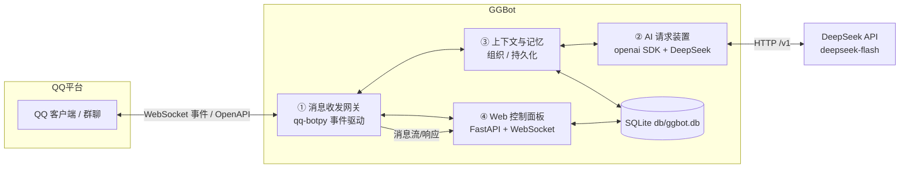
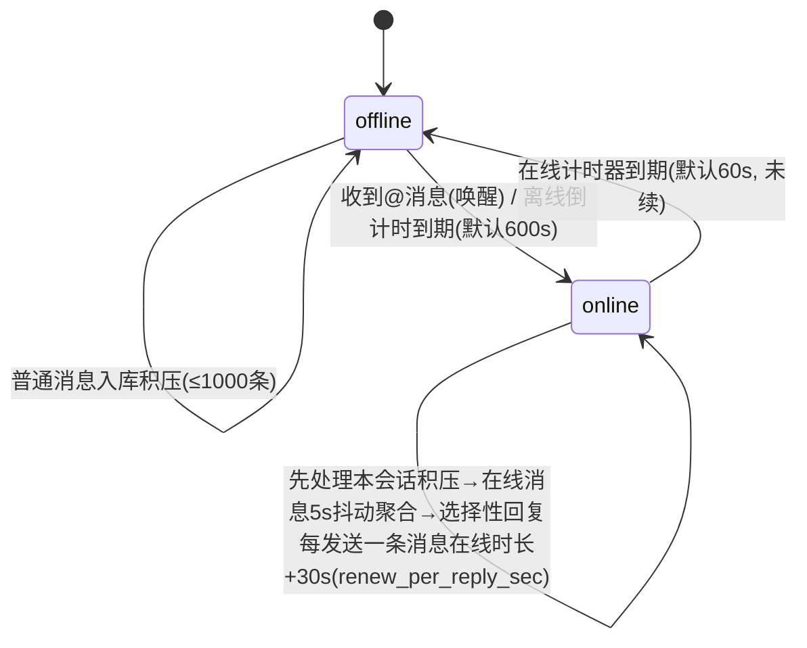

# GGBot — QQ 群聊机器人

基于官方 QQ 开放平台 api-v2（qq-botpy 1.2.1）+ DeepSeek（deepseek-flash）+ SiliconFlow 向量记忆的群聊机器人。

**四大模块：**
1. **消息收发网关**（`ggbot/qq/bot.py`）— 群@/单聊事件接收、归一化、去重，富媒体附件落地 `temp/`
2. **AI 请求装置**（`ggbot/llm/llm.py`）— DeepSeek Chat Completions，function calling 原生工具
3. **上下文组织 / 持久化记忆**（`ggbot/core/storage.py` + `ggbot/llm/memory.py` + `ggbot/tool/__init__.py`）
4. **Web 控制面板**（`ggbot/web/server.py`）— FastAPI，分组导航（概览 / 对话 / 知识 / 系统）：仪表盘、会话与上下文、消息流、向量记忆、规则、设置、运行日志

## 目录结构

```
GGBot/
├── db/
│   ├── config.json      # 全部配置（QQ 凭据 / DeepSeek / Embedding / 行为 / 存储 / Web；含密钥，gitignored）
│   └── ggbot.db         # SQLite 持久化：会话/消息/记忆/规则（运行时生成，gitignored）
├── temp/                # 富媒体附件临时落地 + 日志（temp/logs/ggbot.log；附件按类型分 emoji/voice/video/other 子目录，默认保留 24h 自动清理，gitignored）
├── requirements.txt
├── main.py              # 入口
├── tools/
│   └── manage.py        # 运维 CLI（stats / sessions / context / memory / clear）
├── start.bat            # Windows 前台启动（Ctrl+C 停止）
├── start.sh             # Linux 后台启动（nohup，kill <PID> 停止）
├── ggbot/
│   ├── core/             # 核心业务
│   │   ├── config.py     #   配置加载（纯配置文件驱动 + Web 热更新）
│   │   ├── storage.py    #   SQLite（会话/消息/记忆/规则）
│   │   └── presence.py   #   在线/离线状态机（会话级唤醒/积压分流/抖动/分段发送）
│   ├── llm/
│   │   ├── llm.py        #   DeepSeek 请求装置
│   │   └── memory.py     #   向量记忆（SiliconFlow Embedding + 余弦检索 + 去重/整理）
│   ├── qq/
│   │   └── bot.py        #   QQ 网关（botpy 连接 / 事件解析 / 富媒体落地）
│   ├── tool/
│   │   └── __init__.py   #   9 个 function calling 工具 + agent 循环（ggbot.tool）
│   ├── util/
│   │   ├── logging_setup.py  # 日志系统（五列格式 / 文件轮转 / 面板 tail）
│   │   ├── human.py          # 拟人化时序（抖动 / 阅读停顿 / 打字速度）
│   │   └── session.py        # 会话显示标签（场景 + 8 位 openid）
│   └── web/              # 控制面板
│       ├── server.py     #   FastAPI API + WebSocket + 静态托管（不内嵌前端）
│       └── static/       #   前端（经 /static 托管，改完即热加载）
│           ├── index.html
│           ├── style.css
│           └── app.js
```

## 系统架构



数据流：QQ 事件 → 网关归一化 → 上下文装置组织会话 → AI 装置请求 DeepSeek → 回复回传网关 → QQ；全链路事件同步推送到 Web 面板。

**核心循环**：`技能（9 工具）+ 上下文（群窗口≤128k，超限摘要压缩）+ 相关记忆 → 工具行动`。工具层（可调用动作）通过 DeepSeek function calling 实现；**回合语义：LLM 纯文本输出不发送、会被忽略，必须通过工具行动——send_text/seed_message 发送消息、end_call（或未调用任何工具）结束回合**；认知状态只有记忆：AI 通过 `memory_write` 沉淀、`memory_search` 回忆，system prompt 只注入规则与当前话题相关的 top-3 记忆（不设固定人设，避免上下文膨胀）。

## 快速开始

```powershell
# 1. 虚拟环境（已建 .venv）
python -m venv .venv
.\.venv\Scripts\python.exe -m pip install -r requirements.txt

# 2. 配置 db/config.json（密钥已写入）：
#    appid / appsecret          → QQ 机器人凭据（qq 开放平台后台）
#    deepseek.api_key           → DeepSeek key
#    embedding.api_key          → SiliconFlow key（Qwen3-Embedding-4B）

# 3. 启动（脚本自动创建 .venv + 安装依赖，无需手动准备）
start.bat                    # Windows 前台（Ctrl+C 停止）
# 或直接运行（无命令行参数，全部行为由 db/config.json 驱动）：
.\.venv\Scripts\python.exe main.py
# Linux 后台：
./start.sh
```

启动后：QQ gateway 连接成功 → 群@消息触发 → Presence 状态机（离线积压 / @唤醒 / 在线抖动聚合 / 选择性回复）。Web 面板：`http://127.0.0.1:8080`（首次访问在页面输入 `db/config.json → web.token`；登录后写入 HttpOnly + SameSite=Strict Cookie，令牌不落 localStorage/URL）。

## 日志与 Web 运维

- **日志文件**：只写 `temp/logs/ggbot.log`（RotatingFileHandler，5MB × 5 轮转；目录随 `storage.temp_dir` 自动创建；stderr 同时输出）。项目根目录不再产生 `botpy.log` / `logs/`——botpy 的文件 handler 已关闭（`bot_log=None, ext_handlers=False`）。格式 `时间 | 等级 | 位置 | 会话 | 内容`——会话列统一为 `群聊xxxxxxxx` / `私聊xxxxxxxx` / `系统00000000`（8 位 openid），控制台、文件、Web 面板三处一致；第三方库默认 WARNING 降噪
- **启动日志**：仅六条就绪信息——`日志就绪`（相对路径）/ `存储就绪`（相对路径）/ `记忆就绪`（模型）/ `LLM就绪`（模型 + 地址）/ `Web就绪`（地址）/ `QQBot就绪`（gateway）；收发消息只保留一条入站日志和一条发送内容，不再重复打印 `seq/passive` 等内部字段
- **等级控制**：`db/config.json → web.log_level`（默认 INFO）；面板保存设置即时热切换。项目**纯配置文件驱动**，不使用环境变量、不设启动参数（Web 面板开关：`web.enable`）
- **Web 面板**：分组导航 + 响应式布局。仪表盘（在线状态 / 会话倒计时 / 指标 / 最近消息）、会话与上下文（历史摘要、消息气泡、单独清空）、消息流、向量记忆（语义检索 / 写入 / 编辑 / 整理）、规则启停、设置分组（LLM / 在线作息 / 拟人回复 / 积压与日志，白名单热更新并写回 config.json）、日志（等级 / 会话 / 内容过滤，自动刷新）
- **运维 CLI**：`python tools/manage.py stats|sessions|context|clear|reset-chat|memory ...`，可直接查看统计、导出会话上下文、清空单个会话、检索/增改/整理记忆（`--yes` 跳过确认）
- **API**：登录 `POST /api/login`（HttpOnly Cookie，失败限流 8 次/60s）、`GET /api/auth`、`POST /api/logout`；业务 `GET /api/stats|sessions|messages|memories|rules|config|logs`，`POST /api/config`（`[{"path": "a.b.c", "value": x}]` 批量，白名单 + 类型校验，越权拒绝）；`GET /api/config` 密钥脱敏
- **安全**：Cookie 鉴权（常量时间比较）、`/ws` 同源 + Cookie 校验、跨站写请求拦截、CSP / X-Frame-Options DENY / nosniff / no-store，FastAPI 文档端点关闭；公网部署建议再加 HTTPS 反向代理并设 `web.cookie_secure=true`

## 关键行为（config.json `behavior`）

| 机制 | 配置 | 说明 |
|---|---|---|
| 在线/离线作息 | `presence.online_duration_sec`（默认 60）/ `offline_interval_sec`（默认 600） | 每会话独立：定时上线、在线一段时间后下线 |
| @唤醒 | `presence.wake_on_at_message` | 离线被@（本会话）→ 本会话上线并立即回复该条（不进积压） |
| 聊得火热 | `presence.renew_on_reply` + `renew_per_reply_sec`（默认 30） | 每发送一条消息，本会话在线时长 +30s |
| 抖动聚合 | `reply.debounce_sec`（默认 5） | 在线消息 5s 窗口聚合，LLM 选择性回复（非每条必回） |
| 积压分流 | `backlog.*` | 上线扫描本会话 pending（≤1000）；@/C2C 事件窗口内单独被动回，其余每 100 条合并主动回 |
| 分段发送 | `reply.max_segments` / `max_chars_per_segment` / `segment_gap_sec` | 回复拆短句逐条发送（msg_seq 递增，官方支持同一消息多次回复） |
| 作息抖动 | `presence.online_duration_jitter` / `offline_interval_jitter` / `renew_jitter` | 上下线时长、续期时长按 ±比例随机，避免机械整点；每会话首次上线时间也随机错开 |
| 阅读停顿 | `reply.read_delay_min_sec` / `read_delay_max_sec` | 被动回复前随机"看一眼"停顿（积压批量 ≤3 条时才加，避免拖过被动窗口；默认 0 关闭） |
| 打字速度 | `reply.typing_chars_per_sec` / `typing_min_sec` / `typing_max_sec` / `typing_jitter` | 按文本长度估算打字耗时再发送（受最短/最长限制与随机抖动；默认 0 关闭） |

> **会话隔离**：每个会话（每个群 / 每段私聊）是独立状态机——私聊被@只唤醒私聊会话，不会让群聊上线；A 群唤醒不影响 B 群；群聊积压只有本群被唤醒时才处理。离线倒计时/在线时长/抖动窗口均按会话独立计时。

**状态机（每会话）**



**消息处理路径**：收到消息 → 归属会话 → 该会话离线？→ 入库标记 pending（不调 LLM）；若被@且 `wake_on_at_message` → 本会话唤醒并**立即被动回复该条**（不进积压）→ 本会话上线流程。在线：先浏览本会话积压 pending（≤1000 条）：`passive_ok` 事件（群@/C2C）且窗口内单独被动回，其余每 ≤`batch_size` 条合并为一条主动回（省额度），然后进入实时模式：5s 抖动窗口聚合 → LLM 选择性回复 → 每段发送成功续期 +30s。

> **平台被动回复硬规则**：只有 `GROUP_AT_MESSAGE_CREATE`（群@本机器人）与 `C2C_MSG_RECEIVE`（私聊）事件的消息能带 `msg_id+event_id` 被动回复（不限额度）；`GROUP_MESSAGE_CREATE`（群全量）事件的 `event_id` 平台拒绝用于被动回复（400 40034027），只能主动发送（额度每月 4 条/群）。代码按事件来源持久化 `passive_ok` 标记并据此选通道。

## 消息全形式矩阵

| 消息形式 | 接收依据 | 处理策略 |
|---|---|---|
| 文本 | `content` | 直接进入上下文 |
| 图片 | attachments content_type=image/* | 下载存 temp/ → base64 → DeepSeek 视觉输入（单图≤32MiB） |
| 语音 | content_type=voice + `asr_refer_text` | 下载存 temp/；优先用平台 ASR 参考文本 |
| 视频 | content_type=video/* | **不下载不处理**（`storage.download_video=false`），仅保留 URL/元信息供引用转发 |
| 文件 | content_type=file | 元信息描述，可选存 temp/ |
| 艾特 | content 去@前缀 + mentions[] | 作为对话触发信号（离线可唤醒） |
| 引用 | msg_elements type=103 | 拉取被引消息原文并入上下文 |
| 卡片 | ark_data | 解析 title/desc/jump_url 为文本 |
| 聊天记录 | msg_elements type=102 | 文本化并入上下文 |

> 已注册**群全量消息**事件（私域 `GROUP_MESSAGE_CREATE`，botpy 1.2.1 未内置，运行时注入 parser）：普通消息（非@）进入 Presence 积压/抖动路径，与@消息共用去重与统一路由。机器人需在开放平台/群内开启"接收群内全部消息"权限。

> **群@识别（三层）**：① 首选 `GROUP_AT_MESSAGE_CREATE` 事件（开放平台需订阅该事件，事件送达时自动学习机器人 openid 写入 config）；② 全量消息 content 内嵌 `<@openid>`——`bot_openid` 为空时自动学习第一条 `<@>` 的 id 写入 config，之后精确匹配（当前生效）；③ `mentions` 精确匹配 `bot_openid`。

> **显示用标识（不解析真名）**：不再调用任何名称接口（群成员/用户信息需 11253 白名单，且网络失败会拖慢消息处理）。日志与面板统一显示 `场景 + openid 前 8 位`（如 `群聊8825F8A7`、`私聊A1B2C3D4`、`系统00000000`），无白名单依赖、无额外网络请求。

> `temp/` 目录默认只保留 24h（`storage.temp_ttl_hours=24`）：启动时清理一次 + 每小时巡检，超过时限的文件自动删除。

## 配置（db/config.json 全字段）

```json
{
  "appid": "...", "appsecret": "...",
  "bot_openid": "",                    // 机器人 openid，自动学习（群消息 <@id> / @事件 mentions），也可手动填
  "deepseek": {
    "base_url": "https://api.deepseek.com", "api_key": "...", "model": "deepseek-flash",
    "request": { "thinking": "disabled", "reasoning_effort": "high", "temperature": 1.0,
                 "top_p": 1.0, "max_tokens": 2048, "stop": [], "stream": false },
    "context": { "max_input_tokens": 128000, "max_history_messages": 50,
                 "summary_threshold_tokens": 100000 }
  },
  "embedding": { "provider": "siliconflow", "base_url": "https://api.siliconflow.cn/v1",
                 "model": "Qwen/Qwen3-Embedding-4B", "api_key": "...", "batch_size": 32 },
  "behavior": {
    "presence": { "online_duration_sec": 300, "offline_interval_sec": 900,
                  "online_duration_jitter": 0.3, "offline_interval_jitter": 0.4,
                  "renew_jitter": 0.3, "wake_on_at_message": true, "wake_on_c2c": false,
                  "renew_on_reply": true, "renew_per_reply_sec": 30 },
    "backlog": { "max_scan_messages": 1000, "batch_size": 100, "priority_rule": "llm" },
    "reply": { "max_segments": 5, "max_chars_per_segment": 80,
               "segment_gap_sec": 2, "debounce_sec": 10,
               "read_delay_min_sec": 0.4, "read_delay_max_sec": 1.6,
               "typing_chars_per_sec": 10, "typing_min_sec": 0.4,
               "typing_max_sec": 4.0, "typing_jitter": 0.25 }
  },
  "storage": { "temp_dir": "temp", "db_path": "db/ggbot.db", "public_base_url": "",
               "temp_ttl_hours": 24, "download_video": false },
  "web": { "enable": true, "host": "127.0.0.1", "port": 8080, "token": "<面板令牌>",
           "cookie_secure": false, "log_level": "INFO" }
}
```

参数口径（按 DeepSeek 官方文档核实）：`thinking` 仅 `enabled`/`disabled`（disabled 经 `extra_body` 生效）；`temperature` 仅非思考模式生效、`top_p` 仅思考模式生效；`reasoning_effort` 仅思考模式；`top_k` 官方不支持、`presence/frequency_penalty` 已废弃，均不入配置；base_url 不带 `/v1`。

## 工具（DeepSeek function calling，`ggbot/tool/__init__.py`）

`send_text` / `seed_message` / `end_call` / `send_image` / `send_voice`(TTS) / `send_video` / `send_emoji` / `memory_search` / `memory_write`

> 富媒体发送限制：官方 `post_group_file` 上传需要**公网 URL**。转发群友刚发的图片/语音直接用其附件 URL（代码已记录；视频不下载但保留 URL 同样可转发）；本地生成的文件（如 TTS 语音）需配置 `storage.public_base_url` 指向公网可访问的目录，否则该工具返回明确错误。

## 记忆向量化

- 嵌入：SiliconFlow `Qwen/Qwen3-Embedding-4B`（OpenAI 兼容 `/embeddings`，无本地模型）
- 写入：AI 调 `memory_write`（importance 1-5）；同会话内余弦 ≥0.95 视为重复，更新原条目而非新增
- 检索：`memory_search` 余弦相似度 top-k；system prompt 只注入与当前消息相关度 ≥0.35 的 top-3，作用域为「全局 + 本会话」，避免无关记忆污染低上下文请求
- 高可用：embedding 调用失败重试 3 次；检索失败仅跳过注入（按无记忆继续回复），不阻塞消息处理
- 整理：面板「整理」按钮合并近似重复（阈值 0.95）

## 运维 CLI

```powershell
.\.venv\Scripts\python.exe tools\manage.py stats            # 会话/消息/待处理/记忆/规则统计
.\.venv\Scripts\python.exe tools\manage.py sessions         # 会话列表（标签 / 消息数 / 最后活动）
.\.venv\Scripts\python.exe tools\manage.py context 群聊8825F8A7 --limit 50  # 导出某会话上下文
.\.venv\Scripts\python.exe tools\manage.py clear 群聊8825F8A7 --yes          # 只清该会话消息
.\.venv\Scripts\python.exe tools\manage.py memory list|search|add|edit|delete|tidy
```

会话参数支持完整 id（`group:xxx` / `c2c:xxx`）、8 位标签（`群聊8825F8A7` / `私聊abcdef12`）或 openid 前缀。

## 验证记录（已通过）

```
[PASS] import_all        # 全部模块导入
[PASS] storage_crud      # SQLite 会话/消息/记忆/规则 CRUD + 积压查询
[PASS] memory_vector     # SiliconFlow embedding 真实调用 + 语义检索 + 去重/ tidy 合并
[PASS] llm_chat          # DeepSeek deepseek-flash 真实调用（thinking=disabled 生效）
[PASS] tools_schema      # 9 工具 schema 校验
[PASS] presence_split    # 分段逻辑（空行/按句/无标点硬切/限段）
[PASS] tool_loop         # function calling 端到端：AI 调用 memory_write 真实入库
[PASS] config_read       # 纯配置文件驱动（无环境变量）+ temp/db 路径
[PASS] logging_system    # 多等级写文件 + tail 等级过滤 + set_level 热切换；根目录不产生 botpy.log
[PASS] presence_backlog  # 上线积压处理（wake-on-at 全链路：锁/会话分组/attachments 反序列化/目标派生）
[PASS] presence_fail     # 发送失败隔离（失效会话标记 failed，不中断其余会话积压）
[PASS] target_derive     # 发送目标反查（session_id 内部主键 ≠ openid，从 sessions.key 取完整 openid；c2c/group 双场景）
[PASS] msg_seq           # 回复序号会话内小整数递增（被动 base+1 / 主动 1 起，int32 内防 400），失败自动降级主动发送
[PASS] at_persist        # @标志/事件ID 持久化入库（积压读回恢复 is_at/event_id/msg_seq）+ 旧库自动迁移补列
[PASS] audit            # 订阅 message_audit intent；审核通过/拦截事件均记日志（排查"平台受理但未展示"）
[PASS] singleton_lock    # 单实例锁（僵尸锁清理 / 存活 pid 探测，防双进程双写 db）
[PASS] web_security_api  # Cookie 登录/401/限流、HttpOnly+SameSite、密钥脱敏、配置类型校验、会话/记忆/规则 API、跨站拦截、WS 鉴权、安全响应头
[PASS] web_ui            # 浏览器实测：登录/错误提示、仪表盘、会话详情、消息流、记忆增改检索、设置保存、日志过滤、退出
[PASS] web_static        # web/ 前端拆分托管（/ + /static）、无内联脚本/样式（CSP）、移动端列折叠
[PASS] temp_video_policy # 视频附件不下载 + temp 过期文件清理
```

> 未覆盖：QQ 真实收发（需机器人上线 + 群内实测）；`send_image/video/voice` 富媒体实发（需真实群 + 公网 URL）。

## QQ 平台侧配置要求（发送失败的常见原因）

代码能**收**到群全量消息 ≠ 机器人能**发**消息。以下为 QQ 开放平台侧硬性要求，缺任一项都会出现「群里显示：该机器人的服务异常，暂时无法响应」而本地日志无 ERROR（HTTP 200 但未投递）：

1. **机器人必须已加入目标群**（未认证开发者仅能添加自己是群主/管理员身份的群；机器人进群能力在管理后台/客户端添加）
2. **群主需在 QQ 客户端打开【机器人主动在群聊内发言】**——2026-06-22 起主动推送能力全量开放，未打开则主动消息（积压合并回复）全部失败
3. **开放平台需订阅群@事件（`GROUP_AT_MESSAGE_CREATE`）**：未订阅则@本机器人的消息不推该事件（只有群全量流），机器人无法识别被@；可用 config `bot_openid` 兜底
4. 被动回复（@ 消息）依赖前置事件 ID `event_id`（代码已随消息事件透传）
5. 频控硬限制：群被动消息每条消息 5 分钟内最多回复 5 次；**群主动消息每月 4 条/群**（积压合并回复属主动消息，额度极低，优先依赖在线时被动回复）
6. 消息内容含 URL 需在 q.qq.com 后台「开发设置 → 消息URL配置」预先配置，否则发送失败

## 已知限制

- qq-botpy 1.2.1（2024-03 停更）但内置新鉴权（appId+clientSecret → access_token 自动缓存刷新），实测可用
- 语音 TTS 产出 mp3，QQ 语音富媒体为 silk 格式，平台不接收时该工具返回错误（转发收到的语音不受影响）
- 表情消息类型官方未单列，`send_emoji` 以文本形式发送
- Web 面板为单令牌 + HttpOnly Cookie 鉴权，适合本机/内网；公网暴露请加 HTTPS 反向代理并设 `web.cookie_secure=true`
