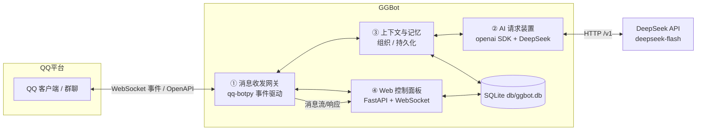
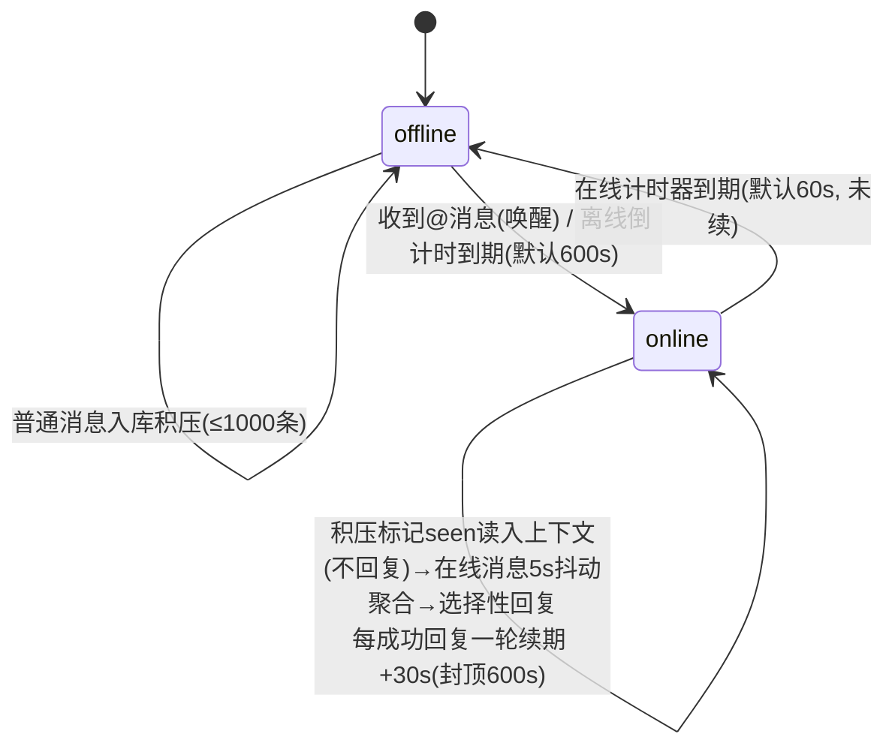

# GGBot — QQ 群聊机器人

基于官方 QQ 开放平台 api-v2（qq-botpy 1.2.1）+ DeepSeek（deepseek-flash）+ SiliconFlow 向量记忆的群聊机器人。

**五大模块：**
1. **消息收发网关**（`ggbot/qq/bot.py`）— 群@/单聊事件接收、归一化、去重，富媒体附件落地 `temp/`
2. **AI 请求装置**（`ggbot/llm/llm.py`）— DeepSeek Chat Completions，function calling 原生工具
3. **Tool 插件系统**（`tool/base.py` + `tool/<分类>/`）— 一切皆 Tool：按能力域分包的 toolset 自包含代码/配置/数据，启动时自动发现并动态挂载进上下文
4. **上下文组织 / 持久化记忆**（`ggbot/core/storage.py` + `ggbot/llm/memory.py` + `ggbot/core/presence.py`）
5. **Web 控制面板**（`ggbot/web/server.py`）— FastAPI，分组导航（概览 / 对话 / 知识 / 工具 / 系统）：仪表盘、会话与上下文、消息流、向量记忆、规则、工具开关、设置、运行日志

## 目录结构

```
GGBot/
├── db/
│   ├── config.json      # 全局配置（QQ 凭据 / DeepSeek / Embedding / 行为 / 存储 / Web；含密钥，gitignored）
│   └── ggbot.db         # SQLite 持久化：会话/消息/记忆/规则（运行时生成，gitignored）
├── tool/                # Tool 自包含目录：每个 toolset = 代码 + config.json + 持久化数据（整目录可复制迁移）
│   ├── core/            #   send_text / end_call
│   ├── memory/          #   memory_search / memory_write
│   ├── emoji/           #   sticker.py + config.json + index.json + stickers/（内置素材）+ user/（用户投喂）
│   ├── audio/           #   voice_clone.py + config.json（MiMo key）+ voice_ref.wav（参考音频）
│   ├── media/           #   send_image / send_video
│   └── mail/            #   email.py + config.json（SMTP 账号 / 收件人白名单）
├── temp/                # 富媒体附件临时落地 + 日志 + Tool 运行产物（temp/tool/<name>/；默认 24h 清理，gitignored）
├── requirements.txt
├── main.py              # 入口
├── tools/
│   └── manage.py        # 运维 CLI（stats / sessions / context / memory / clear）
├── start.bat            # Windows 前台启动（Ctrl+C 停止）
├── start.sh             # Linux 后台启动（nohup，kill <PID> 停止）
├── ggbot/
│   ├── core/             # 核心业务
│   │   ├── config.py     #   配置加载（纯配置文件驱动 + Web 热更新）
│   │   ├── storage.py    #   SQLite（会话/消息/记忆/规则）
│   │   └── presence.py   #   在线/离线状态机（会话级唤醒/积压只读/抖动/分段发送）
│   ├── llm/
│   │   ├── llm.py        #   DeepSeek 请求装置
│   │   └── memory.py     #   向量记忆（SiliconFlow Embedding + 余弦检索 + 去重/整理）
│   ├── qq/
│   │   └── bot.py        #   QQ 网关（botpy 连接 / 事件解析 / 富媒体落地）
│   ├── util/
│   │   ├── logging_setup.py  # 日志系统（四列格式 / 文件轮转 / 面板 tail）
│   │   ├── human.py          # 拟人化时序（抖动 / 阅读停顿 / 打字速度）
│   │   ├── media.py          #   本地媒体 HMAC 签名 URL（/media/<exp>/<sig>/<rel>）
│   │   └── session.py        # 会话显示标签（场景 + 8 位 openid）
│   └── web/              # 控制面板
│       ├── server.py     #   FastAPI API + WebSocket + 静态托管 + 签名媒体路由（不内嵌前端）
│       └── static/       #   前端（经 /static 托管，改完即热加载）
│           ├── index.html
│           ├── style.css
│           └── app.js
```

## 系统架构



数据流：QQ 事件 → 网关归一化 → 上下文装置组织会话 → AI 装置请求 DeepSeek → 回复回传网关 → QQ；全链路事件同步推送到 Web 面板。

**核心循环**：`Tool 插件（按配置动态挂载）+ 上下文（群窗口≤128k，超限摘要压缩）+ 相关记忆 → Tool 行动`。Tool 层通过 DeepSeek function calling 实现，插件在项目根 `tool/<分类>/` 下自动发现；**回合语义：优先通过 Tool 行动——send_text 发送消息、end_call（或未调用任何 Tool）结束回合；若模型无视协议直接回文本且本轮尚未发送，自动按 send_text 兜底发出，避免整轮静默**；认知状态只有记忆：AI 通过 `memory_write` 沉淀、`memory_search` 回忆，system prompt 只注入规则、各 Tool 自己挂载的提示与当前话题相关的 top-3 记忆（不设固定人设，避免上下文膨胀）。

## 快速开始

```powershell
# 1. 虚拟环境（已建 .venv）
python -m venv .venv
.\.venv\Scripts\python.exe -m pip install -r requirements.txt

# 2. 配置 db/config.json（密钥已写入）：
#    appid / appsecret          → QQ 机器人凭据（qq 开放平台后台）
#    deepseek.api_key           → DeepSeek key
#    embedding.api_key          → SiliconFlow key（Qwen3-Embedding-4B）

# 3. 启动（脚本自动创建 .venv + 安装依赖，无需手动准备；脚本默认 --log-level DEBUG）
start.bat                    # Windows 前台（Ctrl+C 停止）
# 或直接运行（无参数时全部行为由 db/config.json 驱动，日志等级取 web.log_level）：
.\.venv\Scripts\python.exe main.py
# Linux 后台：
./start.sh
```

启动后：QQ gateway 连接成功 → 群@消息触发 → Presence 状态机（离线积压 / @唤醒 / 在线抖动聚合 / 选择性回复）。Web 面板：`http://127.0.0.1:8080`（首次访问在页面输入 `db/config.json → web.token`；登录后写入 HttpOnly + SameSite=Strict Cookie，令牌不落 localStorage/URL）。

## 日志与 Web 运维

- **日志文件**：只写 `temp/logs/ggbot.log`（RotatingFileHandler，5MB × 5 轮转；目录随 `storage.temp_dir` 自动创建；stderr 同时输出）。项目根目录不再产生 `botpy.log` / `logs/`——botpy 的文件 handler 已关闭（`bot_log=None, ext_handlers=False`）。格式 `时间 | 等级 | 会话 | 内容`——会话列统一为 `群聊xxxxxxxx` / `私聊xxxxxxxx` / `系统00000000`（8 位 openid），控制台、文件、Web 面板三处一致；DEBUG 只输出业务状态（入站 / 上下文 / LLM 请求 / 工具 / 发送 / 上下线），第三方库（botpy / openai / httpx / httpcore2 / uvicorn 等）固定 WARNING，不打印连接与报文细节
- **启动日志**：仅六条就绪信息——`日志就绪`（相对路径 + 等级）/ `存储就绪`（相对路径）/ `记忆就绪`（模型 + 地址）/ `LLM就绪`（模型 + 地址）/ `Web就绪`（地址）/ `QQBot就绪`（gateway）；收发消息只保留一条入站日志（`私聊[54019C24] 内容` / `群@[54019C24] 内容`）和一条发送内容；上下线只打 `自然上线 预计在线 53s, 积压消息 0 条` / `强制上线 …` / `下线 预计离线 438s`
- **等级控制**：`db/config.json → web.log_level`（默认 INFO）；面板保存设置即时热切换。`start.bat` / `start.sh` 默认带 `--log-level DEBUG`，直接 `python main.py` 则用配置值；项目不使用环境变量（Web 面板开关：`web.enable`）
- **Web 面板**：分组导航 + 响应式布局。仪表盘（在线状态 / 会话倒计时 / 指标 / 最近消息）、会话与上下文（历史摘要、消息气泡、单独清空）、消息流、向量记忆（语义检索 / 写入 / 编辑 / 整理）、规则启停、工具（11 个 Tool 的启停与脱敏配置概览）、设置分组（LLM / 在线作息 / 拟人回复 / 积压读取与日志，白名单热更新并写回 config.json）、日志（等级 / 会话 / 内容过滤，自动刷新）
- **运维 CLI**：`python tools/manage.py stats|sessions|context|clear|reset-chat|memory ...`，可直接查看统计、导出会话上下文、清空单个会话、检索/增改/整理记忆（`--yes` 跳过确认）
- **API**：登录 `POST /api/login`（HttpOnly Cookie，失败限流 8 次/60s）、`GET /api/auth`、`POST /api/logout`；业务 `GET /api/stats|sessions|messages|memories|rules|tools|config|logs`，`POST /api/config`（`[{"path": "a.b.c", "value": x}]` 批量，白名单 + 类型校验，越权拒绝）、`POST /api/tools/{name}/toggle`（共享配置的 Tool 返回 400）；`GET /api/config|tools` 密钥脱敏；`GET /media/{exp}/{sig}/{rel}` 为 QQ 提供签名媒体，不参与 Cookie 鉴权
- **安全**：Cookie 鉴权（常量时间比较）、`/ws` 同源 + Cookie 校验、跨站写请求拦截、CSP / X-Frame-Options DENY / nosniff / no-store，FastAPI 文档端点关闭；公网部署建议再加 HTTPS 反向代理并设 `web.cookie_secure=true`

## 关键行为（config.json `behavior`）

| 机制 | 配置 | 说明 |
|---|---|---|
| 在线/离线作息 | `presence.online_duration_sec`（默认 60）/ `offline_interval_sec`（默认 600） | 每会话独立：定时上线、在线一段时间后下线 |
| @唤醒 | `presence.wake_on_at_message` | 离线被@（本会话）→ 先读入离线积压（不含本条），本会话上线并立即回复该条 |
| 回复续期 | `presence.renew_on_reply` + `renew_per_reply_sec`（默认 30）/ `renew_max_sec`（默认 600） | 每成功回复一轮固定续期 30s（带抖动），单次封顶 600s；不随连聊轮数递增 |
| 积压只读 | `backlog.max_scan_messages`（默认 1000） | 上线把离线 pending（≤上限）标记为 `seen` 读入上下文，**不回复、不触发 LLM**；下次回复时能看到期间发生了什么 |
| 抖动聚合 | `reply.debounce_sec`（默认 5） | 在线消息 5s 窗口聚合，LLM 选择性回复（非每条必回） |
| 分段发送 | `reply.segment_gap_sec` | send_text 遇到换行自动拆成多条，按间隔逐条发送（msg_seq 递增） |
| 作息抖动 | `presence.online_duration_jitter` / `offline_interval_jitter` / `renew_jitter` | 上下线时长、续期时长按 ±比例随机，避免机械整点；每会话首次上线时间也随机错开 |
| 阅读停顿 | `reply.read_delay_min_sec` / `read_delay_max_sec` | 被动回复前随机"看一眼"停顿（仅被动且消息 ≤3 条时加，避免拖过 5 分钟窗口；默认 0.4–1.6s） |
| 打字速度 | `reply.typing_chars_per_sec` / `typing_min_sec` / `typing_max_sec` / `typing_jitter` | 按文本长度估算打字耗时再发送（受最短/最长限制与随机抖动；默认 0 关闭） |

> **会话隔离**：每个会话（每个群 / 每段私聊）是独立状态机——私聊被@只唤醒私聊会话，不会让群聊上线；A 群唤醒不影响 B 群；群聊积压只在本群上线时读入，不会跨群回复。离线倒计时/在线时长/抖动窗口均按会话独立计时。

**状态机（每会话）**



**消息处理路径**：收到消息 → 归属会话 → 该会话离线？→ 入库标记 pending（不调 LLM）；若被@且 `wake_on_at_message` → 先把旧积压标记 `seen` 读入上下文，再**立即被动回复本条** → 本会话上线。定时上线：把本会话积压（≤1000）标记 `seen` 后**直接进入在线状态，不回复任何积压消息**（`seen` 历史会参与之后生成，所以 AI 知道离线期间聊了什么）。在线：5s 抖动窗口聚合 → 走 LLM 决策是否接话（@/私聊用被动回复，普通群消息用主动消息）→ 每成功回复一轮固定续期 30s（封顶 600s）。

> **平台发送通道**：只有 `GROUP_AT_MESSAGE_CREATE`（群@本机器人）与 `C2C_MSG_RECEIVE`（私聊）事件能用 `msg_id+event_id` 被动回复（5 分钟内至多 5 次，不占主动额度）；`GROUP_MESSAGE_CREATE`（群全量）事件只能主动发送（2026-06-22 起全量开放，群主需开启「机器人主动在群聊内发言」，20 条/分钟、1000 条/天）。代码按事件来源持久化 `passive_ok` 标记并据此选通道，另加 `proactive_per_minute`（默认 6）/`proactive_per_day`（默认 1000）本地闸门。

## 消息全形式矩阵

| 消息形式 | 接收依据 | 处理策略 |
|---|---|---|
| 文本 | `content` | 直接进入上下文 |
| 图片 | attachments content_type=image/* | 下载存 temp/ → 上下文标注 `url`/`local`，可直接转发；模型本身看不到图片内容 |
| 语音 | content_type=voice | 下载存 temp/ → 上下文标注 `url`/`local`；无平台转写文本，模型不能“听”，可原样转发 |
| 视频 | content_type=video/* | **不下载不处理**（`storage.download_video=false`），仅保留 URL/元信息供引用转发 |
| 文件 | content_type=file | 元信息描述，可选存 temp/ |
| 艾特 | content 去@前缀 + mentions[] | 作为对话触发信号（离线可唤醒） |
| 引用 | msg_elements type=103 | 拉取被引消息原文并入上下文 |
| 卡片 | ark_data | 解析 title/desc/jump_url 为文本 |
| 聊天记录 | msg_elements type=102 | 文本化并入上下文 |

> 已注册**群全量消息**事件（私域 `GROUP_MESSAGE_CREATE`，botpy 1.2.1 未内置，运行时注入 parser）：普通消息（非@）进入 Presence 积压/抖动路径，与@消息共用去重与统一路由。机器人需在开放平台/群内开启"接收群内全部消息"权限。

> **群@识别（三层）**：① 首选 `GROUP_AT_MESSAGE_CREATE` 事件（开放平台需订阅该事件，事件送达时自动学习机器人 openid 写入 config）；② 全量消息 content 内嵌 `<@openid>`——`bot_openid` 为空时自动学习第一条 `<@>` 的 id 写入 config，之后精确匹配（当前生效）；③ `mentions` 精确匹配 `bot_openid`。

> **显示用标识（不解析真名）**：不再调用任何名称接口（群成员/用户信息需 11253 白名单，且网络失败会拖慢消息处理）。日志与面板统一显示 `场景 + openid 前 8 位`（如 `群聊8825F8A7`、`私聊A1B2C3D4`、`系统00000000`），无白名单依赖、无额外网络请求。

> `temp/` 目录默认只保留 24h（`storage.temp_ttl_hours=24`）：启动时清理一次 + 每小时巡检，超过时限的文件自动删除。

## 配置（db/config.json 全字段）

```json
{
  "appid": "...", "appsecret": "...",
  "bot_openid": "",                    // 机器人 openid，自动学习（群消息 <@id> / @事件 mentions），也可手动填
  "deepseek": {
    "base_url": "https://api.deepseek.com", "api_key": "...", "model": "deepseek-flash",
    "request": { "thinking": "disabled", "reasoning_effort": "high", "temperature": 1.0,
                 "top_p": 1.0, "max_tokens": 2048, "stop": [], "stream": false },
    "context": { "max_input_tokens": 128000, "max_history_messages": 50,
                 "summary_threshold_tokens": 100000 }
  },
  "embedding": { "provider": "siliconflow", "base_url": "https://api.siliconflow.cn/v1",
                 "model": "Qwen/Qwen3-Embedding-4B", "api_key": "...", "batch_size": 32 },
  "behavior": {
    "presence": { "online_duration_sec": 300, "offline_interval_sec": 900,
                  "online_duration_jitter": 0.3, "offline_interval_jitter": 0.4,
                  "renew_jitter": 0.3, "wake_on_at_message": true, "wake_on_c2c": false,
                  "renew_on_reply": true, "renew_per_reply_sec": 30,
                  "renew_max_sec": 600,
                  "proactive_enabled": true, "proactive_per_minute": 6,
                  "proactive_per_day": 1000 },
    "backlog": { "max_scan_messages": 1000 },
    "reply": { "segment_gap_sec": 2, "debounce_sec": 5,
               "read_delay_min_sec": 0.4, "read_delay_max_sec": 1.6,
               "typing_chars_per_sec": 10, "typing_min_sec": 0.4,
               "typing_max_sec": 4.0, "typing_jitter": 0.25 }
  },
  "storage": { "temp_dir": "temp", "db_path": "db/ggbot.db", "public_base_url": "",
               "temp_ttl_hours": 24, "download_video": false },
  "web": { "enable": true, "host": "127.0.0.1", "port": 8080, "token": "<面板令牌>",
           "cookie_secure": false, "log_level": "INFO" }
}
```

参数口径（按 DeepSeek 官方文档核实）：`thinking` 仅 `enabled`/`disabled`（disabled 经 `extra_body` 生效）；`temperature` 仅非思考模式生效、`top_p` 仅思考模式生效；`reasoning_effort` 仅思考模式；`top_k` 官方不支持、`presence/frequency_penalty` 已废弃，均不入配置；base_url 不带 `/v1`。

`storage.public_base_url` 是**签名媒体的公网入口**——填 Web 面板对外地址（如 `https://bot.example.com`）。本地图片/表情/语音默认走 QQ 的 base64 `file_data` 直传（不需要公网地址）；只有超过 10MB 的本地文件才退回签名链接，此时未配置 `public_base_url` 会明确报错。Tool 私有配置不在 `db/config.json` 里，见下一节。

## Tool 管理（一切皆 Tool）

### 分类与发现

`tool/base.py` 是插件基座；每个 **toolset 自包含**在项目根的 `tool/<分类>/` 下——代码、`config.json`、持久化数据（索引 / 素材 / 参考音频）同目录，整个文件夹可原样复制到另一台机器。启动时由 `ToolRegistry` 自动发现 `tool/` 的子包——每个模块暴露 `get_tools(rt)`，返回若干 `Tool` 实例，注册表按所在子包自动打上 `category`。新增能力 = 在某个分类下新增一个模块，无需改动注册表或提示词模板；新增分类 = 新建一个含插件模块的子包。

| 分类 | Tool | 作用 | 配置/数据（`tool/<分类>/`） |
|---|---|---|---|
| core | `send_text` | 发送一条聊天消息（回应、主动开场、分段接话都用它；一条一句，换行会自动拆成多条） | 无（首次停用才生成 config） |
| core | `end_call` | 结束本回合 | 无 |
| memory | `memory_search` / `memory_write` | 向量记忆检索 / 沉淀 | 无 |
| emoji | `send_sticker` | 按情绪/场景从素材库挑图发送 | `config.json`、`index.json`、`stickers/`、`user/` |
| emoji | `sticker_list` / `sticker_save` | 查看可用素材 / 收藏用户投喂的图 | 与 `send_sticker` 同组（不单独启停） |
| audio | `send_voice_clone` | MiMo 声音克隆 TTS（参考音频克隆音色） | `config.json`、`voice_ref.wav` |
| media | `send_image` / `send_video` | 发送图片 / 视频（URL 或本地文件，本地走 base64 直传） | 无 |
| mail | `send_email` | SMTP 发邮件（文本/HTML + 附件） | `config.json` |

### 一个 Tool 由什么组成

- **schema**：`name` / `description` / `parameters`，直接进入 DeepSeek function calling 的 tools 列表
- **执行器**：`run(args, ctx)`，通过 `ToolRuntime` 获得配置、数据目录与发送能力
- **自我描述**：`prompt_hint` 自动汇总进 system prompt 的 `【工具提示】`，只在启用时出现
- **启停与归属**：`enabled_by_default` / `toggleable` / `config_owner` / `data_name`（目录名，如 `send_email → mail`）

### 配置与数据

- 每个 Tool 的配置在 `tool/<分类>/config.json`：读取时与默认值合并、保留未知字段、自动补齐新增默认项；`enabled=false` 即从 schema 与提示词中消失
- **无默认配置的工具**（`send_text` 等）在首次被停用时才落盘 `{"enabled": false}`，不产生空配置/空目录
- **共享配置组**：表情三件套同一份 `tool/emoji/config.json`，`sticker_list`/`sticker_save` 标记 `config_owner=false, toggleable=false`，面板显示"同组"
- 持久化数据（索引、素材、参考音频）与代码同目录，在 `tool/<分类>/`；运行产物（TTS/下载/生成）在 `temp/tool/<key>/`，随 temp TTL 清理
- **迁移**：复制 `tool/<分类>/` 整个目录即可带走该 toolset 的代码 + 配置 + 数据，无需同步数据库或其他目录
- **Web 开关**：面板「工具」页按分类排序列出全部 Tool、描述与脱敏配置，可即时启停（`POST /api/tools/{name}/toggle`，密钥字段返回 `***`）
- **动态挂载**：`ToolRegistry.schemas()` 只返回已启用的 Tool；agent 循环每回合按当前启用集合请求 LLM

### 表情包（emoji）

- 索引 `tool/emoji/index.json`：`{file, meaning, scenes[], source}`，66 条内置素材（`stickers/`，gitignored）；`user/` 存用户投喂
- 匹配：按 `mood` 与 meaning/scenes 关键词打分，top-3 随机，避开该会话最近 12 张，避免复读
- 节制：`max_per_turn`（默认 1，按回合计数）/ `min_interval_sec`（默认 30s，按会话）双重限流；prompt 提示"对方说正事时不要用表情"
- 入库：`sticker_save` 只接受 `temp/` 下的图片，复制到 `tool/emoji/user/` 后原子更新索引；`max_user_stickers` 默认 200；仅限用户明确同意收藏的图

### 语音（audio）

- `tool/audio/config.json`：`api_key` / `base_url` / `model`（默认 `mimo-v2.5-tts-voiceclone`）/ `reference_voice_path` / `timeout` / `max_retries` / `max_chars`（默认 60）
- `voice_ref.wav` 为参考音频；`send_voice_clone` 把文本合成 wav 到 `temp/tool/audio/`，再用 `pysilk` 转成带 `#!SILK_V3` 头的 24kHz silk 并以 file_type=3 发送；`api_key` 或参考音频缺失时工具自动视为未启用
- 语气约束走 prompt 提示：短句、口语化、情绪随内容变化；`pysilk-mod` 已在 `requirements.txt` 中

### 邮件（mail）

- 配置 `tool/mail/config.json`：SMTP 服务器/端口/SSL、发件邮箱、授权码、`default_to`、`allowed_recipients`、附件数量/大小上限
- **收件人白名单**：LLM 只能发给 `allowed_recipients`；未配置白名单时只能发 `default_to`；越界直接拒绝
- **附件白名单**：只允许 `temp/` 下的运行时文件，拒绝 `logs/`、`config.json`、`.env`、数据库、脚本等；默认最多 3 个、单个 ≤10MB
- 仅当用户明确要求发邮件时由模型调用（prompt 提示约束），避免被当作外发通道

> **本地媒体上传**：本地文件（`temp/`、`tool/` 下的图片/表情/语音/视频）直接以 base64 `file_data` 调 `POST /v2/groups/{group_openid}/files`（或 `/v2/users/{openid}/files`）上传，再用返回的 `file_info` 发 `msg_type=7`，不依赖公网地址；超过 10MB 的本地文件改用 `ggbot/util/media.py` 生成的 HMAC 签名链接 `/media/<exp>/<sig>/<rel>`（由 Web 面板提供，无需 Cookie，仅限媒体扩展名，禁止目录穿越与日志），此时需配置 `storage.public_base_url`。签名密钥取自 `web.token`（或 `appsecret`），有效期默认 1 小时。

> **版本库边界**：`tool/*/config.json` 含 MiMo key / SMTP 授权码，由全局 `config.json` 规则忽略；`tool/emoji/{stickers,user}/` 与 `tool/audio/*.wav` 体积大或含个人音频同样忽略；`tool/emoji/index.json` 入库（仅含义索引，不含素材本体）。换机重建时把素材放回 `tool/emoji/stickers/`、参考音频放回 `tool/audio/voice_ref.wav` 即可，索引与配置会自动补齐缺失字段。

## 记忆管理

记忆分三层，各自独立持久化、独立清理：

1. **会话消息（短期上下文）** — `messages` 表，用户消息与助手消息都落库。聊天发送工具（`send_text` 与 `send_media` 背后的图片/视频/语音/表情）成功后写入一条 `assistant` 行，状态 `sent`；用户消息按处理阶段标记 `pending`（未处理积压）→ `seen`（上线只读）/ `replied` / `skipped` / `failed`。组装上下文时**排除 `pending`**，当前批次单独放进 `【本轮消息】（只回应这里的内容）`，历史只作背景——避免模型逐条重答旧消息。
2. **会话摘要** — `sessions.summary`。历史 + 系统提示超过 `summary_threshold_tokens`（默认 100k）时，调用 LLM 把历史压缩成摘要，旧消息从上下文移出但仍在库里；摘要随会话保存。
3. **长期记忆（向量）** — `memories` 表，`content + embedding + importance + session_id`。AI 通过 `memory_write` 主动沉淀，`memory_search` 按语义回忆；system prompt 只注入与当前消息相关度 ≥0.35 的 top-3，作用域为「全局 + 本会话」。

- **写入**：SiliconFlow `Qwen/Qwen3-Embedding-4B` 生成向量；同会话余弦 ≥0.95 视为重复，更新原条目而非新增；importance 1-5
- **检索**：`memory_search` 余弦 top-k；面板「整理」合并近似重复（阈值 0.95）
- **高可用**：embedding 调用失败重试 3 次；检索失败仅跳过注入（按无记忆继续回复），不阻塞消息处理
- **边界**：不设固定人设、不做人设进化；规则（`rules` 表）单独注入 system prompt，与记忆分开。`--reset-chat` 清 messages + sessions（含摘要）但**保留 memories**；单会话清空只删该会话消息；记忆可单独增删改

## 运维 CLI

```powershell
.\.venv\Scripts\python.exe tools\manage.py stats            # 会话/消息/待处理/记忆/规则统计
.\.venv\Scripts\python.exe tools\manage.py sessions         # 会话列表（标签 / 消息数 / 最后活动）
.\.venv\Scripts\python.exe tools\manage.py context 群聊8825F8A7 --limit 50  # 导出某会话上下文
.\.venv\Scripts\python.exe tools\manage.py clear 群聊8825F8A7 --yes          # 只清该会话消息
.\.venv\Scripts\python.exe tools\manage.py memory list|search|add|edit|delete|tidy
```

会话参数支持完整 id（`group:xxx` / `c2c:xxx`）、8 位标签（`群聊8825F8A7` / `私聊abcdef12`）或 openid 前缀。

## 验证记录（已通过）

```
[PASS] import_all        # 全部模块导入
[PASS] storage_crud      # SQLite 会话/消息/记忆/规则 CRUD + 积压查询
[PASS] memory_vector     # SiliconFlow embedding 真实调用 + 语义检索 + 去重/ tidy 合并
[PASS] llm_chat          # DeepSeek deepseek-flash 真实调用（thinking=disabled 生效）
[PASS] tools_schema      # 11 个 Tool 插件自动发现 + schema 校验 + 启用状态过滤
[PASS] tool_layout       # 根目录 tool/ 按分类包自动发现（core/memory/emoji/audio/media/mail）+ 自包含数据目录 + config-less 工具 toggle 生效
[PASS] assistant_persist # 发送成功后 assistant 消息入库；pending 不进历史；本轮消息独立标注（防逐条重答旧消息）
[PASS] tool_plugin       # 插件配置隔离（send_email→tool/mail）、共享配置同组不可单独启停、/api/tools 密钥脱敏
[PASS] media_signed      # 签名媒体 URL：有效链接可读、篡改/过期/目录穿越/config.json 均拒绝
[PASS] sticker_tool      # 66 条索引加载 + 情绪匹配 + 单回合/间隔限流 + temp 投喂入库与索引原子更新
[PASS] voice_clone       # MiMo 真实合成（mimo-v2.5-tts-voiceclone）产出 wav
[PASS] email_tool        # SMTP 真实自测发送 + 收件人白名单 + 附件仅限 temp/并拦截敏感文件
[PASS] text_split        # send_text 把带换行的内容拆成多条依次发送（msg_seq 递增、每条单独入库）
[PASS] media_upload      # 本地媒体 base64 file_data 直传（群/私聊路由、file_name、msg_type=7）+ 公网 URL 上传
[PASS] voice_silk        # MiMo wav 24kHz/单声道 → pysilk 编码出 #!SILK_V3 头（207KB→9.5KB）
[PASS] qq_face_clean     # QQ 表情富文本还原为 [表情:文字] + @标记剥离
[PASS] tool_loop         # function calling 端到端：AI 调用 memory_write 真实入库
[PASS] config_read       # 纯配置文件驱动（无环境变量）+ temp/db 路径
[PASS] logging_system    # 多等级写文件 + tail 等级过滤 + set_level 热切换；根目录不产生 botpy.log
[PASS] presence_backlog  # 上线积压只读：pending→seen、零 LLM 调用/零发送；唤醒先读旧积压再回本条
[PASS] presence_proactive # 在线普通消息可主动接话（不带 msg_id/event_id）、开关与每分钟/每日闸门、混合批次取被动锚点
[PASS] renew_flat        # 每轮续期固定 30s（带抖动）、不随轮数递增、renew_max_sec 封顶
[PASS] presence_fail     # 发送失败隔离（失效会话标记 failed，不中断其余会话积压）
[PASS] target_derive     # 发送目标反查（session_id 内部主键 ≠ openid，从 sessions.key 取完整 openid；c2c/group 双场景）
[PASS] msg_seq           # 回复序号每轮从 1 递增（同一 msg_id+msg_seq 不可重复），被动失败自动降级主动发送
[PASS] at_persist        # @标志/事件ID 持久化入库（积压读回恢复 is_at/event_id/msg_seq）+ 旧库自动迁移补列
[PASS] audit            # 订阅 message_audit intent；审核通过/拦截事件均记日志（排查"平台受理但未展示"）
[PASS] singleton_lock    # 单实例锁（僵尸锁清理 / 存活 pid 探测，防双进程双写 db）
[PASS] web_security_api  # Cookie 登录/401/限流、HttpOnly+SameSite、密钥脱敏、配置类型校验、会话/记忆/规则 API、跨站拦截、WS 鉴权、安全响应头
[PASS] web_ui            # 浏览器实测：登录/错误提示、仪表盘、会话详情、消息流、记忆增改检索、设置保存、日志过滤、退出
[PASS] web_static        # web/ 前端拆分托管（/ + /static）、无内联脚本/样式（CSP）、移动端列折叠
[PASS] temp_video_policy # 视频附件不下载 + temp 过期文件清理
```

> 未覆盖：QQ 真实收发（需机器人上线 + 群内实测）；`send_image/video/voice` 与表情/克隆语音的富媒体实发（需真实群；本地文件走 base64 直传）。

## QQ 平台侧配置要求（发送失败的常见原因）

代码能**收**到群全量消息 ≠ 机器人能**发**消息。以下为 QQ 开放平台侧硬性要求，缺任一项都会出现「群里显示：该机器人的服务异常，暂时无法响应」而本地日志无 ERROR（HTTP 200 但未投递）：

1. **机器人必须已加入目标群**（未认证开发者仅能添加自己是群主/管理员身份的群；机器人进群能力在管理后台/客户端添加）
2. **群主需在 QQ 客户端打开【机器人主动在群聊内发言】**——2026-06-22 起主动推送能力全量开放；未打开则普通消息（没@机器人）的接话会失败，@/私聊的被动回复不受影响
3. **开放平台需订阅群@事件（`GROUP_AT_MESSAGE_CREATE`）**：未订阅则@本机器人的消息不推该事件（只有群全量流），机器人无法识别被@；可用 config `bot_openid` 兜底
4. 被动回复（@ 消息）依赖前置事件 ID `event_id`（代码已随消息事件透传）
5. 频控硬限制：群被动消息每条消息 5 分钟内最多回复 5 次；群主动消息单群 20 条/分钟、1000 条/天（本地默认再限 6 轮/分钟）
6. 消息内容含 URL 需在 q.qq.com 后台「开发设置 → 消息URL配置」预先配置，否则发送失败

## 已知限制

- qq-botpy 1.2.1（2024-03 停更）但内置新鉴权（appId+clientSecret → access_token 自动缓存刷新），实测可用
- `send_voice_clone` 产出 wav 后由 `pysilk` 转成 24kHz silk 再发送；QQ 语音富媒体只接受 silk
- 表情包以图片富媒体发送（非 QQ 商城表情）；本地素材走 base64 直传，不需要公网地址
- 工具目录 `tool/*/config.json` 含第三方密钥/授权码，已在 `.gitignore` 中排除，部署时需自行创建或从备份恢复
- Web 面板为单令牌 + HttpOnly Cookie 鉴权，适合本机/内网；公网暴露请加 HTTPS 反向代理并设 `web.cookie_secure=true`
