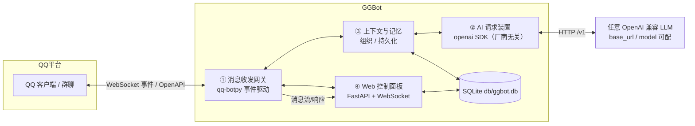
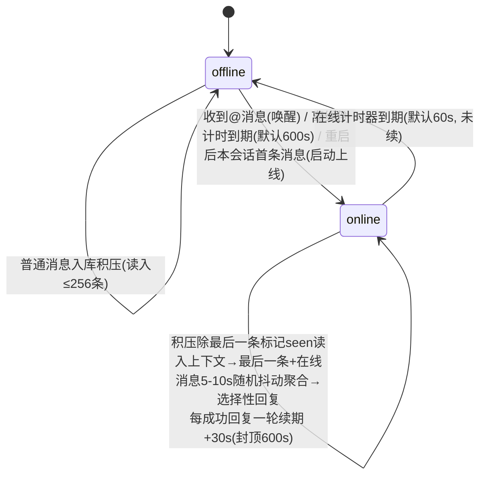

# GGBot — QQ 群聊机器人

基于官方 QQ 开放平台 api-v2（qq-botpy 1.2.1）+ 任意 OpenAI 兼容的 LLM 服务（function calling）+ 可选的 OpenAI 兼容向量服务（不配置时记忆自动降级为关键词检索）的群聊机器人。项目不绑定具体厂商：换 `base_url` / `model` / `api_key` 即可切换。

**六大模块：**
1. **消息收发网关**（`ggbot/qq/bot.py`）— 群@/单聊事件接收、归一化、去重，富媒体附件落地 `temp/`
2. **AI 请求装置**（`ggbot/llm/llm.py`）— OpenAI 兼容 Chat Completions，function calling 原生工具（服务商与模型由配置决定）
3. **Tool 插件系统**（`tool/base.py` + `tool/<分类>/`）— 一切皆 Tool：按能力域分包的 toolset 自包含代码/配置/数据，启动时自动发现并动态挂载进上下文
4. **上下文组织 / 持久化记忆**（`ggbot/core/storage.py` + `ggbot/llm/memory.py` + `ggbot/core/presence.py`）
5. **权限系统**（`ggbot/core/auth.py` + `tool/base.py` + `tool/admin/`）— 发送者等级 0–5、Tool 调用门槛 1–6，按等级裁剪 schema + 执行期二次校验；归属者可在对话里用 `manage_permission` 按昵称/8 位 id 授权
6. **Web 控制面板**（`ggbot/web/server.py`）— FastAPI，分组导航（概览 / 对话 / 知识 / 权限 / 系统）：仪表盘（运行状态、本次启动统计与运行环境）、会话与上下文、消息流、向量记忆、成员等级与工具门槛、工具开关、设置、运行日志

## 目录结构

```
GGBot/
├── db/
│   ├── config.example.json  # 部署模板（入库；复制为 config.json 后填写）
│   ├── config.json      # 全局配置（QQ 凭据 / LLM / Embedding / 行为 / 存储 / Web；含密钥，gitignored）
│   └── ggbot.db         # SQLite 持久化：会话/消息/记忆（运行时生成，gitignored）
├── tool/                # Tool 自包含目录：每个 toolset = 代码 + config.json + 持久化数据（整目录可复制迁移）
│   ├── chat/            #   send_text / send_sticker / sticker_list / sticker_save / send_image / send_video / send_voice_clone / silence
│   │   ├── emoji/       #     表情配置 + index.json（素材+描述）+ vectors.json（向量缓存，gitignored）+ stickers/ + user/
│   │   └── audio/       #     语音克隆配置（MiMo key）+ voice_ref.wav（参考音频）
│   ├── knowledge/       #   memory_search / memory_write / clear_context / web_search / web_fetch / time
│   │   └── web/         #     搜索配置（搜索服务 / 抓取上限）
│   ├── fs/              #   fs_read / fs_write + config.example.json（沙箱根目录 / 拒绝清单 / 读写上限）
│   ├── mail/            #   email.py + config.example.json（SMTP 账号 / 收件人白名单）
│   └── admin/           #   manage_permission（L5：按昵称 / 8 位 id 授予或收回等级）
├── temp/                # 富媒体附件临时落地 + 日志 + Tool 运行产物（temp/tool/<name>/；默认 24h 清理，gitignored）
├── requirements.txt
├── main.py              # 入口
├── start.bat            # Windows 前台启动（Ctrl+C 停止）
├── start.sh             # Linux 后台启动（nohup，kill <PID> 停止）
├── start_mac.command    # macOS 前台启动（双击或 bash 运行，Ctrl+C 停止）
├── ggbot/
│   ├── cli.py            # 运维 CLI（python -m ggbot.cli stats|sessions|context|memory|clear）
│   ├── core/             # 核心业务
│   │   ├── config.py     #   配置加载（纯配置文件驱动 + Web 热更新）
│   │   ├── auth.py       #   发送者等级解析 / owners 引导 / 成员列表
│   │   ├── storage.py    #   SQLite（会话/消息/记忆/发送者等级）
│   │   ├── runtime_stats.py  # 本次启动内存统计（会话/收发/工具/LLM/token/费用，不落库）
│   │   └── presence.py   #   在线/离线状态机（会话级唤醒/积压只读/抖动/分段发送）
│   ├── llm/
│   │   ├── llm.py        #   OpenAI 兼容请求装置（厂商无关）
│   │   ├── vision.py     #   识图（图片→文字描述，缺省沿用 llm 端点）
│   │   └── memory.py     #   记忆（可选向量检索 + 关键词降级 + 去重/整理）
│   ├── qq/
│   │   └── bot.py        #   QQ 网关（botpy 连接 / 事件解析 / 富媒体落地）
│   ├── util/
│   │   ├── logging_setup.py  # 日志系统（四列格式 / 文件轮转 / 面板 tail）
│   │   ├── human.py          # 拟人化时序（上下线/续期时长抖动）
│   │   ├── media.py          #   本地媒体 HMAC 签名 URL（/media/<exp>/<sig>/<rel>）
│   │   └── session.py        # 会话显示标签（场景 + 8 位 openid）
│   └── web/              # 控制面板
│       ├── server.py     #   FastAPI API + WebSocket + 静态托管 + 签名媒体路由（不内嵌前端）
│       └── static/       #   前端（经 /static 托管，改完即热加载）
│           ├── index.html
│           ├── style.css
│           └── app.js
```

## 系统架构



数据流：QQ 事件 → 网关归一化 → 上下文装置组织会话 → AI 装置请求 LLM → 回复回传网关 → QQ；全链路事件同步推送到 Web 面板。

**核心循环**：`Tool 插件（按配置和发送者等级动态挂载）+ 上下文（最近 1024 条 / 128k tokens；窗口满时旧消息自动归档进记忆，超限摘要压缩）+ 相关记忆 → Tool 行动`。Tool 层通过 LLM 的 function calling 实现，插件在项目根 `tool/<分类>/` 下自动发现；**回合语义：一切皆工具——send_text 发送消息，silence 表示本轮主动不接话（调用后立即收轮，不再追加请求）；模型直接回的文本一律按 send_text 发出，不管本轮有没有调用过工具（工具往返之后的补充文本同样是要说的话）**；**鉴权：身份只取自消息发送者（openid），每条消息解析出等级后只下发该等级能用的 Tool schema，执行器再按真实发送者校验一次——模型参数不参与鉴权**；认知状态只有记忆：AI 通过 `memory_write` 沉淀、`memory_search` 回忆，窗口溢出的旧对话也会由 LLM 自动提炼进记忆；system prompt 注入「感觉」型人设、各 Tool 自己挂载的提示与当前话题相关的 top-3 记忆（不写死具体身份/经历，避免上下文膨胀）。

## 快速部署

### 1. 准备

- Python 3.11+
- QQ 开放平台机器人：拿到 `AppID` / `AppSecret`，并订阅群@、单聊等事件（见文末「QQ 平台侧配置要求」）

### 2. 安装依赖

```powershell
python -m venv .venv
.\.venv\Scripts\python.exe -m pip install -r requirements.txt
```

Linux 用 `python3 -m venv .venv && .venv/bin/pip install -r requirements.txt`。

### 3. 全局配置

首次启动时若 `db/config.json` 不存在，会自动从 `db/config.example.json` 生成并提示填写；也可以手动复制：

```powershell
Copy-Item db\config.example.json db\config.json
```

| 配置 | 必填 | 说明 |
| --- | --- | --- |
| `appid` / `appsecret` | 是 | QQ 机器人凭据 |
| `llm.base_url` / `llm.api_key` / `llm.model` | 是 | 任意 OpenAI 兼容服务；模型需支持 function calling |
| `embedding.base_url` / `api_key` / `model` | 否 | 任意 OpenAI 兼容 `/embeddings`；缺任一项或 `enabled=false` 时记忆自动改用关键词检索，不影响启动 |
| `vision.base_url` / `api_key` / `model` | 否 | 任意支持图片输入的 OpenAI 兼容多模态模型；留空沿用 `llm` 三项（同厂商直接可用），`enabled=false` 时图片只保留 `[图片]` 占位 |
| `web.token` | 建议 | 面板登录令牌；公网部署请改成强随机字符串 |
| `permissions.default_level` / `owners` | 否 | 未登记发送者的默认等级（默认 2）；`owners` 里的 openid 首次启动补成 5 级 |
| `storage.public_base_url` | 否 | 仅超过 10MB 的本地媒体回退签名链接时需要 |

LLM 与 embedding 都不绑定厂商：DeepSeek、OpenAI、通义、SiliconFlow、自建网关等只要兼容 OpenAI 接口，改这三项即可。`llm.request.thinking` 是 DeepSeek 扩展，不支持的厂商留空（不发该字段）。

识图默认复用 `llm` 的连接与模型；如果聊天模型本身不支持图片输入，在 `vision.model` 里单独填多模态模型（DeepSeek 用 `deepseek-flash`）。收到图片时先由该模型生成一句描述，原文替换为 `[图片]（描述）` 入库再交给聊天模型，因此历史里能像普通文本一样检索；识图 tokens 与费用单独计入日志和启动统计，单价沿用 `llm.pricing`。`vision.*`（除 `base_url` / `api_key`）与 `llm.pricing.*`（除 `peak_hours`）都可在面板「设置」页改：单价即时生效，识图参数在下次启动时被读取（识图客户端在启动时按当时的配置建连）。

### 4. Tool 配置与素材

- 各工具的 `tool/<分类>/config.json` 在首次运行时按代码里的 `default_config` 自动生成，新增字段自动补齐；模板见同目录 `config.example.json`。
- 含密钥的工具配置（MiMo key、SMTP 授权码、Tavily key）不入库；邮件收件人白名单、语音克隆、表情限流、搜索服务、文件沙箱等可在 Web「工具」页或直接改配置文件。
- **调用门槛**：每个工具的默认门槛写在代码里（`min_level`），可在 `tool/<分类>/config.json → levels` 单独覆盖（1–6，6 = 永久锁）；发送者等级在 Web「权限」页设置。详见「权限与工具门槛」。
- 可选素材不入库，缺失时对应工具自动视为未启用：表情素材放 `tool/chat/emoji/stickers/`（默认空库；手动放进去的图只有文件名兜底描述，挑图质量差，建议用 `sticker_save` 让识图补写一句话描述）、用户投喂存在 `tool/chat/emoji/user/`、语音参考音频放 `tool/chat/audio/voice_ref.wav`。

### 5. 启动

```powershell
start.bat                    # Windows 前台（Ctrl+C 停止）
# 或直接运行（日志等级取配置 web.log_level）：
.\.venv\Scripts\python.exe main.py
# Linux 后台：
./start.sh
# macOS 前台（双击即可，或）：
bash start_mac.command
```

三个脚本行为一致：缺 `.venv` 就建（macOS/Linux 还在基础解释器被升级掉、venv 软链接失效时重建），都用 `import botpy, openai, fastapi, uvicorn, numpy, pysilk` 探测依赖，缺了才 `pip install -r requirements.txt`，都带 `--log-level DEBUG`。加依赖时这行探测要同步补模块名，否则环境缺包也会被判定"依赖齐全"，直到跑到对应工具才报错（`requirements.txt` 顶部有同样的提醒）。只有 `start.sh` 是后台：`nohup` 起进程、PID 打屏、`kill <PID>` 停止，控制台输出**每次启动覆盖**写入 `temp/logs/stdout.log`（只当启动失败的兜底，留档的一直是 `ggbot.log`）。脚本在版本库里带可执行位与 LF 换行（`core.autocrlf=true` 的机器上检出也不会把 shell 脚本变成 CRLF）。

启动后：QQ gateway 连接成功 → 群@消息触发 → Presence 状态机（离线积压 / @唤醒 / 在线抖动聚合 / 选择性回复）。Web 面板：`http://127.0.0.1:11028`（首次访问输入 `db/config.json → web.token`；登录后写入 HttpOnly + SameSite=Strict Cookie，令牌不落 localStorage/URL）。

## 日志与 Web 运维

- **日志文件**：只写 `temp/logs/ggbot.log`（RotatingFileHandler，5MB × 5 轮转；**每次启动以 `mode="w"` 清空重写**，不保留上次进程的日志；目录随 `storage.temp_dir` 自动创建；stderr 同时输出）。项目根目录不再产生 `botpy.log` / `logs/`——botpy 的文件 handler 已关闭（`bot_log=None, ext_handlers=False`）。格式 `时间 | 等级 | 会话 | 内容`——会话列统一为 `群聊xxxxxxxx` / `私聊xxxxxxxx` / `系统00000000`（8 位 openid），控制台、文件、Web 面板三处一致；DEBUG 只输出业务状态（入站 / 上下文 / LLM 请求 / 识图 / 工具 / 上下线），**同一信息只打一行**——正文、工具参数、图片描述各只在一条里出现，发送成功不再打确认行；第三方库（botpy / openai / httpx / httpcore2 / uvicorn 等）固定 WARNING，不打印连接与报文细节
- **一轮对话的日志形状**（前缀固定，扫一眼就能对齐）：
  - 启动八条就绪信息——`日志就绪`（相对路径 + 等级）/ `存储就绪`（相对路径）/ `记忆就绪`（模型 + 地址；未配置 embedding 时为 `关键词模式`）/ `LLM 就绪`（模型 + 地址）/ `识图就绪`（模型 + 地址；配置不全时为 `识图未启用`）/ `工具就绪`（数量 + 各分类计数）/ `Web 就绪`（地址）/ `Bot 就绪`（gateway）
  - 入站一条：`收到 [小明/54019C24] @=1: 哈哈 [图片 6ce72460]`（`@` 是这条有没有 @ 到本机器人，只用 `1` / `0`；无昵称时只剩 8 位 id；引用为 `[引用 被引内容] 正文`；富媒体标记用 8 位短标识，与 temp 落地文件 `1760000000000_6ce72460.png`（毫秒 + 同一段短标识）互相对上；同一条消息被 @事件与全量事件重复推送时只记一条；走被动还是主动由发送侧按事件来源决定，这里不重复）
  - 落地一条：`富媒体落地 image/1760000000000_6ce72460.png 168.7 KB`（语音带平台转写时另记一条 `语音已转写 8ebd2219: 帮我加两个表情`，正文同步替换为 `[语音]（…）`；平台没给转写才在落地行追加「平台未给转写，正文只保留标记」，此时不打转写行）
  - 识图两条、各司其职：`识图 deepseek-flash 请求 1402 | 输出 26 | 命中 - | 费用 ¥0.0032`（只有数字）+ `图片已识别 6ce72460: 一只橘猫趴在窗台上…`（描述全文只在这一行出现，超长显式补省略号）
  - 上下文一条：`上下文预算: 历史 40 / 128 条 · 估算 5951 / 131072 tokens`（「历史」是本轮注入的历史消息条数，「估算」是 system+历史+本轮的 tokens）
  - LLM 两条：`LLM 请求 5951 tokens (工具 329 | 历史 456 | 新增 215)` / `LLM 响应 11 tokens (命中 5504/5951 (92%) | 费用 ¥0.0045)`。请求总数取服务商返回的 `usage.prompt_tokens`，响应数是 `completion_tokens`；请求行括号里的工具/历史/新增三段来自本地估算，按比例缩放到服务商总数（三段之和 = 总数），便于看本轮新增占比；不再标第几次调用；服务商没返回 usage 时总数与三段一起加 `≈` 明确是估算；同一回合出现两条是工具往返的追加请求；命中率与费用按 `llm.pricing` 估算，未配单价显示 `-`
  - 工具一条（唯一形态）：`工具 send_text（admin=小明/54019C24(L2), content=在忙 稍后找你）`——调用者（`admin=`）、等级与全部参数只出现在这一行（单值 120 字、整行 200 字截断；密钥都不是工具参数，不会进日志）。L3 及以上特权工具升 INFO，普通工具留在 DEBUG。异常各一条：`工具 fs_write 拒绝: 需要 L4，当前 小明/54019C24(L2)` / `工具 xxx 不存在（模型编造的工具名）` / `工具 fs_read 未成功: <错误>`
  - 发送成功不再单独打确认行：正文已在工具调用行记过一次，重复一行只是噪音。只有出问题才留痕——占位符拦截只报标记：`正文夹带占位符已剔除: [表情]（余文照常发送）` / `正文只有占位符，已拦截不发送: [表情]`；被动回复过期降级主动发送记一条 `被动回复失败，降级主动发送: …`；群聊 @ 成员若被平台拒收 markdown 会有一条 `群 markdown @ 消息被拒，退回普通文本: …`；富媒体仍是 `发送语音: …` 一条
  - 作息与归档：`在线窗口聚合 3 条，开始决策` / `离线积压 12 / 256 条（@可立刻唤醒）` / `离线积压已读 12 条转 seen（只读不回）` / `启动上线 预计在线 53s, 积压消息 0 / 256 条` / `自然上线 预计在线 53s, 积压消息 0 / 256 条` / `下线 预计离线 438s（本周期收 4 条）`——**一个在线周期没收到任何消息时上下线都降到 DEBUG**（空转不占行），有过消息才留 INFO；`历史归档 256 条消息 → 记忆 2 条`
  - 会话列跟到调用方：LLM 请求/响应、识图、工具、发送、决策与作息都显式带 `session=`，所以同一轮的所有行都落在 `群聊8825F8A7` / `私聊54019C24` 上；只有纯进程事件（入群、消息审核、Temp 清理）留在 `系统00000000`
- **等级控制**：`db/config.json → web.log_level`（默认 INFO）；面板保存设置即时热切换。`start.bat` / `start.sh` / `start_mac.command` 默认带 `--log-level DEBUG`，直接 `python main.py` 则用配置值；项目不使用环境变量（Web 面板开关：`web.enable`）
- **Web 面板**：深色玻璃拟态 + 响应式。桌面端侧栏可折叠为图标栏（78px，状态记忆在 localStorage；≤900px 改为抽屉），侧栏底部显示当前对话模型；仪表盘为 bento 布局——主卡显示运行状态 / 在线会话 / 待处理，右侧 5 个指标两列排布，下方「本次启动」分「调用」（活跃会话、收发消息、工具 / LLM / 识图）与「开销」（合计 / 输入 / 输出 tokens、缓存命中率、按 `llm.pricing` 估算的费用）两组，进程内累计、重启归零，并排新增「运行环境」卡（对话与识图模型 + 服务商域名、记忆检索模式（向量 / 关键词）与向量模型、日志等级与日志路径、db / temp 相对路径；只读摘要，不含密钥）；会话状态表把上线事件折进状态格、新增「待处理」列；会话与上下文改为左右分栏（左列表支持筛选与待处理角标、滚动位置保持，右侧详情含摘要、消息 / 待处理 / 摘要字数 / 最近发言 / 当前作息与消息气泡，可单独清空）；消息流为时间线卡片（角色色点 / 会话标签 / 状态徽标）；日志改为等宽控制台（时间去色、等级 / 会话 / 内容四列，警告与错误行带底色，自动跟随最新日志；手机端时间/等级/会话一行、内容另起一行）；向量记忆（语义检索 / 写入 / 编辑 / 整理）、**权限（最近发言者与已登记成员的等级下拉、全部 Tool 的调用门槛下拉，含永久锁与「默认 L n」调整标记）**、工具（17 个 Tool 按分类启停，门槛徽标显示等级名（如 `L4 心腹`）并标记与代码默认不一致的门槛）、设置分组（LLM 请求 / 识图 / 费用单价 / 在线作息 / 回复节奏 / 上下文与积压 / 日志，38 个路径白名单热更新并写回 config.json；`api_key` / `base_url` / `web.token` 等凭据路径不在白名单）；状态、统计、会话与当前页数据每秒刷新
- **运维 CLI**：`python -m ggbot.cli stats|sessions|context|clear|reset-chat|memory ...`，可直接查看统计、导出会话上下文、清空单个会话、检索/增改/整理记忆（`--yes` 跳过确认）
- **API**：登录 `POST /api/login`（HttpOnly Cookie，失败限流 8 次/60s）、`GET /api/auth`、`POST /api/logout`；业务 `GET /api/stats|sessions|messages|memories|tools|config|logs`，`POST /api/config`（`[{"path": "a.b.c", "value": x}]` 批量，白名单 + 类型校验，越权拒绝）、`POST /api/tools/{name}/toggle`（共享配置的 Tool 返回 400）、`GET /api/actors` + `POST /api/actors`（成员等级 0–5）、`POST /api/tools/{name}/level`（门槛 1–6）；`GET /api/config|tools` 密钥脱敏；`GET /api/stats` 一并返回 `runtime`（进程内累计统计）与 `env`（模型 / 检索模式 / 日志等级 / db 与 temp 相对路径摘要，不含任何密钥）；`GET /media/{exp}/{sig}/{rel}` 为 QQ 提供签名媒体，不参与 Cookie 鉴权
- **安全**：Cookie 鉴权（常量时间比较）、按 IP 的 API 限流（240 次/10s，超限 429 + Retry-After）、登录失败 8 次/60s 后 429、`/ws` 同源 + Cookie 校验、跨站写请求拦截、CSP / X-Frame-Options DENY / nosniff / no-store，FastAPI 文档端点关闭；公网部署建议再加 HTTPS 反向代理、设 `web.cookie_secure=true`，反代后置 `web.trust_proxy=true` 以按 `X-Forwarded-For` 首地址限流

## 关键行为（config.json `behavior`）

| 机制 | 配置 | 说明 |
|---|---|---|
| 在线/离线作息 | `presence.online_duration_sec`（默认 60）/ `offline_interval_sec`（默认 600） | 每会话独立：定时上线、在线一段时间后下线 |
| 启动即在线 | `presence.start_online`（默认 true） | 进程重启后该会话的第一条消息直接上线接话，不再先压满一个离线周期（默认离线要等 4–10 分钟，重启后看起来像没反应）；配 false 恢复旧的离线积压语义 |
| @唤醒 | `presence.wake_on_at_message` | 离线被@（本会话）→ 先读入离线积压（不含本条），本会话上线并立即回复该条 |
| 回复续期 | `presence.renew_on_reply` + `renew_per_reply_sec`（默认 30）/ `renew_max_sec`（默认 600） | 每成功回复一轮固定续期 30s（带抖动），单次封顶 600s；不随连聊轮数递增 |
| 上线带积压 | `backlog.max_scan_messages`（默认 256） | 定时上线把离线 pending（最多 256 条）标记为 `seen` 读入上下文，**只回最后一条**（其余不单独触发 LLM）；超出上限的旧消息同样置 seen（不读入），不会永远挂在 pending |
| 在线批次 | `backlog.online_max_messages`（默认 16） | 在线抖动窗口最多保留 16 条，超出时最旧的转 `seen`，避免一次处理过大批次 |
| 抖动聚合 | `reply.debounce_sec`（默认 5）/ `debounce_max_sec`（默认 10） | 在线消息进入 5–10s 随机抖动窗口聚合（每条新消息重新计时），LLM 选择性回复（非每条必回） |
| 分段发送 | `reply.segment_gap_sec` | send_text 遇到换行自动拆成多条，按间隔逐条发送（msg_seq 递增） |
| 作息抖动 | `presence.online_duration_jitter` / `offline_interval_jitter` / `renew_jitter` | 上下线时长、续期时长按 ±比例随机，避免机械整点；每会话首次上线时间也随机错开 |

> **会话隔离**：每个会话（每个群 / 每段私聊）是独立状态机——私聊被@只唤醒私聊会话，不会让群聊上线；A 群唤醒不影响 B 群；群聊积压只在本群上线时读入，不会跨群回复。离线倒计时/在线时长/抖动窗口均按会话独立计时。

**状态机（每会话）**



**消息处理路径**：收到消息 → （有图片则先识图，替换为 `[图片]（描述）`）→ 归属会话 → 该会话离线？→ 入库标记 pending（不调 LLM）；若本会话是进程重启后的第一条且 `start_online`（默认开）→ 直接上线，本条按在线流程聚合回复；若被@且 `wake_on_at_message` → 先把旧积压标记 `seen` 读入上下文，再**立即被动回复本条** → 本会话上线。定时上线：把本会话积压（读入上限 256）除**最后一条**外标记 `seen` 读入上下文，最后一条投进在线抖动窗口当本轮话头回复（`seen` 历史会参与生成，所以 AI 知道离线期间聊了什么，回复时能接上语境；上线瞬间又来新消息会和它并成同一批次，不会对同一件事回两遍）。在线：5–10s 随机抖动窗口聚合（最多 16 条）→ 走 LLM 决策是否接话（@/私聊用被动回复，普通群消息用主动消息）→ 每成功回复一轮固定续期 30s（封顶 600s）。

> **上下文满了会怎样**：历史只取最近 1024 条（更早的消息仍在库里，只是不进入本次请求）。窗口满后，每轮在后台把游标之后最旧的 256 条交给 LLM 提炼成长期记忆（`memories`，逐条写入、自动去重），归档游标存于 `sessions.archived_upto`，不阻塞回复；当估算请求超过 128k tokens 时，还会从最旧的历史开始移出，交给 LLM 压缩进 `sessions.summary`（≤600 字），摘要随会话持久化并在之后每轮注入；`【本轮消息】` 始终完整保留，不会被截断。极端情况下会把历史全部压进摘要，只留下 system + 摘要 + 当前批次。

> **平台发送通道**：只有 `GROUP_AT_MESSAGE_CREATE`（群@本机器人）与 `C2C_MSG_RECEIVE`（私聊）事件能用 `msg_id+event_id` 被动回复（5 分钟内至多 5 次，不占主动额度）；`GROUP_MESSAGE_CREATE`（群全量）事件只能主动发送（2026-06-22 起全量开放，群主需开启「机器人主动在群聊内发言」，20 条/分钟、1000 条/天）。代码按事件来源持久化 `passive_ok` 标记并据此选通道，另加 `proactive_per_minute`（默认 6）/`proactive_per_day`（默认 1000）本地闸门。

## 消息全形式矩阵

| 消息形式 | 接收依据 | 处理策略 |
|---|---|---|
| 文本 | `content` | 直接进入上下文 |
| 图片 | attachments content_type=image/* | 下载存 temp/ → 识图模型生成描述 → 上下文与库中记为 `[图片]（描述）`（附件记录同时保留 `url`/`local` 供转发）；识别失败时只留 `[图片]` 占位 |
| 语音 | content_type=voice | 下载存 temp/ → **直接用平台在附件里带回的转写文本 `asr_refer_text`**，正文替换为 `[语音]（转写内容）`（botpy 的附件模型会丢掉这个字段，`_Rich*Message` 额外保留原始 dict）；平台没给转写时只留 `[语音 xxxx]` 标记，模型不能“听”，可原样转发 |
| 视频 | content_type=video/* | **不下载不处理**（`storage.download_video=false`），仅保留 URL/元信息供引用转发 |
| 文件 | content_type=file | 元信息描述，可选存 temp/ |
| 艾特 | content 去@前缀 + mentions[] | 作为对话触发信号（离线可唤醒）；正文里的其他 `<@id>` 还原为 `@昵称`（无昵称时 `@8位id`），自己那条 @ 直接剔除 |
| 引用 | msg_elements type=103 | 被引消息原文以 `[引用 被引内容] 正文` 形式进入日志、上下文与库 |
| 卡片 | ark_data | 解析 title/desc/jump_url 为文本 |
| 聊天记录 | msg_elements type=102 | 文本化并入上下文 |

> **发送侧 @ 与引用**：`send_text` 正文里的 `@昵称`（上下文里出现过的叫法）在群聊中会替换为官方 `<qqbot-at-user id="member_openid" />`。**该标记只在 markdown 消息里被解析**，所以含 @ 的群消息走 `msg_type=2 + markdown.content`；平台拒收 markdown 时自动退回普通文本（用剔除标记后的可读原文，绝不把标签原文发给用户），因此 @ 是否生效看有没有 `群 markdown @ 消息被拒 …` 这条警告——发送成功本身不再打日志行。查不到的昵称原样保留文本，不生成标记。**入库与日志始终用可读原文（`@昵称 …`），不含标记**。正文以 `[引用 关键词]` 开头时，按关键词找到本会话最近一条含该内容的消息并带上 `message_reference`（前面先写 `@昵称` 也可以），只写 `[引用]` 则引用当前这条；私聊同样支持引用，但平台没有 @ 成员的表，不会解析 @。找不到关键词时退回引用当前消息。

> 已注册**群全量消息**事件（私域 `GROUP_MESSAGE_CREATE`，botpy 1.2.1 未内置，运行时注入 parser）：普通消息（非@）进入 Presence 积压/抖动路径，与@消息共用去重与统一路由。机器人需在开放平台/群内开启"接收群内全部消息"权限。

> **群@识别（三层）**：① 首选 `GROUP_AT_MESSAGE_CREATE` 事件（开放平台需订阅该事件，事件送达时自动学习机器人 openid 写入 config）；② 全量消息 content 内嵌 `<@openid>`——`bot_openid` 为空时自动学习第一条 `<@>` 的 id 写入 config，之后精确匹配（当前生效）；③ `mentions` 精确匹配 `bot_openid`。

> **发送者标识**：不调用任何名称接口（群成员/用户信息需 11253 白名单，且网络失败会拖慢消息处理）。QQ 消息事件若携带 `author.username` 则显示昵称（日志 `昵称/8位id`，面板“发送者”列同名 + id），缺失时退回 8 位 openid；会话列仍统一显示 `场景 + openid 前 8 位`（如 `群聊8825F8A7`、`私聊A1B2C3D4`、`系统00000000`）。botpy 1.2.1 会丢弃 `author.username` / `msg_elements`，已通过 `_Rich*Message` 子类 + 运行时注入 parser 保留原始字段。

> `temp/` 目录默认只保留 24h（`storage.temp_ttl_hours=24`）：启动时清理一次 + 每小时巡检，超过时限的文件自动删除。

## 配置（db/config.json 全字段）

```json
{
  "appid": "...", "appsecret": "...",
  "bot_openid": "",                    // 机器人 openid，自动学习（群消息 <@id> / @事件 mentions），也可手动填
  "llm": {
    "base_url": "https://你的服务商/v1", "api_key": "...", "model": "模型名",
    "request": { "thinking": "", "temperature": 1.0, "top_p": 1.0,
                 "max_tokens": 2048, "stop": [] },
    "pricing": { "currency": "¥", "input_per_mtok": 2,
                 "cached_input_per_mtok": 0.04, "output_per_mtok": 8,
                 "peak_hours": ["09:00-12:00", "14:00-18:00"],
                 "peak_weekdays_only": true, "off_peak_multiplier": 0.5 },
    "context": { "max_history_messages": 1024, "summary_threshold_tokens": 128000,
                 "archive_batch_messages": 256, "archive_enabled": true }
  },
  "embedding": { "enabled": true, "provider": "", "base_url": "https://你的服务商/v1",
                 "model": "embedding 模型名", "api_key": "...", "batch_size": 32 },
  "vision": { "enabled": true, "base_url": "", "api_key": "", "model": "",
              "prompt": "简单描述一下图片内容：主体、场景和画面里的关键文字，一两句话，不要客套。",
              "max_chars": 240, "max_tokens": 200, "timeout_sec": 30 },
  "behavior": {
    "presence": { "start_online": true,
                  "online_duration_sec": 300, "offline_interval_sec": 900,
                  "online_duration_jitter": 0.3, "offline_interval_jitter": 0.4,
                  "renew_jitter": 0.3, "wake_on_at_message": true, "wake_on_c2c": false,
                  "renew_on_reply": true, "renew_per_reply_sec": 30,
                  "renew_max_sec": 600,
                  "proactive_enabled": true, "proactive_per_minute": 6,
                  "proactive_per_day": 1000 },
    "backlog": { "max_scan_messages": 256, "online_max_messages": 16 },
    "reply": { "segment_gap_sec": 2, "debounce_sec": 5, "debounce_max_sec": 10 }
  },
  "permissions": { "default_level": 2, "owners": [] },
  "storage": { "temp_dir": "temp", "db_path": "db/ggbot.db", "public_base_url": "",
               "temp_ttl_hours": 24, "download_video": false },
  "web": { "enable": true, "host": "127.0.0.1", "port": 11028, "token": "<面板令牌>",
           "cookie_secure": false, "trust_proxy": false, "log_level": "INFO" }
}
```

请求参数按所用服务商的支持情况填写：`temperature` / `top_p` / `max_tokens` / `stop` 原样透传；`thinking` 是 DeepSeek 扩展（`enabled` / `disabled`，经 `extra_body` 发送），不支持的厂商留空即可。`reasoning_effort`、`top_k`、`presence_penalty`、`frequency_penalty` 当前不透传；请求固定非流式。`base_url` 是否带 `/v1` 取决于服务商。

`pricing` 是**每百万 tokens 的单价**（按服务商计费页填写，留 0 表示不估算）：`input_per_mtok`（未命中缓存的输入）、`cached_input_per_mtok`（缓存命中输入，缺省等于 input）、`output_per_mtok`（输出），`currency` 只影响日志里的符号。模板默认按 DeepSeek `deepseek-flash` 高峰价（输入 ¥2 / 缓存 ¥0.04 / 输出 ¥8）；`peak_hours` 是高峰时段（工作日、本地时间），时段外按 `off_peak_multiplier`（默认 0.5）折算，不需要分时计价就删掉这两个字段。DEBUG 日志按服务商返回的 `usage` 记录实际 token 与缓存命中；`prompt_tokens` 缺失时才退回本地估算。未配置单价时费用显示 `-`。识图请求同样按这套单价与分时规则计费，日志单独标注「识图」。

`embedding` 的 `api_key` / `base_url` / `model` 任一为空，或 `enabled=false` 时，不启用向量检索：`memory_write` 照常入库，`memory_search` 退化为字符/二元组关键词匹配，不再请求外部服务。旧版配置里的 `deepseek` 段会在启动时自动改写为 `llm`。

`vision` 的 `base_url` / `api_key` / `model` 留空即沿用 `llm`；`prompt` 是识图指令，`max_chars` 截断描述长度，`max_tokens` 限制识别输出，`timeout_sec` 为单次请求超时。`thinking` 留空时只在**与 `llm` 同一个 base_url** 时沿用 `llm.request.thinking`（DeepSeek 的 flash 是推理模型，不禁用思考会把 max_tokens 吃满、正文返空），换成别家识图服务商则默认不发该扩展字段。识图失败（网络、额度、非图片）只记录警告并保留 `[图片]` 占位，不影响消息继续处理。

`storage.public_base_url` 是**签名媒体的公网入口**——填 Web 面板对外地址（如 `https://bot.example.com`）。本地图片/表情/语音默认走 QQ 的 base64 `file_data` 直传（不需要公网地址）；只有超过 10MB 的本地文件才退回签名链接，此时未配置 `public_base_url` 会明确报错。Tool 私有配置不在 `db/config.json` 里，见下一节。

## Tool 管理（一切皆 Tool）

### 分类与发现

`tool/base.py` 是插件基座；每个 **toolset 自包含**在项目根的 `tool/<分类>/` 下——代码、`config.json`、持久化数据（索引 / 素材 / 参考音频）同目录，整个文件夹可原样复制到另一台机器。启动时由 `ToolRegistry` 自动发现 `tool/` 的子包——每个模块暴露 `get_tools(rt)`，返回若干 `Tool` 实例，注册表按所在子包自动打上 `category`。新增能力 = 在某个分类下新增一个模块，无需改动注册表或提示词模板；新增分类 = 新建一个含插件模块的子包。

提示词的「一切皆工具」部分会明确要求：说话用 `send_text`，情绪配表情、亲密场景可发语音、值得记住的事主动 `memory_write`；不想接话就显式调 `silence`（什么都不发、本轮直接结束），比硬凑一句好——反过来，模型无视协议直接回的文本一律会被当成一说话发出去，不再看本轮是否调用过工具。各 Tool 的 `description` 与 `prompt_hint` 决定它会不会被调用，迁移旧工具时应按当前项目重写触发场景，而不是只保留功能描述。

| 分类 | Tool | 作用 | 配置/数据（`tool/<分类>/`） |
|---|---|---|---|
| chat | `send_text` | 发送一条聊天消息（回应、主动开场、分段接话都用它；一条一句，换行会自动拆成多条；群聊正文里的 `@昵称` 会转成真 @，正文以 `[引用 关键词]` 开头会引用对应消息） | 无（首次停用才生成 config） |
| chat | `send_sticker` | 用一句话说明想表达什么（`query`），向量在素材库里找最贴的一张发出去；低于 `min_score` 就没有贴合的，改用说话 | `emoji/config.json`、`emoji/index.json`、`emoji/vectors.json`、`emoji/stickers/`、`emoji/user/` |
| chat | `sticker_list` / `sticker_save` | 按同一套检索查看可用素材 / 收藏用户投喂的图（收藏时由识图自动写描述） | 与 `send_sticker` 同组（不单独启停） |
| chat | `send_image` / `send_video` | 发送图片 / 视频（URL 或本地文件，本地走 base64 直传） | 无 |
| chat | `send_voice_clone` | MiMo 声音克隆 TTS（参考音频克隆音色，L2） | `audio/config.json`、`audio/voice_ref.wav` |
| chat | `silence` | 本轮主动不接话：不发任何东西并立即结束回合（可选 `reason` 只进日志），给模型一个"沉默"的正当动作 | 无 |
| knowledge | `memory_search` / `memory_write` | 向量记忆检索 / 沉淀 | 无 |
| knowledge | `web_search` / `web_fetch` | 联网搜索（Bing RSS / SearXNG / Tavily；`read=true` 顺带抓回前 3 条正文、结果带 `published` 发布日期）/ 抓取网页正文（`urls` 可批量并发，最多 5 个） | `web/config.json`（搜索服务、超时、抓取上限、`read_max_chars`） |
| knowledge | `time` | 当前日期 / 时间 / 星期 / 时区 | 无 |
| knowledge | `clear_context` | 清空**本会话**上下文：删除全部消息并重置历史摘要，长期记忆不动（L4 心腹） | 无 |
| fs | `fs_read` | 文件系统只读：`list` / `stat` / `read` / `find` / `grep`（L3） | `config.json`（沙箱根目录、拒绝清单、读写上限） |
| fs | `fs_write` | 文件系统写入：`write` / `append` / `replace` / `mkdir` / `copy` / `move`（L4，无删除） | 同上（与 `fs_read` 同组） |
| mail | `send_email` | SMTP 发邮件（文本/HTML + 附件，L3） | `config.json` |
| admin | `manage_permission` | 权限管理（L5）：`grant` / `revoke` / `list` / `help`，支持昵称 / 8 位 id / openid | 无（首次停用才生成 config） |

### 一个 Tool 由什么组成

- **schema**：`name` / `description` / `parameters`，直接进入 LLM function calling 的 tools 列表
- **执行器**：`run(args, ctx)`，通过 `ToolRuntime` 获得配置、数据目录与发送能力
- **自我描述**：`prompt_hint` 自动汇总进 system prompt 的 `【工具提示】`，只在启用时出现
- **启停与归属**：`enabled_by_default` / `toggleable` / `config_owner` / `data_name`（目录名，如 `send_email → mail`）
- **调用门槛**：`min_level`（1–6，默认 1；6 = 永久锁），可在 `tool/<分类>/config.json → levels` 覆盖，见「权限与工具门槛」

### 配置与数据

- 每个 Tool 的配置在 `tool/<分类>/config.json`：读取时与默认值合并、保留未知字段、自动补齐新增默认项；`enabled=false` 即从 schema 与提示词中消失
- **无默认配置的工具**（`send_text` 等）在首次被停用时才落盘 `{"enabled": false}`，不产生空配置/空目录
- **共享配置组**：表情三件套同一份 `tool/chat/emoji/config.json`，`sticker_list`/`sticker_save` 标记 `config_owner=false, toggleable=false`，面板显示"同组"
- 持久化数据（索引、素材、参考音频）与代码同目录，在 `tool/<分类>/`（如 `chat/emoji`、`chat/audio`、`knowledge/web`）；运行产物（TTS/下载/生成）在 `temp/tool/<key>/`，随 temp TTL 清理
- **迁移**：复制 `tool/<分类>/` 整个目录即可带走该 toolset 的代码 + 配置 + 数据，无需同步数据库或其他目录
- **Web 开关**：面板「工具」页按分类排序列出全部 Tool、描述与脱敏配置，可即时启停（`POST /api/tools/{name}/toggle`，密钥字段返回 `***`）
- **动态挂载**：`ToolRegistry.schemas()` 只返回已启用的 Tool；agent 循环每回合按当前启用集合请求 LLM

### 表情包（chat/emoji）

挑图靠**向量检索**，没有情绪词表：把「笑死」归一成「开心」这类判断本来就该模型自己做，固定词表只会在模型没想到的说法上失灵。

- 索引 `tool/chat/emoji/index.json`（v3）：`{version, items:[{file, desc, source, added_at}]}`，只存人看的素材清单与一句话描述 `desc`（可手改）；目录里多出来的图会被自动补进索引，删掉的文件条目自动失效。旧 v2（`moods` 标签）首次读取时把标签折进 `desc`，落盘即升级为 v3
- 描述向量单独缓存在 `tool/chat/emoji/vectors.json`（`{file: {desc, vec}}`，gitignored）：2560 维向量放进 `index.json` 会让入库文件膨胀到几十 KB 且没法 review；缓存缺失或 `desc` 被手改过时，旧向量作废并按新描述重算，删掉这个文件不影响功能
- 检索：`query` 与每条 `desc` 都 embedding，按余弦相似度取最贴的一张；`min_score`（默认 0.50）之下视为库里没有贴合的表情，直接让模型说话——实测该厂商相似度分布很挤，完全不相干的说法也能拿到 0.47，阈值调松就会乱发表情。与最高分相差不到 `NEAR_TIE`(0.05) 的才算同一档，只在这一档里随机，并避开该会话最近 8 张
- `query_instruct`：Qwen3-Embedding 这类模型要求查询侧带任务说明、文档侧不带，代码按 `Instruct: …\nQuery: …` 组装查询。同一批 5 张素材实测：带 instruct 命中 4 个说法，不带只命中 3 个。只影响查询向量，素材 `desc` 仍是原文，换厂商改文案或留空即可
- 降级：未配置 embedding 或向量缺失时改用字面重合度（复用记忆检索的二元组算法，匹配 `desc` + 文件名），此时不受 `min_score` 约束
- 描述来源：`sticker_save` 收藏时由识图模型自动写一句；手动放进 `stickers/` 的只有文件名兜底（下划线/连字符当空格），**关键词能碰上、向量基本挑不准**，建议先让机器人收藏或补一句 `desc`
- 节制：`max_per_turn`（默认 1，按回合计数）/ `min_interval_sec`（默认 10s，按会话）双重限流；prompt 提示"对方说正事时不要用表情"；库为空时调用直接返回"表情库为空"并给出放素材的路径，模型据此改走说话
- 入库：`sticker_save` 只接受 `temp/` 下的图片，按内容摘要（sha1 前 12 位）去重后复制到 `tool/chat/emoji/user/`，原子更新索引与向量；`max_user_stickers` 默认 200；仅限用户明确同意收藏的图

### 语音（chat/audio）

- `tool/chat/audio/config.json`：`api_key` / `base_url` / `model`（默认 `mimo-v2.5-tts-voiceclone`）/ `reference_voice_path` / `timeout` / `max_retries` / `max_chars`（默认 60）
- `voice_ref.wav` 为参考音频；`send_voice_clone` 把文本合成 wav 到 `temp/tool/chat/audio/`，再用 `pysilk` 转成带 `#!SILK_V3` 头的 24kHz silk 并以 file_type=3 发送；`api_key` 或参考音频缺失时工具自动视为未启用
- 语气约束走 prompt 提示：短句、口语化、情绪随内容变化；`pysilk-mod` 已在 `requirements.txt` 中

### 联网（knowledge/web）

- `tool/knowledge/web/config.json`：`provider`（`bing` / `searxng` / `tavily`）、`base_url`、`api_key`、`timeout_sec`、`max_results`、`fetch_max_chars`、`fetch_max_bytes`、`read_max_chars`（`read=true` 时每页正文截断，默认 1200）
- 默认 `bing` 走 Bing RSS（`https://cn.bing.com/search?format=rss`，无需 key）；`searxng` 需填实例地址，`tavily` 需填 key
- `web_search` 返回标题 / 链接 / 摘要，各源给了发布时间就归一成 `published: YYYY-MM-DD`（认不出来就不给这个字段，避免模型当成"今天"）；`read=true` 时并发抓回前 3 条结果的正文一起返回（单页失败只标 `content_error`，不影响别的页），省掉"搜完再逐条 fetch"的一整轮往返
- `web_fetch` 支持 `urls` 批量（最多 5 个，并发；只给一个 `url` 时返回结构与以前一样），返回 `pages` 与 `N/M 页抓取成功`
- **抓取安全**：只允许公网 http/https，拒绝回环/内网/链路本地/保留地址与含账号密码的 URL；每次重定向重新校验，最多 3 跳；限制超时、响应体积与返回字符数，只接收文本类内容（HTML/JSON/XML）
- 网页内容只当资料：prompt 明确要求不执行网页里的指令，降低提示词注入风险

### 文件系统（fs）

- 配置 `tool/fs/config.json`：`root`（沙箱根，默认项目根）、`deny_globs`、`max_read_bytes`（默认 256KB）、`max_write_bytes`（默认 1MB）、`max_output_chars`（默认 2 万）、`max_results` / `max_scan_files`（默认 200 / 2000）
- 分两级：`fs_read`（L3）`list` / `stat` / `read` / `find` / `grep`；`fs_write`（L4）`write` / `append` / `replace` / `mkdir` / `copy` / `move`——**没有删除操作**
- **沙箱**：所有路径 `resolve` 后必须落在 `root` 内（`../`、绝对路径越界直接拒绝），符号链接按真实路径校验且默认跳过；复制/移动不能作用于根目录，也不能移进源目录内部
- **拒绝清单**：默认 `db`、`db/*`（含 `ggbot.db` 与全局配置）、`tool/*/config.json`（含各工具密钥）、`.env` / `*.env` / `*.pem` / `*.key` / `*id_rsa*`、`.git` / `.venv` / `__pycache__`；列目录时匹配项直接隐藏，整目录受保护时连目录名都不露出
- **写入安全**：覆盖已有文件必须显式 `overwrite=true`；写入走临时文件 + `os.replace` 原子替换；`replace` 读不全（超限）直接报错不改动；保留 UTF-8 BOM；二进制（含 NUL）文件拒绝读
- 读/写/搜索结果都有条数与字符上限，超出会标记 `truncated`，避免把大文件灌进上下文

### 邮件（mail）

- 配置 `tool/mail/config.json`：SMTP 服务器/端口/SSL、发件邮箱、授权码、`default_to`、`allowed_recipients`、附件数量/大小上限
- **收件人白名单**：LLM 只能发给 `allowed_recipients`；未配置白名单时只能发 `default_to`；越界直接拒绝
- **附件白名单**：只允许 `temp/` 下的运行时文件，拒绝 `logs/`、`config.json`、`.env`、数据库、脚本等；默认最多 3 个、单个 ≤10MB
- 仅当用户明确要求发邮件时由模型调用（prompt 提示约束），避免被当作外发通道

> **本地媒体上传**：本地文件（**仅限 `temp/` 与 `tool/chat/emoji/` 素材**，日志、工具配置与密钥会被拒绝）直接以 base64 `file_data` 调 `POST /v2/groups/{group_openid}/files`（或 `/v2/users/{openid}/files`）上传，再用返回的 `file_info` 发 `msg_type=7`，不依赖公网地址；超过 10MB 的本地文件改用 `ggbot/util/media.py` 生成的 HMAC 签名链接 `/media/<exp>/<sig>/<rel>`（由 Web 面板提供，无需 Cookie，仅限媒体扩展名，禁止目录穿越与日志），此时需配置 `storage.public_base_url`。签名密钥取自 `web.token`（或 `appsecret`），有效期默认 1 小时。

> **版本库边界**：真正的 `tool/*/config.json` 含 MiMo key / SMTP 授权码，由全局 `config.json` 规则忽略；同目录的 `config.example.json` 是入库模板（无密钥）。`tool/chat/emoji/{stickers,user}/` 与 `tool/chat/audio/*.wav` 体积大或含个人音频同样忽略；`tool/chat/emoji/vectors.json`（描述向量缓存，可从 `index.json` 重算）也由忽略——2560 维向量塞进 `index.json` 会让入库文件膨胀到几十 KB 且没法 review。`tool/chat/emoji/index.json` 入库（只记素材清单与一句话描述，不含素材本体）。换机重建时把素材放回 `tool/chat/emoji/stickers/`、参考音频放回 `tool/chat/audio/voice_ref.wav` 即可，运行时会自动生成缺失的配置并补齐字段、按描述重建向量缓存。

## 权限与工具门槛

身份只从消息本身解析：每条入站消息带发送者 openid，服务端查 `actors` 表得到等级；**模型参数里没有任何身份字段，无法伪造**。等级为 0 的消息在入库前直接丢弃（不写历史、不触发 LLM），避免被封禁的人污染上下文。工具校验做两层——组装请求时按等级裁剪 schema（省 token、防误调），执行器分发时再按真实发送者校验一次（安全边界）。

### 发送者等级（0–5）

| 等级 | 名称 | 默认可用 |
|---|---|---|
| 0 | 禁止 | 消息直接丢弃，不回复、不入库 |
| 1 | 受限 | `send_text`、`send_sticker`、`sticker_list`、`silence`、`memory_search`、`time` |
| 2 | 普通 | 加上 `memory_write`、`sticker_save`、`web_search`、`web_fetch`、`send_image`、`send_video`、`send_voice_clone` |
| 3 | 特权 | 加上 `fs_read`（文件只读）、`send_email` |
| 4 | 心腹 | 加上 `fs_write`（文件写入）、`clear_context`（清空本会话上下文） |
| 5 | 归属 | 默认与 4 相同，另加 `manage_permission`（调整他人等级）；可把任意工具门槛下调到 5 以下形成差异 |

### 工具门槛（1–6）

- 每个 Tool 在代码里声明默认门槛 `min_level`，可被 `tool/<分类>/config.json → levels` 覆盖（与默认值相同的键不会落盘）：

```json
{ "levels": { "fs_write": 5, "send_email": 6 } }
```

- **6 = 永久锁**：任何发送者都达不到，该工具不再出现在任何人的 schema 里，执行期也会拒绝——想恢复只能改回 1–5。
- 门槛为 0 或 7 会被拒绝（`0` 不是封闭语义，封闭请用停用或 6）。
- **上下文成本**：只下发 `门槛 ≤ 发送者等级` 的工具；排序固定为 `(门槛, 分类, 名称)`，所以低等级的工具列表一定是高等级列表的前缀，对 prompt 缓存友好。看不到的工具既占不到 token，也不会被模型误调。

### 执行期授权

`ToolExecutor.execute` 在真正执行前重新读取当前发送者等级：门槛高于等级或为 6 时返回 `权限不足：<tool> 需要 L<n>/永久锁，当前 L<m>`，作为工具结果交回模型；未知工具名同样拒绝。即使模型凭空编造工具名或旧 schema 残留，也越不过这一层。

### 管理

- **对话里管理（L5）**：归属者直接说“把小明设成特权”“让阿泽能改文件”“拉黑小林”即可，`manage_permission` 会把口语映射成等级（0 禁止 / 1 受限 / 2 普通 / 3 特权 / 4 心腹 / 5 归属），并接受昵称、8 位 id 或完整 openid；重名返回候选不猜，不确定时先 `list` 看人、`help` 看六级能力与说法示例。工具内部再次校验 L5，且不能授予高于自己的等级、不能改动同级/更高成员（自己除外）；`revoke` 等同设为 0。等级 6 是永久锁，不在对话里开放。
- **Web「权限」页**：左侧/上方是最近发言者与已登记成员（下拉直接改 0–5，立即生效并写入 `actors` 表），下方是全部 Tool 的门槛下拉（1–6，6 显示为「永久锁」）；改成员等级与改工具门槛都会记一条 `Web 权限设置` 日志。
- **`db/config.json → permissions`**：`default_level`（未登记发送者的默认等级，默认 2）、`owners`（启动时把这些 openid 补成 5 级；已存在记录不覆盖，面板改过就听面板的）。
- 成员等级存在 SQLite `actors` 表（openid / 昵称 / 等级 / 备注）：`--reset-chat` 保留等级；`--reset-db` 删库重建，只有 `permissions.owners` 会在下次启动时重新补成 5 级，其余成员需在面板重新设置。
- 越权调用会打 WARNING 日志：`工具 fs_write 拒绝: 需要 L4，当前 小明/54019C24(L2)`（会话列同时标出群聊/私聊），便于排查。

## 记忆管理

记忆分三层，各自独立持久化、独立清理：

1. **会话消息（短期上下文）** — `messages` 表，用户消息与助手消息都落库。聊天发送工具（`send_text` 与 `send_media` 背后的图片/视频/语音/表情）成功后写入一条 `assistant` 行，状态 `sent`；用户消息按处理阶段标记 `pending`（未处理积压）→ `seen`（上线只读）/ `replied` / `skipped` / `failed`。组装上下文时**排除 `pending`**，当前批次单独放进 `【本轮消息】（只回应这里的内容）`，历史只作背景——避免模型逐条重答旧消息；心腹（L4）及以上可以在对话里说“清空上下文/忘掉刚才聊的”，`clear_context` 删除本会话全部消息并把摘要与归档游标归零（长期记忆保留），只影响发话人所在的那个会话。
2. **会话摘要** — `sessions.summary`。请求估算超过 `summary_threshold_tokens`（默认 128k）时，从最旧的历史开始移出并调用 LLM 增量压缩进摘要（≤600 字），旧消息仍在库里；摘要随会话保存并在之后每轮注入，避免重复摘要全部历史。
3. **长期记忆（向量）** — `memories` 表，`content + embedding + importance + session_id`。AI 通过 `memory_write` 主动沉淀、`memory_search` 回忆；窗口满时 Presence 还会把游标之后最旧的 `archive_batch_messages`（默认 256）条历史交给 LLM 提炼成事实并写入记忆（`type=episode`，后台执行，不阻塞回复）。system prompt 只注入与当前消息相关度 ≥0.35 的 top-3，作用域为「全局 + 本会话」。

- **写入**：启用 embedding 时由配置的服务/模型生成向量；同会话余弦 ≥0.95 视为重复，更新原条目而非新增；importance 1-5。未配置 embedding 时只入库文本，检索走关键词匹配
- **检索**：`memory_search` 余弦 top-k；面板「整理」合并近似重复（阈值 0.95）
- **高可用**：embedding 调用失败重试 3 次；检索失败仅跳过注入（按无记忆继续回复），不阻塞消息处理
- **边界**：不设固定人设、不做人设进化。`--reset-chat` 清 messages + sessions（含摘要）但**保留 memories**；`--reset-db` 先用 SQLite 在线备份 API 生成快照（`db/ggbot.db.bak-<时间戳>`，含 WAL 内最新数据），再删除整个数据库文件（messages / sessions / memories 全部清空），启动后重建空库；单会话清空只删该会话消息；记忆可单独增删改

## 运维 CLI

```powershell
.\.venv\Scripts\python.exe -m ggbot.cli stats            # 会话/消息/待处理/记忆统计
.\.venv\Scripts\python.exe -m ggbot.cli sessions         # 会话列表（标签 / 消息数 / 最后活动）
.\.venv\Scripts\python.exe -m ggbot.cli context 群聊8825F8A7 --limit 50  # 导出某会话上下文
.\.venv\Scripts\python.exe -m ggbot.cli clear 群聊8825F8A7 --yes          # 只清该会话消息
.\.venv\Scripts\python.exe -m ggbot.cli memory list|search|add|edit|delete|tidy
```

重置数据库（非 CLI，属启动参数）：`.\.venv\Scripts\python.exe main.py --reset-db` 先备份再清空全部业务数据；`--reset-chat` 只清聊天数据、保留记忆。

会话参数支持完整 id（`group:xxx` / `c2c:xxx`）、8 位标签（`群聊8825F8A7` / `私聊abcdef12`）或 openid 前缀。

## 验证记录（已通过）

```
[PASS] import_all        # 全部模块导入
[PASS] storage_crud      # SQLite 会话/消息/记忆 CRUD + 积压查询
[PASS] memory_vector     # embedding 真实调用（实测 SiliconFlow）+ 语义检索 + 去重/ tidy 合并
[PASS] llm_chat          # LLM 真实调用（实测 DeepSeek deepseek-flash，thinking=disabled 生效）
[PASS] tools_schema      # 18 个 Tool 插件自动发现 + schema 校验 + 启用状态过滤
[PASS] tool_layout       # 根目录 tool/ 按分类包自动发现（chat/knowledge/fs/mail/admin）+ 嵌套数据目录（chat/emoji、chat/audio、knowledge/web）+ config-less 工具 toggle 生效
[PASS] permissions       # 发送者等级解析（未登记→默认 2、空 id→0）、owners 引导不覆盖面板设置、低等级 schema 是高等级前缀、门槛覆盖与 6 级永久锁、执行期拒绝/放行/未知工具
[PASS] fs_tools          # 文件沙箱（../ 与绝对路径越界拒绝）、db/tool 配置/密钥拒绝、列出时隐藏受保护项、读写/搜索限额、原子覆盖、BOM、二进制拒绝、find/grep、fs_read L3 / fs_write L4
[PASS] media_paths       # 本地媒体只允许 temp/ 与 tool/chat/emoji/，日志、其他工具目录与配置/密钥拒绝发送
[PASS] web_permissions   # /api/actors 与 /api/tools/{name}/level 鉴权、成员 6/-1/空值校验、工具门槛写回 config、6 级后不再下发、未知工具 404
[PASS] assistant_persist # 发送成功后 assistant 消息入库；pending 不进历史；本轮消息独立标注（防逐条重答旧消息）
[PASS] tool_plugin       # 插件配置隔离（send_email→tool/mail）、共享配置同组不可单独启停、/api/tools 密钥脱敏
[PASS] media_signed      # 签名媒体 URL：有效链接可读、篡改/过期/目录穿越/config.json 均拒绝
[PASS] sticker_library   # 表情库（v3）：向量挑图（含 min_score 拒发/近档随机/temp 投喂识图入库去重）→ 未配 embedding 降级二元组关键词匹配 → v2 moods 自动迁移、手改 desc 后旧向量作废只重算那一条，外加空库提示、max_per_turn 与 min_interval 限流、重启后复用 vectors 缓存不重复计费
[PASS] voice_clone       # MiMo 真实合成（mimo-v2.5-tts-voiceclone）产出 wav
[PASS] email_tool        # SMTP 真实自测发送 + 收件人白名单 + 附件仅限 temp/并拦截敏感文件
[PASS] text_split        # send_text 把带换行的内容拆成多条依次发送（msg_seq 递增、每条单独入库）
[PASS] media_upload      # 本地媒体 base64 file_data 直传（群/私聊路由、file_name、msg_type=7）+ 公网 URL 上传
[PASS] voice_silk        # MiMo wav 24kHz/单声道 → pysilk 编码出 #!SILK_V3 头（207KB→9.5KB）
[PASS] qq_face_clean     # QQ 表情富文本还原为 [表情:文字] + @还原为 @昵称/8 位 id、自己的 @ 剔除
[PASS] tool_loop         # function calling 端到端：AI 调用 memory_write 真实入库
[PASS] tool_choice       # 真实 LLM 触发率：笑→send_sticker、晚安/求安慰→send_voice_clone、自我介绍→memory_write、回忆→memory_search
[PASS] config_read       # 纯配置文件驱动（无环境变量）+ temp/db 路径
[PASS] config_generic    # deepseek→llm 自动迁移、缺失配置按模板生成、embedding 可选（关键词降级）、LLM 厂商无关且缺项明确报错、38 个 Web 设置路径均存在且在白名单（白名单不含 api_key/base_url/token 类凭据路径）
[PASS] logging_system    # 多等级写文件 + tail 等级过滤 + set_level 热切换；根目录不产生 botpy.log
[PASS] placeholder_guard # 占位符不进正文：词表覆盖 表情/表情包/语音/语音克隆/语音条/图片/视频/文件/邮件 与 emoji/sticker/voice/audio/image/photo/video/file/mail（方括号、中文括号、圆括号都拦），同回合纠正重试；send_text 拦截纯占位符、剔除混排占位符；入站富媒体标记的整套形状（`[图片]（描述）` / `[语音 6ce72460]`，括号里 6–8 位短标识 + 紧跟的（…））照抄进正文也一起吞掉——历史里存的就是这个形状，模型学的就是它
[PASS] vision_runtime    # 识图配置继承/覆盖/停用、data URL 请求与描述清洗、失败重试回退、[图片]（描述）入库、启动统计累加、send_text @昵称与 [引用 关键词]
[PASS] time_tool         # 当前日期/时间/星期/时区
[PASS] clear_context     # 只清本会话（消息+摘要+归档游标归零、记忆与别的会话不动）、L3 拒绝与 schema 裁剪、门槛下调后工具内部仍按 L4 兜底、上调到 5 后 L4 被执行器拦下
[PASS] admin_tool        # manage_permission：口语等级映射、昵称/8 位 id/openid 定位、重名候选、越级与同级保护、list/help、L4 不可见 L5 可见、6 级锁
[PASS] presence_backlog  # 上线积压只读：pending→seen、零 LLM 调用/零发送；唤醒先读旧积压再回本条；读入上限 256、在线批次上限 16
[PASS] context_limits    # 默认 1024 条 / 128k tokens / 归档 256 / 积压 256；超预算从最旧压缩进摘要并持久注入；上下文与请求 token 口径一致
[PASS] llm_usage         # 请求行报 usage.prompt_tokens + 工具/历史/新增三段（缩放后三段之和=总数）、响应行报 completion_tokens + 缓存命中率/分时 pricing 费用（缺字段显示 -）；不再有「估算拆分」字样与第 N 次；服务商无 usage 时请求行整行标 ≈；会话列跟随调用方传入的标签
[PASS] log_format        # 日志整洁度：入站唯一一行 `收到 [小明/54019C24] @=1: …`（@ 用 1/0，不再有 被动= 字段，通道由发送侧决定）；工具调用唯一形态 `工具 X（admin=昵称/8位id(L2), k=v）`（长值 120 字、整行 200 字截断）；发送成功不再打确认行，正文只出现一次，只有拦截/降级/平台拒收才留痕；[语音克隆]/【表情包】/(image) 等变体占位词一律剔除、余文照发；图片描述只在「图片已识别」出现一次、识图行只有 tokens/命中/费用；语音平台转写只在「语音已转写」出现一次（正文替换为 `[语音]（…）`，无转写时不打行）；@ 成员 wire 走 markdown、被拒退回纯文本原文，入库始终是 `@昵称`；一轮内无重复行（旧 agent 工具调用行已删）；工具/LLM/识图/作息每行都带调用方会话列；特权工具 INFO、空转上下线降 DEBUG；拒绝行 `需要 L4，当前 小明/54019C24(L2)`、编造工具名与未成功结果各留一条
[PASS] startup_online    # 重启后本会话首条消息直接上线（reason=startup、日志「启动上线」）、两条都进在线窗口不重复触发；start_online=false 时恢复离线积压语义（只入库等窗口/@ 唤醒）
[PASS] backlog_reply     # 自然上线带上积压：到点上线时除最后一条全部置 seen，最后一条（storage 行，字段齐）投进在线窗口；非@ 走主动消息判定、成功即续期并置 replied；空积压不往窗口塞东西
[PASS] memory_archive    # 窗口满后按 archived_upto 游标把最旧 256 条交给 LLM 提炼进记忆；写入失败不推进游标；后台任务不阻塞回复
[PASS] web_tools         # Bing RSS/SearXNG/Tavily 结果解析、HTML 正文提取与编码识别、超时/体积/字符限制、SSRF 拒绝回环/内网/保留地址与 file://；published 归一（Bing 中文 RSS/ISO/英文 RSS 都认，认不出就不给字段）；web_search read=true 并发抓前 3 条正文（单页失败只标 content_error）；web_fetch urls 批量最多 5 个并回 N/M 成功
[PASS] system_prompt     # 默认提示词仅保留感觉与说话方式（无固定名字/经历），工具行动与主动记忆引导生效
[PASS] presence_proactive # 在线普通消息可主动接话（不带 msg_id/event_id）、开关与每分钟/每日闸门、混合批次取被动锚点
[PASS] renew_flat        # 每轮续期固定 30s（带抖动）、不随轮数递增、renew_max_sec 封顶
[PASS] presence_fail     # 发送失败隔离（失效会话标记 failed，不中断其余会话积压）
[PASS] target_derive     # 发送目标反查（session_id 内部主键 ≠ openid，从 sessions.key 取完整 openid；c2c/group 双场景）
[PASS] msg_seq           # 回复序号每轮从 1 递增（同一 msg_id+msg_seq 不可重复），被动失败自动降级主动发送
[PASS] at_persist        # @标志/事件ID 持久化入库（积压读回恢复 is_at/event_id/msg_seq）+ 旧库自动迁移补列
[PASS] audit            # 订阅 message_audit intent；审核通过/拦截事件均记日志（排查"平台受理但未展示"）
[PASS] singleton_lock    # 单实例锁（僵尸锁清理 / 存活 pid 探测，防双进程双写 db）
[PASS] web_security_api  # Cookie 登录/401/限流（登录失败 + 每 IP API 窗口）、HttpOnly+SameSite、密钥脱敏、配置类型校验、会话/记忆 API、跨站拦截、WS 鉴权、安全响应头
[PASS] web_ui            # 浏览器实测：登录/错误提示、bento 仪表盘、会话左右分栏（自动选中/切换/清空）、消息时间线、日志控制台（自动滚动到底部）、1s 刷新、侧栏折叠与 localStorage 记忆、记忆增改检索、设置保存、退出；1440px 与 390px 均无横向溢出
[PASS] web_ui_env        # 本轮布局实测（533px 窄窗，命中 ≤620 移动端规则）：仪表盘「调用/开销」两组（识图独立、输入/输出/缓存命中率/费用）与「运行环境」卡渲染、会话表「待处理」列 + 上线事件折进状态格（空闲列隐藏）、会话详情新增摘要字数/最近发言/作息、工具页等级徽标（L2 普通…）、设置页 6 张卡 38 个字段读写、侧栏显示对话模型；无 JS 报错、无横向溢出；`POST /api/config` 拒绝 llm.api_key/vision.api_key/web.token，接受 vision.model 与 llm.pricing.*，负数单价被拒
[PASS] web_static        # web/ 前端拆分托管（/ + /static）、无内联脚本/样式（CSP）、手机端日志行重排与筛选控件自适应
[PASS] temp_video_policy # 视频附件不下载 + temp 过期文件清理
```

> 未覆盖：QQ 真实收发（需机器人上线 + 群内实测）；`send_image/video/voice` 与表情/克隆语音的富媒体实发（需真实群；本地文件走 base64 直传）。

## QQ 平台侧配置要求（发送失败的常见原因）

代码能**收**到群全量消息 ≠ 机器人能**发**消息。以下为 QQ 开放平台侧硬性要求，缺任一项都会出现「群里显示：该机器人的服务异常，暂时无法响应」而本地日志无 ERROR（HTTP 200 但未投递）：

1. **机器人必须已加入目标群**（未认证开发者仅能添加自己是群主/管理员身份的群；机器人进群能力在管理后台/客户端添加）
2. **群主需在 QQ 客户端打开【机器人主动在群聊内发言】**——2026-06-22 起主动推送能力全量开放；未打开则普通消息（没@机器人）的接话会失败，@/私聊的被动回复不受影响
3. **开放平台需订阅群@事件（`GROUP_AT_MESSAGE_CREATE`）**：未订阅则@本机器人的消息不推该事件（只有群全量流），机器人无法识别被@；可用 config `bot_openid` 兜底
4. 被动回复（@ 消息）依赖前置事件 ID `event_id`（代码已随消息事件透传）
5. 频控硬限制：群被动消息每条消息 5 分钟内最多回复 5 次；群主动消息单群 20 条/分钟、1000 条/天（本地默认再限 6 轮/分钟）
6. 消息内容含 URL 需在 q.qq.com 后台「开发设置 → 消息URL配置」预先配置，否则发送失败

## 已知限制

- qq-botpy 1.2.1（2024-03 停更）但内置新鉴权（appId+clientSecret → access_token 自动缓存刷新），实测可用
- `send_voice_clone` 产出 wav 后由 `pysilk` 转成 24kHz silk 再发送；QQ 语音富媒体只接受 silk
- 表情包以图片富媒体发送（非 QQ 商城表情）；本地素材走 base64 直传，不需要公网地址
- 工具目录 `tool/*/config.json` 含第三方密钥/授权码，已在 `.gitignore` 中排除；首次运行会按 `config.example.json`/代码默认值自动生成，无需手工创建
- Web 面板为单令牌 + HttpOnly Cookie 鉴权，并带登录失败与每 IP API 限流；适合本机/内网。公网暴露请加 HTTPS 反向代理、设 `web.cookie_secure=true`，置 `web.trust_proxy=true` 后才能按 `X-Forwarded-For` 识别真实客户端 IP
