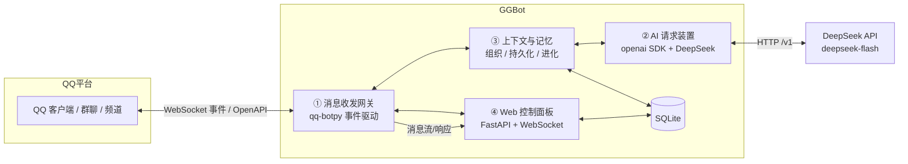
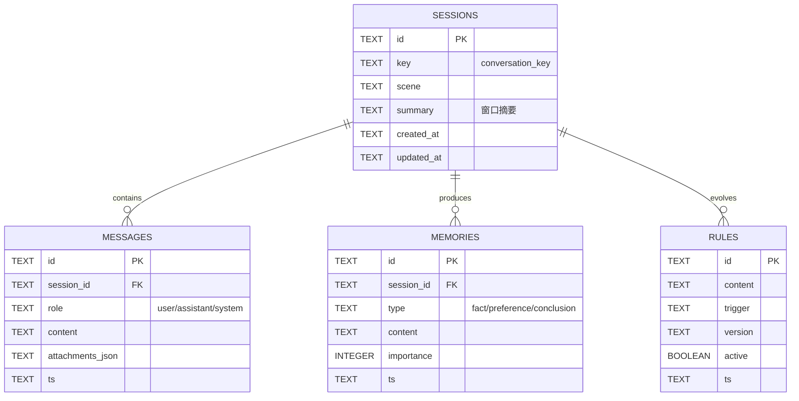

# GGBot 实施方案

> 版本：v1.0（2026-10-28）
> 定位：QQ 官方 Bot（api-v2）+ DeepSeek LLM 驱动的智能对话机器人
> 依据：QQ 机器人官方文档（bot.q.qq.com/wiki/develop/api-v2/）、DeepSeek API 文档（api-docs.deepseek.com）

## 1. 系统架构



数据流：QQ 事件 → 网关归一化 → 上下文装置组织会话 → AI 装置请求 DeepSeek → 回复回传网关 → QQ；全链路事件同步推送到 Web 面板。

## 2. 模块① 消息收发网关

**职责**：对接 QQ 官方 Bot，接收所有形式消息、发送所有形式回复，向上层提供统一消息模型。

### 2.1 技术基座

- `qq-botpy==1.2.1`（已装，内置新版 Access Token 鉴权，`Client.run(appid, secret)`）
- 事件订阅 intents（按机器人实际权限勾选）：
  - `GROUP_AND_C2C_EVENT (1<<25)`：群@消息、群全量消息、单聊、加群、好友事件
  - `PUBLIC_GUILD_MESSAGES (1<<30)`：频道@消息
  - `DIRECT_MESSAGE (1<<12)`：频道私信
  - 私域专属（需申请）：`GUILD_MESSAGES (1<<9)`、`FORUMS_EVENT (1<<28)`

### 2.2 统一内部消息模型 `InboundMessage`

| 字段 | 来源（事件字段） | 说明 |
|---|---|---|
| msg_id | `id` | 消息 ID，被动回复与撤回用 |
| msg_seq | 事件推送序号 | 配合 msg_id 去重（同 msg_id 可能重复推送） |
| scene | — | `c2c` / `group` / `channel` |
| sender | `author` | user_openid / member_openid、username、member_role（owner/admin/member）、bot |
| content | `content` | 文本（群@事件已自动去除@前缀） |
| attachments | `attachments[]` | 富媒体：图片/语音/视频/文件，含 url、filename、size、content_type |
| mentions | `mentions[]` | 消息中@的用户列表（不含机器人自身） |
| quote | `msg_elements`(type=103) / `message_scene.ext.ref_msg_idx` | 引用消息 |
| ark_data | `ark_data` | 结构化卡片（小程序、位置、名片、视频分享等） |
| chat_record | `msg_elements`(type=102) | 聊天记录（文本化） |
| timestamp | `timestamp` | RFC3339 |

### 2.3 消息全形式支持矩阵

| 消息形式 | 接收依据（官方字段） | 处理策略 |
|---|---|---|
| 文本 | `content` | 直接进入上下文 |
| 图片 | `attachments[]` content_type=image/jpeg、png、gif | 下载附件 → base64 → DeepSeek 视觉输入（image_url，JPEG/PNG/GIF/WebP，单图≤32MiB） |
| 语音 | content_type=voice，附 `voice_wav_url`（WAV）、`asr_refer_text`（平台 ASR 参考） | 优先用 asr_refer_text；质量不足时下载 WAV 自接 ASR |
| 视频 | content_type=video/mp4 | LLM 无视频理解能力：转元信息（文件名/大小）描述，可选本地保存 |
| 文件 | content_type=file | 元信息描述，可选保存 |
| 艾特 | `content` 已去@前缀 + `mentions[]` | 作为对话触发信号 |
| 引用 | msg_elements type=103 / ref_msg_idx | 拉取被引消息原文并入上下文 |
| 卡片 | `ark_data`（tuwen/feed/miniapp/map/contact_card/video_share/music_together/picture） | 解析 title/desc/jump_url 为文本 |
| 聊天记录 | msg_elements type=102 | 文本化并入上下文 |
| 表情/贴纸 | 官方文档未单列 | 待实测验证后补充 |

### 2.4 发送能力封装 `OutboundMessage`

| 类型 | msg_type | 说明 |
|---|---|---|
| 文本 | 0 | content |
| Markdown | 2 | markdown 字段 |
| 富媒体（图片/语音/视频/文件） | 7 | 先上传拿 file_info（`POST /v2/groups/{group_openid}/files` 等），再发 media；单聊/群聊上传接口不互通 |

- 被动回复：携带 `msg_id`（或 `event_id`）+ 递增 `msg_seq`（相同 msg_id+msg_seq 重复发送会失败，递增可对同一消息多次回复）
- 回复时效与次数（官方限制）：单聊 60 分钟/4 次，群聊 5 分钟/5 次，频道 5 分钟
- 主动消息：走独立频控（单聊 10qps/20qpm、群聊 60qpm、每日 1000 条），需管理发送队列
- 撤回：仅 2 分钟内可撤回

### 2.5 去重与顺序

- 已处理 msg_id 缓存（内存 + SQLite 落盘），重复推送直接丢弃
- 频道消息不保证严格有序，如需严格顺序基于 seq 缓冲排序

## 3. 模块② AI 请求装置

**职责**：统一封装 LLM 调用，屏蔽供应商差异，提供可靠的多模态对话能力。

### 3.1 配置（config.json，已写入）

```json
"deepseek": {
  "base_url": "https://api.deepseek.com/v1",
  "api_key": "sk-***",
  "model": "deepseek-flash",
  "request": {
    "thinking": "disabled",
    "reasoning_effort": "high",
    "temperature": 1.0,
    "top_p": 1.0,
    "top_k": 0,
    "max_tokens": 2048,
    "stop": [],
    "stream": false
  },
  "context": {
    "max_input_tokens": 100000,
    "max_history_messages": 50,
    "summary_threshold_tokens": 60000
  }
}
```

- `deepseek-flash`：官方现行模型名（DeepSeek-V4.1-Flash-1017 提供服务），上下文 1M / 输出上限 384K
- 子对象 `request`：API 请求参数（与官方 Chat Completions 参数一一对应）
- 子对象 `context`：会话上下文管理参数（模块③使用，非 API 参数）
- 参数生效说明（官方文档核实）：
  - `thinking`：OpenAI 格式合法取值仅 `enabled`/`disabled`（默认 enabled）；`none` 为 Anthropic/Responses 格式取值，本项目用 openai SDK，故取 `disabled`，代码映射 `extra_body={"thinking": {"type": "disabled"}}`
  - `temperature`：0~2，默认 1；**仅非思考模式生效**（思考模式下无效）
  - `top_p`：0~1，默认 1；**仅思考模式生效**（非思考模式固定 1.0 被忽略）
  - `top_k`：**DeepSeek OpenAI 格式不支持**，代码构造请求时过滤不传；保留字段供未来更换支持该参数的模型
  - `max_tokens`：1~384K，即"输出上下文"上限；未设置时非思考模式默认 8K
  - `presence_penalty` / `frequency_penalty`：官方已废弃（deprecated），不入配置
  - `max_input_tokens`：每次请求输入预算（模型上限 1M），超限触发摘要压缩
- `/v1` 后缀官方明确兼容，与模型版本无关

### 3.2 接口设计

```python
async def chat(messages, *, stream=False, max_tokens=500, **kw) -> str
```

- 非流式/流式（SSE）双通道
- 超时、指数退避重试、错误分类（限流/网络/鉴权/内容）
- 并发信号量限制（默认 2~4 并发），防触发平台频控与内存暴涨
- 多模态 content 组装：`[{type:"text", text}, {type:"image_url", image_url:{url: base64_data_url}}]`
- token 估算与窗口管理（见模块③）
- 图片计费：一张图最多 384 tokens，按 Flash 价

## 4. 模块③ 上下文组织与持久化记忆与自我进化

**职责**：管理会话上下文窗口；长期记忆持久化；让机器人从交互中沉淀知识、进化行为规则。

### 4.1 三层结构

| 层 | 载体 | 机制 |
|---|---|---|
| 短期上下文 | 会话窗口（内存/SQLite） | 按 conversation_key（单聊=user_openid，群聊=group_openid+member_openid）维护最近 N 条；按 token 预算裁剪，超限触发 LLM 摘要压缩 |
| 长期记忆 | SQLite `memories` | 事实型/偏好型/结论型记忆，带来源与重要性；重要对话沉淀为记忆 |
| 自我进化 | SQLite `rules` + 自省任务 | ①反馈沉淀：用户纠正/肯定 → 生成/更新规则；②空闲自省：LLM 总结近期会话提取可复用知识；③规则版本化：版本号+生效时间+触发条件，可回滚 |

### 4.2 数据模型（SQLite）



### 4.3 进化机制要点

- 反馈信号：用户显式纠正（"不是这样/应该是…"）、否定、重复追问、正向反馈
- 沉淀时机：会话结束/空闲时异步执行，不阻塞消息响应
- 规则注入：构建 system prompt 时拼入命中 trigger 的活跃规则与高重要性记忆
- 全部进化动作可审计（version、ts、source session），面板可启停

## 5. 模块④ Web 控制面板

**职责**：运行观测与内容管理，本地部署。

| 功能 | 实现 |
|---|---|
| 实时消息流 | FastAPI + WebSocket，推送入站/出站/AI 响应 |
| 会话管理 | 会话列表、详情、历史回放 |
| 记忆管理 | 查看/新增/编辑/删除记忆 |
| 规则管理 | 查看/启停/回滚进化规则 |
| 配置 | 模型参数、思考开关、并发数、回复风格（写回 config.json） |
| 运行状态 | QQ 连接状态、DeepSeek 状态、错误日志、频控计数 |

技术栈：FastAPI + uvicorn + WebSocket；前端单页 HTML/JS（原生或 Vue3 CDN，无构建链）。默认仅监听 127.0.0.1，面板入口带本地 token。

## 6. 技术选型汇总

| 层 | 选型 | 说明 |
|---|---|---|
| 运行时 | Python 3.13 + .venv | 已就绪 |
| QQ 接入 | qq-botpy 1.2.1 | 已装，Access Token 鉴权 |
| LLM | openai SDK（3.39.0）+ DeepSeek | 已装，deepseek-flash |
| 存储 | SQLite（标准库 sqlite3） | 零依赖，单文件 |
| Web | FastAPI + uvicorn | 待装 |
| 异步 | asyncio | 全链路 async |

## 7. 开发里程碑

| 阶段 | 内容 | 验收标准 |
|---|---|---|
| M1 网关+核心打通 | 群@文本 → 上下文 → DeepSeek → 回复；去重、被动回复、思考参数生效 | 群内@机器人能对话 |
| M2 全形式消息 | 图片视觉、语音 ASR 接入、引用展开、卡片解析、富媒体回复 | 图片/语音/引用消息正确进上下文并响应 |
| M3 上下文与记忆 | 会话窗口、摘要压缩、SQLite 持久化、记忆沉淀 | 重启后上下文可恢复，记忆可查询 |
| M4 自我进化 | 反馈规则生成、版本化、自省任务 | 规则可生成/启停/回滚 |
| M5 Web 面板 | 实时流、会话/记忆/规则管理、配置 | 面板全功能可用 |

## 8. 风险与待验证项

1. **QQ 附件 URL 时效与鉴权**：事件中 attachments.url（multimedia.nt.qq.com.cn 带 rkey）是否可外网直接访问未实测；不可用时改为下载到本地再 base64 传 DeepSeek
2. **群全量消息（GROUP_MESSAGE_CREATE）**：需群主在机器人资料页授权"接收群内全部消息"
3. **私域 intents**（群全量/论坛等）：需在开放平台申请权限，未授权传 intents 会被断开
4. **语音 ASR**：asr_refer_text 为平台参考结果，质量未验证；WAV 下载后如需自接 ASR 需另选引擎（如 faster-whisper）
5. **视频/文件**：当前模型无视频理解，只能元信息级处理，是否做下载保存待定
6. **表情/贴纸消息**：官方文档未单列，需实测事件体
7. **DeepSeek 成本与并发**：图片按 token 计费，需关注用量；并发数需实测限流边界
