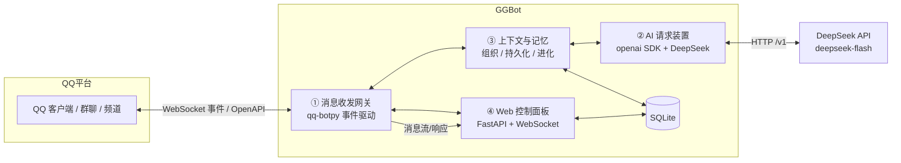
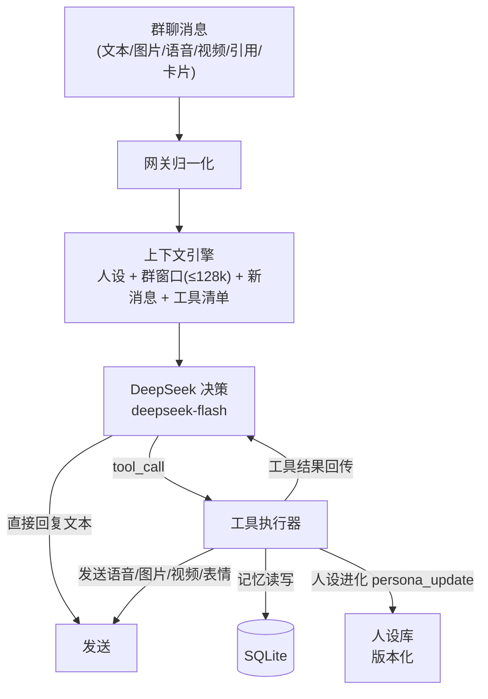
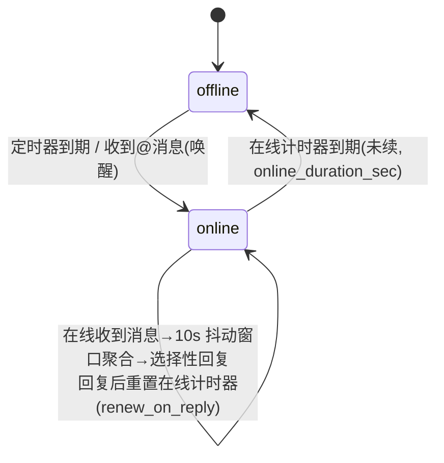
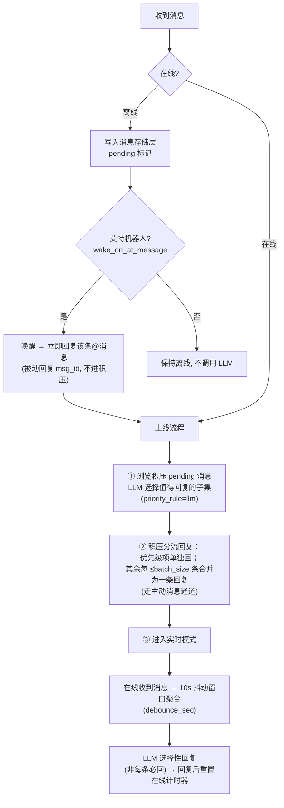
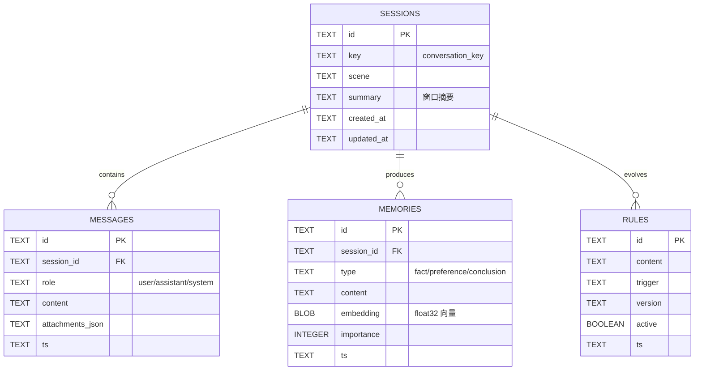

# GGBot 实施方案

> 版本：v1.0（2026-10-28）
> 定位：QQ 官方 Bot（api-v2）+ DeepSeek LLM 驱动的智能对话机器人
> 依据：QQ 机器人官方文档（bot.q.qq.com/wiki/develop/api-v2/）、DeepSeek API 文档（api-docs.deepseek.com）

## 1. 系统架构



数据流：QQ 事件 → 网关归一化 → 上下文装置组织会话 → AI 装置请求 DeepSeek → 回复回传网关 → QQ；全链路事件同步推送到 Web 面板。

### 1.1 核心运行模型（人设 + 技能 + 上下文 → 回复）

群聊机器人核心循环。一次响应的完整链路：



**三层分类（修正"技能"的混淆）**

| 层 | 内容 | 说明 |
|---|---|---|
| 工具层（AI 可调用的动作） | send_text / send_image / send_voice / send_video / send_emoji / memory_write / memory_search / persona_update | 通过 DeepSeek function calling（tools）实现 |
| 认知层（元操作机制） | 人设进化、记忆沉淀 | 由 AI 通过工具触发，非独立技能 |
| 基础设施层（存储） | SQLite：消息、记忆、人设版本 | 持久化底座 |

**人设（双层，AI 可进化）**
- 内核人设：owner 定义（身份、语气、底线），AI 只读
- 动态人设：AI 可追加/整理/补充，版本化（v1→v2），带 diff 与回滚
- 注入方式：system prompt 由「内核 + 动态人设」拼接

**上下文（群聊维度）**
- 会话单元 = 群（group_openid），消息带说话人昵称
- 窗口预算 `max_input_tokens=128k`，超过 `summary_threshold_tokens` 触发 LLM 摘要压缩
- Presence（2.6）为可选外层调度：在线实时跑核心循环，离线积压上线后补跑

## 2. 模块① 消息收发网关

**职责**：对接 QQ 官方 Bot，接收所有形式消息、发送所有形式回复，向上层提供统一消息模型。

### 2.1 技术基座

- `qq-botpy==1.2.1`（已装，内置新版 Access Token 鉴权，`Client.run(appid, secret)`）
- 事件订阅 intents（按机器人实际权限勾选）：
  - `GROUP_AND_C2C_EVENT (1<<25)`：群@消息、群全量消息、单聊、加群、好友事件
  - `PUBLIC_GUILD_MESSAGES (1<<30)`：频道@消息
  - `DIRECT_MESSAGE (1<<12)`：频道私信
  - 私域专属（需申请）：`GUILD_MESSAGES (1<<9)`、`FORUMS_EVENT (1<<28)`

### 2.2 统一内部消息模型 `InboundMessage`

| 字段 | 来源（事件字段） | 说明 |
|---|---|---|
| msg_id | `id` | 消息 ID，被动回复与撤回用 |
| msg_seq | 事件推送序号 | 配合 msg_id 去重（同 msg_id 可能重复推送） |
| scene | — | `c2c` / `group` / `channel` |
| sender | `author` | user_openid / member_openid、username、member_role（owner/admin/member）、bot |
| content | `content` | 文本（群@事件已自动去除@前缀） |
| attachments | `attachments[]` | 富媒体：图片/语音/视频/文件，含 url、filename、size、content_type |
| mentions | `mentions[]` | 消息中@的用户列表（不含机器人自身） |
| quote | `msg_elements`(type=103) / `message_scene.ext.ref_msg_idx` | 引用消息 |
| ark_data | `ark_data` | 结构化卡片（小程序、位置、名片、视频分享等） |
| chat_record | `msg_elements`(type=102) | 聊天记录（文本化） |
| timestamp | `timestamp` | RFC3339 |

### 2.3 消息全形式支持矩阵

| 消息形式 | 接收依据（官方字段） | 处理策略 |
|---|---|---|
| 文本 | `content` | 直接进入上下文 |
| 图片 | `attachments[]` content_type=image/jpeg、png、gif | 下载存 temp/ → base64 → DeepSeek 视觉输入（image_url，JPEG/PNG/GIF/WebP，单图≤32MiB） |
| 语音 | content_type=voice，附 `voice_wav_url`（WAV）、`asr_refer_text`（平台 ASR 参考） | 下载存 temp/；优先用 asr_refer_text；质量不足时用下载的 WAV 自接 ASR |
| 视频 | content_type=video/mp4 | 下载存 temp/；LLM 无视频理解：转元信息（文件名/大小）描述 |
| 文件 | content_type=file | 元信息描述，可选存 temp/ |
| 艾特 | `content` 已去@前缀 + `mentions[]` | 作为对话触发信号 |
| 引用 | msg_elements type=103 / ref_msg_idx | 拉取被引消息原文并入上下文 |
| 卡片 | `ark_data`（tuwen/feed/miniapp/map/contact_card/video_share/music_together/picture） | 解析 title/desc/jump_url 为文本 |
| 聊天记录 | msg_elements type=102 | 文本化并入上下文 |
| 表情/贴纸 | 官方文档未单列 | 待实测验证后补充 |

### 2.4 发送能力封装 `OutboundMessage`

| 类型 | msg_type | 说明 |
|---|---|---|
| 文本 | 0 | content |
| Markdown | 2 | markdown 字段 |
| 富媒体（图片/语音/视频/文件） | 7 | 先上传拿 file_info（`POST /v2/groups/{group_openid}/files` 等），再发 media；单聊/群聊上传接口不互通 |

- 被动回复：携带 `msg_id`（或 `event_id`）+ 递增 `msg_seq`（相同 msg_id+msg_seq 重复发送会失败，递增可对同一消息多次回复）
- 回复时效与次数（官方限制）：单聊 60 分钟/4 次，群聊 5 分钟/5 次，频道 5 分钟
- 主动消息：走独立频控（单聊 10qps/20qpm、群聊 60qpm、每日 1000 条），需管理发送队列
- 撤回：仅 2 分钟内可撤回

**分段发送（短句真人感）**

LLM 一条回复可能是一大段，发送前按 `behavior.reply` 拆分为多条短消息：

| 字段 | 默认 | 说明 |
|---|---|---|
| `reply.max_segments` | 5 | 一条回复最多拆成几条消息 |
| `reply.max_chars_per_segment` | 80 | 单段字符上限，超长段落按句（。！？）兜底切分 |
| `reply.segment_gap_sec` | 2 | 段落间发送间隔（秒），模拟真人打字节奏 |
| `reply.debounce_sec` | 10 | 在线消息去抖窗口：窗口内到达的多条消息聚合后，由 LLM 选择性回复（非每条必回），回复后重置在线计时器 |
| `storage.temp_dir` | temp | 富媒体附件（图片/语音/视频/文件）下载落地目录 |

- 拆分约定：LLM 生成时用空行 `\n\n` 分隔短句（配合人设 prompt 约束"口语化短句"），代码按 `\n\n` 拆分
- 对同一消息多次回复：官方支持递增 `msg_seq`（相同 msg_id+msg_seq 重复发送会失败）——分段发送天然复用该机制
- 超限兜底：拆出段数超过 max_segments 时合并尾部；单段超过 max_chars_per_segment 时按句切分
- 被动回复时效内（群聊 5 分钟）完成所有分段发送，分段过多时转为主动消息补充

### 2.5 去重与顺序

- 已处理 msg_id 缓存（内存 + SQLite 落盘），重复推送直接丢弃
- 频道消息不保证严格有序，如需严格顺序基于 seq 缓冲排序

### 2.6 真人感在线行为（Presence）

机器人按"真人作息"运行：**定期上线、在线一段时间后离线**；离线期间消息不即时回复、仅入库；上线后先浏览积压消息、选择性回复其中一部分，再进入实时回复；离线期间被 **@ 直接唤起**进入在线。

**状态机**



**消息处理路径**



**关键约束（官方文档）**

- 被动回复时效：群聊 5 分钟 / 单聊 60 分钟。离线积压可能已过期 → **积压回复统一走主动消息通道**（受频控：群聊 60qpm、每日 1000 条/群）；在线实时回复走被动回复（携带 msg_id + 递增 msg_seq）
- 离线期间不调用 LLM，仅存储，零成本
- 唤醒即回：离线被@唤醒时，该条@消息**立即被动回复**（msg_id 时效内，不进积压队列），回复完成后再进入积压浏览与实时模式

**配置（config.json `behavior` 子对象）**

| 字段 | 默认 | 说明 |
|---|---|---|
| `presence.online_duration_sec` | 300 | 每次在线时长（秒） |
| `presence.offline_interval_sec` | 900 | 离线周期（秒），定时器到期上线 |
| `presence.wake_on_at_message` | true | 离线时群/频道@消息是否唤起在线 |
| `presence.wake_on_c2c` | false | 离线时单聊消息是否唤起在线 |
| `presence.renew_on_reply` | true | 聊得火热：在线期间每次回复后，在线计时器重置为 online_duration_sec（持续互动保持在线，冷场后到期下线） |
| `backlog.max_scan_messages` | 1000 | 上线时积压扫描上限 |
| `backlog.batch_size` | 100 | 积压合并批次上限：每 ≤N 条积压合成一条回复，超过则分批 |
| `backlog.priority_rule` | llm | 优先级分流：llm=LLM 判定哪些单独回、其余合并；at=仅@消息单独回、其余合并 |

积压回复分流策略：
- **单独回**：被@消息（必回）、LLM/规则判定含明确问题或必须单独响应的消息
- **合并回**：其余积压按 `batch_size` 分批，每批合成一条总结性回复（例：300 条积压 → 1 条@单独回复 + 2 条合并回复）
- 合并回复由 LLM 基于该批消息生成（"刚看到你们聊到…"），走主动消息通道

- 消息存储层：`messages` 表增加 `status` 字段（pending / replied / skipped），离线消息落 pending
- Web 面板（模块④）增加在线状态展示：当前 offline/online、下次上线倒计时、积压待处理数

## 3. 模块② AI 请求装置

**职责**：统一封装 LLM 调用，屏蔽供应商差异，提供可靠的多模态对话能力。

### 3.1 配置（config.json，已写入，结构见下方；密钥以 *** 省略）

```json
{
  "appid": "1905840807",
  "appsecret": "***",
  "deepseek": {
    "base_url": "https://api.deepseek.com",
    "api_key": "***",
    "model": "deepseek-flash",
    "request": {
      "thinking": "disabled",
      "reasoning_effort": "high",
      "temperature": 1.0,
      "top_p": 1.0,
      "max_tokens": 2048,
      "stop": [],
      "stream": false
    },
    "context": {
      "max_input_tokens": 128000,
      "max_history_messages": 50,
      "summary_threshold_tokens": 100000
    }
  },
  "embedding": {
    "provider": "siliconflow",
    "base_url": "https://api.siliconflow.cn/v1",
    "model": "Qwen/Qwen3-Embedding-4B",
    "api_key": "***",
    "batch_size": 32
  },
  "behavior": { "presence": {}, "backlog": {}, "reply": {} },
  "storage": { "temp_dir": "temp", "db_path": "db/ggbot.db", "public_base_url": "" },
  "web": { "enable": true, "host": "127.0.0.1", "port": 8080, "token": "ggbot-local" }
}
```

- 顶层 `appid` / `appsecret`：QQ 机器人凭据（code 解析自顶层，非 `qq` 子对象）
- `deepseek`：LLM 配置；`deepseek.request` = API 请求参数（仅官方 Chat Completions 支持的参数）；`deepseek.context` = 会话上下文管理参数（模块③使用，非 API 参数）
- `embedding`：记忆向量化配置（SiliconFlow API，OpenAI 兼容 `/embeddings`），向量存 SQLite

- `deepseek-flash`：官方现行模型名（DeepSeek-V4.1-Flash-1017 提供服务），上下文 1M / 输出上限 384K
- 子对象 `request`：API 请求参数（仅官方 Chat Completions 支持的参数）
- 子对象 `context`：会话上下文管理参数（模块③使用，非 API 参数）
- 参数生效说明（官方文档核实）：
  - `thinking`：合法取值仅 `enabled`/`disabled`（默认 enabled），代码映射 `extra_body={"thinking": {"type": "disabled"}}`
  - `temperature`：0~2，默认 1；**仅非思考模式生效**（思考模式下无效）
  - `top_p`：0~1，默认 1；**仅思考模式生效**（非思考模式固定 1.0 被忽略）
  - `max_tokens`：1~384K，即"输出上下文"上限；未设置时非思考模式默认 8K
  - `reasoning_effort`：none/low/high/max，思考强度，仅思考模式生效
  - `stop`：停止序列，最多 16 个
  - `stream`：是否流式（SSE）
  - `max_input_tokens`：每次请求输入预算（模型上限 1M），超限触发摘要压缩
  - `presence_penalty` / `frequency_penalty`：官方已废弃（deprecated），不入配置；`top_k`：官方不支持，不入配置
- base_url 使用官方文档写法 `https://api.deepseek.com`

### 3.2 接口设计

```python
async def chat(messages, *, stream=False, max_tokens=500, **kw) -> str
```

- 非流式/流式（SSE）双通道
- 超时、指数退避重试、错误分类（限流/网络/鉴权/内容）
- 并发信号量限制（默认 2~4 并发），防触发平台频控与内存暴涨
- 多模态 content 组装：`[{type:"text", text}, {type:"image_url", image_url:{url: base64_data_url}}]`
- token 估算与窗口管理（见模块③）
- 图片计费：一张图最多 384 tokens，按 Flash 价

### 3.3 技能工具调用（function calling）

DeepSeek Chat Completions 原生支持 `tools` / `tool_choice`（官方文档已核实），技能即工具，无需自造协议：

| 工具 | 类型 | 说明 |
|---|---|---|
| send_text | 输出 | 发送文本（含被动回复 msg_id/msg_seq） |
| send_image | 输出 | 上传 file_info → msg_type=7 发图片 |
| send_voice | 输出 | 上传语音 → 发送（可选 TTS 生成） |
| send_video | 输出 | 上传视频 → 发送 |
| send_emoji | 输出 | 发送表情（待验证消息类型） |
| memory_search | 认知 | 检索长期记忆 |
| memory_write | 认知 | 沉淀记忆（AI 自主决定，可禁用） |
| persona_update | 认知 | 人设进化：追加/整理动态人设 |

工具执行循环：LLM 输出 `tool_call` → 执行器执行 → 结果（含 error）回传 LLM → 继续，直到最终回复或工具调用结束。工具中间结果不写入会话历史，仅保留精简记录。

## 4. 模块③ 上下文组织与持久化记忆与自我进化

**职责**：管理会话上下文窗口；长期记忆持久化；让机器人从交互中沉淀知识、进化行为规则。

### 4.1 三层结构

| 层 | 载体 | 机制 |
|---|---|---|
| 短期上下文 | 群会话窗口（内存/SQLite） | 以群（group_openid）为会话单元，消息带说话人昵称；按 token 预算（128k）裁剪，超限触发 LLM 摘要压缩 |
| 长期记忆 | SQLite `memories` | 事实型/偏好型/结论型记忆，带来源与重要性；重要对话沉淀为记忆 |
| 自我进化 | SQLite `rules` + 自省任务 | ①反馈沉淀：用户纠正/肯定 → 生成/更新规则；②空闲自省：LLM 总结近期会话提取可复用知识；③规则版本化：版本号+生效时间+触发条件，可回滚 |

### 4.2 数据模型（SQLite）



### 4.2.1 向量化记忆（存储 / 搜索 / 整理）

- **嵌入**：SiliconFlow API（`Qwen/Qwen3-Embedding-4B`，OpenAI 兼容 `/embeddings`），无需本地模型；向量以 float32 BLOB 存 SQLite `memories.embedding`
- **写入**：AI 调用 `memory_write` 工具 → 文本向量化入库（type/importance/session_id 随行记录）
- **搜索**：`memory_search(query, k)` → 查询向量化 → 与全部记忆做余弦相似度 top-k；个人机器人记忆量级，暴力检索足够
- **整理**：`tidy()` 两两比较余弦相似度，超过阈值（默认 0.95）视为近似重复，保留 importance 更高/更新的那条，删除其余；面板一键触发
- **注入**：构建 system prompt 时用当前消息作 query 检索 top-4 相关记忆拼入「长期记忆」段

### 4.3 进化机制要点

- 反馈信号：用户显式纠正（"不是这样/应该是…"）、否定、重复追问、正向反馈
- 沉淀时机：会话结束/空闲时异步执行，不阻塞消息响应
- 规则注入：构建 system prompt 时拼入命中 trigger 的活跃规则与高重要性记忆
- 全部进化动作可审计（version、ts、source session），面板可启停

### 4.4 人设管理（双层 + 版本化）

- `persona` 表：id、layer(inner/dynamic)、content、version、operation(append/rewrite)、diff、ts、source_session
- 约束：内核人设 AI 只读；动态人设长度上限（如 4k tokens）；每次变更记录 diff，支持回滚
- 进化触发：对话中 AI 调用 `persona_update` 工具；离线自省可选
- 注入：system prompt = 内核人设 + 动态人设 + 记忆摘要 + 激活规则

## 5. 模块④ Web 控制面板

**职责**：运行观测与内容管理，本地部署。

| 功能 | 实现 |
|---|---|
| 实时消息流 | FastAPI + WebSocket，推送入站/出站/AI 响应 |
| 会话管理 | 会话列表、详情、历史回放 |
| 记忆管理 | 查看/新增/编辑/删除记忆 |
| 规则管理 | 查看/启停/回滚进化规则 |
| 配置 | 模型参数、思考开关、并发数、回复风格（写回 config.json） |
| 运行状态 | QQ 连接状态、DeepSeek 状态、在线/离线状态与下次上线倒计时、积压待处理数、错误日志、频控计数 |

技术栈：FastAPI + uvicorn + WebSocket；前端单页 HTML/JS（原生或 Vue3 CDN，无构建链）。默认仅监听 127.0.0.1，面板入口带本地 token。

## 6. 技术选型汇总

| 层 | 选型 | 说明 |
|---|---|---|
| 运行时 | Python 3.13 + .venv | 已就绪 |
| QQ 接入 | qq-botpy 1.2.1 | 已装，Access Token 鉴权 |
| LLM | openai SDK（3.39.0）+ DeepSeek | 已装，deepseek-flash |
| 存储 | SQLite（标准库 sqlite3） | 零依赖，单文件 |
| Web | FastAPI + uvicorn | 待装 |
| 异步 | asyncio | 全链路 async |

## 7. 开发里程碑

| 阶段 | 内容 | 验收标准 |
|---|---|---|
| M1 网关+核心打通 | 群@文本 → 上下文 → DeepSeek → 回复；去重、被动回复、思考参数生效 | 群内@机器人能对话 |
| M2 全形式消息 | 图片视觉、语音 ASR 接入、引用展开、卡片解析、富媒体回复 | 图片/语音/引用消息正确进上下文并响应 |
| M3 上下文与记忆 | 会话窗口、摘要压缩、SQLite 持久化、记忆沉淀 | 重启后上下文可恢复，记忆可查询 |
| M4 自我进化 | 反馈规则生成、版本化、自省任务 | 规则可生成/启停/回滚 |
| M5 Web 面板 | 实时流、会话/记忆/规则管理、配置 | 面板全功能可用 |

## 8. 风险与待验证项

1. **QQ 附件 URL 时效与鉴权**：事件中 attachments.url（multimedia.nt.qq.com.cn 带 rkey）是否可外网直接访问未实测；不可用时改为下载到本地再 base64 传 DeepSeek
2. **群全量消息（GROUP_MESSAGE_CREATE）**：需群主在机器人资料页授权"接收群内全部消息"
3. **私域 intents**（群全量/论坛等）：需在开放平台申请权限，未授权传 intents 会被断开
4. **语音 ASR**：asr_refer_text 为平台参考结果，质量未验证；WAV 下载后如需自接 ASR 需另选引擎（如 faster-whisper）
5. **视频/文件**：当前模型无视频理解，只能元信息级处理，是否做下载保存待定
6. **表情/贴纸消息**：官方文档未单列，需实测事件体
7. **DeepSeek 成本与并发**：图片按 token 计费，需关注用量；并发数需实测限流边界
